# AGENTS.md — apex-admin-web

本文件是本仓库的开发入口，说明当前实现、模块边界、关键业务链路和变更约束。修改前先定位相关源码；文档与实现不一致时，以执行代码、类型定义和配置为依据，并同步修正文档。历史分析文档和文件头注释不能代替实现核对。

**核对日期：2026-10-01。** 本次依据前端仓库核对；图中的后端与第三方服务表示前端依赖的接口边界，不表示已审计其内部实现。

## 1. 开发入口与关键约束

- 项目版本为 `1.2.0`，声明 Node `>=18`；实际运行还须满足已安装依赖的 engines 要求。
- 技术栈：Vue 3.5、Vite 6、TypeScript ~5.7、Vue Router 4、Pinia 2、Element Plus 2、Axios、ECharts 5、CropperJS 1。
- 页面使用 `<script setup lang="ts">`；路径别名 `@` 指向 `src/`。
- 常规接口在 `src/api/` 按业务域封装，复用 `src/utils/request.ts` 的 `request/get/post/put/del`，页面不新建 Axios 实例。
- 新增菜单驱动页面必须同步 `src/router/dynamic.ts` 的 `VIEW_REGISTRY` 与后端菜单 `component` 字段；文件存在不等于路由已注册。
- 普通列表通常用 `page/size` 和 `list/total`；工作流用 `pageNum/pageSize` 和 `records/total`。以具体 API 类型为准，不能全局替换。
- 会话读写使用 `src/utils/auth.ts`，不可自行引入 `access_token` 等存储键。
- 菜单展示、按钮展示和后端接口鉴权是三个不同层次。前端隐藏元素不能替代后端权限校验。
- 不在浏览器配置中保存客户端密钥、数据库密码等秘密；`VITE_*` 会进入前端产物。
- 优先复用现有组件、类型和工具；不把未接入的工具描述成全局机制。
- 不修改残留备份 `src/router/dynamic.ts.bak`，不以其内容作为当前实现依据。
- 除用户明确要求外，不新增代码注释，不创建额外文档，不提交 Git commit。

### 阅读导航

| 任务 | 首先阅读 | 重点约束 |
| --- | --- | --- |
| 登录与令牌 | `stores/user.ts`、`utils/auth.ts`、`utils/request.ts`、`api/auth.ts` | 身份初始化、401 单飞刷新、单次重放 |
| 页面与菜单 | `router/index.ts`、`router/dynamic.ts`、`layouts/AdminLayout.vue` | 静态/动态路由、注册表、hidden |
| 按钮权限 | `stores/permission.ts`、`directives/permission.ts` | 空列表放行、多码任一满足、移除 DOM |
| 常规 CRUD | 相邻页面、对应 `api/*.ts`、`types/index.ts` | DTO、分页、错误提示与刷新行为 |
| 工作流 | `api/workflow.ts`、`types/workflow.ts`、`views/workflow/` | 特殊分页、静态入口、组件接入范围 |
| 办公平台 | `api/office.ts`、`api/office-new.ts`、`views/office/` | 业务接口与配置绑定接口分离、version |
| 文件上传 | `api/file.ts`、两个上传组件 | Element Plus/XHR 路径不经过 Axios 拦截器 |
| 部署 | `vite.config.ts`、`Dockerfile`、`docker/nginx.conf` | 构建期变量与运行期反代变量 |

## 2. 项目结构与业务边界

```text
src/
├── main.ts / App.vue       应用启动与根视图
├── settings.ts / env.d.ts  公共常量与环境变量类型
├── router/                静态路由、守卫、菜单转换和组件注册表
├── layouts/               AdminLayout：菜单、顶栏、面包屑、主视图
├── views/                 login、oauth2、dashboard、profile、error、demo
│                          system、monitor、data、office、workflow
├── components/            Pagination、GlobalSearch、EmptyState、上传组件
├── composables/           useCrud、useTableConfig、useFormDraft、useBreakpoint
├── stores/                user、permission、app、office
├── directives/            permission
├── api/                   按业务域拆分的类型化接口函数
├── types/                 index.ts 通用领域类型、workflow.ts 工作流类型
├── utils/                 请求、会话、存储、校验、错误、脱敏等工具
├── mock/                  仅开发环境动态加载
└── test/                  Vitest 全局准备
```

`src/api/` 没有统一的 `index.ts` 入口，按具体业务文件导入。工具目录还包含请求缓存、XSS 防护、ECharts 主题和性能监控能力；是否执行应检查调用点，不能仅凭文件存在就宣称所有页面自动使用。

| 业务域 | 主要源码 | 接口边界/页面职责 |
| --- | --- | --- |
| 认证与用户 | `auth.ts`、`user.ts`、`oauth2.ts` | 验证码、密码登录、角色权限、当前用户、标准 OAuth2 |
| 系统管理 | `system.ts`、`database.ts` | 用户/角色/菜单/部门/字典/参数/定时任务、数据库配置 |
| 认证管理与 SSO | `auth-config.ts`、`sso.ts` | 管理端配置页面；与浏览器登录回调区分 |
| 代码生成器 | `generator.ts` | 数据源、表扫描、生成及模板管理 |
| 监控与日志 | `monitor.ts`、`log.ts` | 登录/审计/API 日志、在线用户、大盘、运行和业务日志 |
| 数据管理 | `document.ts`、`chart.ts` | 文档与图表 CRUD、状态操作、数据查询 |
| 工作流 | `workflow.ts` | 定义、实例、统计、任务与高级操作 |
| 办公平台 | `office.ts`、`office-new.ts` | 消息/审批/组织/日历/文档，以及应用配置和绑定管理 |
| 文件与搜索 | `file.ts`、`search.ts` | 文件接口、上传组件、顶栏全文搜索 |

后端路径按现有 API 区分：`/api/v1/**` 为认证、用户和文件等接口；`/admin-api/v1/**` 为管理接口；`/api/workflow/**` 为工作流高级操作；`/api/office/**` 为办公业务；标准 OAuth2 使用 `/oauth2/authorize`、`/oauth2/token`。

## 3. 架构图

### 3.1 系统与部署边界

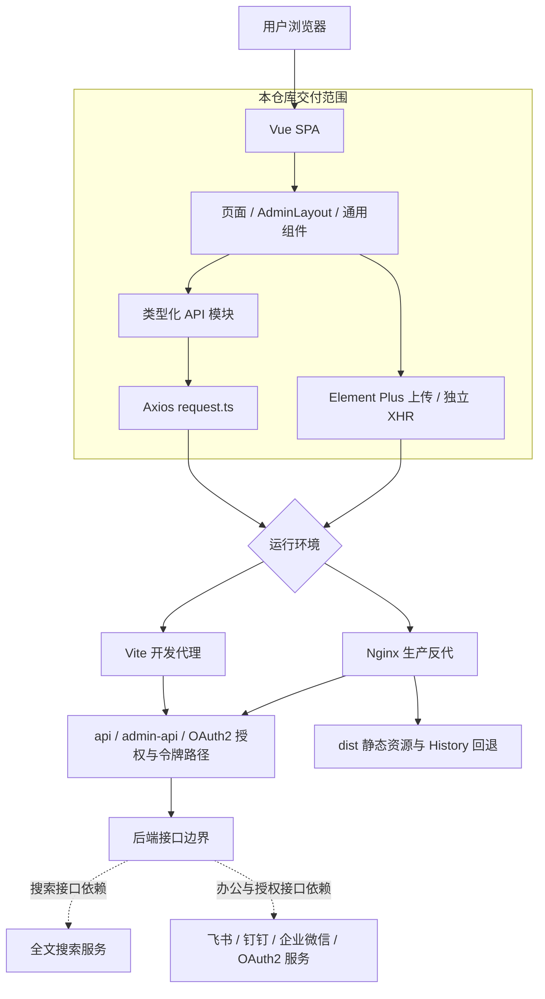

同域部署默认使用相对接口路径。若设置绝对 `VITE_API_BASE_URL`，Axios 请求可能直接访问该地址，绕过本地代理；不能保证所有请求一定经过 Nginx。搜索和第三方服务由后端接口承接，前端不直接维护其内部存储或工作流引擎。

### 3.2 前端分层与状态依赖

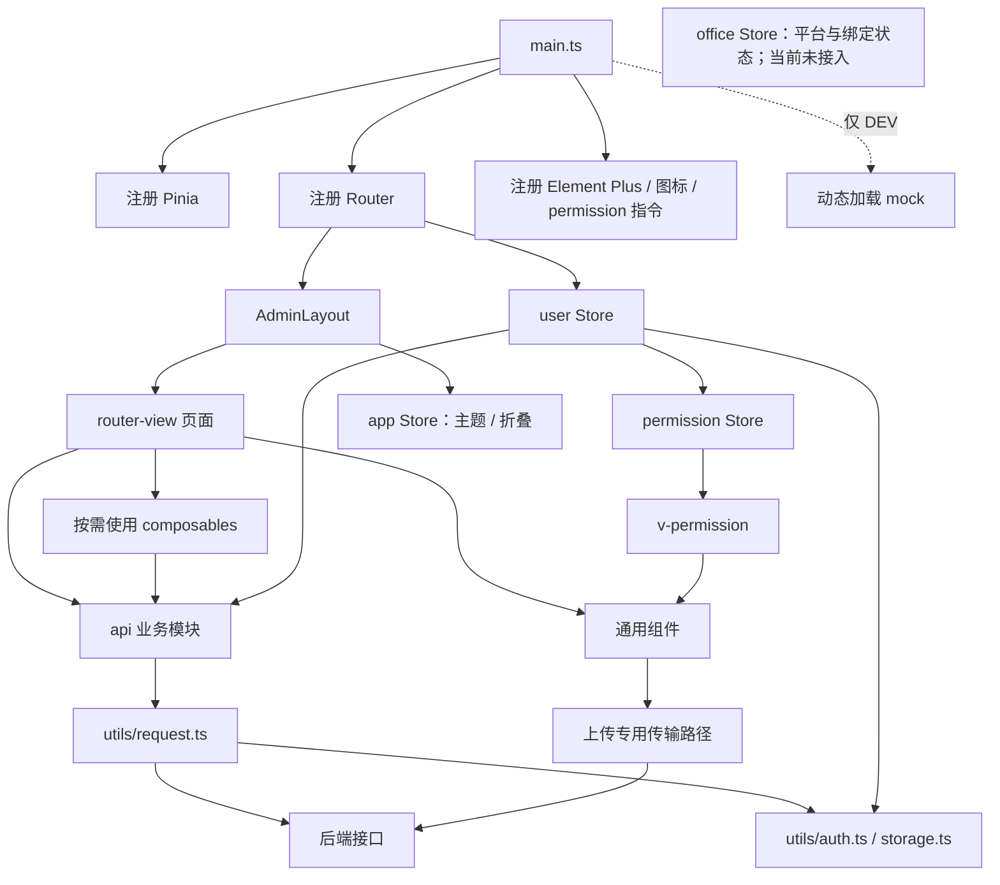

`user` Store 保存 token、identity、permissions 和 initialized；`permission` Store 从用户权限派生；`app` Store 管理 UI 状态；`office` Store 定义当前平台和绑定状态，当前未发现调用点。持久化会话与 Pinia 内存状态是两个层次，请求拦截器从会话工具读取 Token。

### 3.3 构建与发布流程

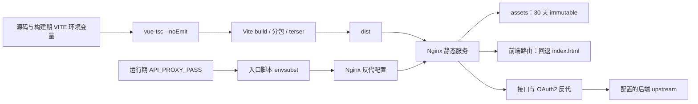

开发服务器默认 `0.0.0.0:5173`，代理目标取 `VITE_API_PROXY_TARGET`，缺省 `http://127.0.0.1:8080`。Vite 对 `/api`、`/admin-api` 及 OAuth2 授权/令牌路径配置代理。构建包含 vendor 分包，生产移除 console/debugger，分析报告为 `dist/stats.html`。

Docker 使用 Node 18 Alpine 构建和 Nginx 运行两个阶段；当前安装命令是 `npm install`。`VITE_API_BASE_URL` 在构建时注入，运行时修改不能重写已打包的 JavaScript；`API_PROXY_PASS` 只影响 Nginx upstream。Compose 依赖外部网络 `apex-scaffold_apex-network`；首页健康检查仅证明静态服务可访问。

## 4. 登录、路由与权限

### 4.1 密码登录时序

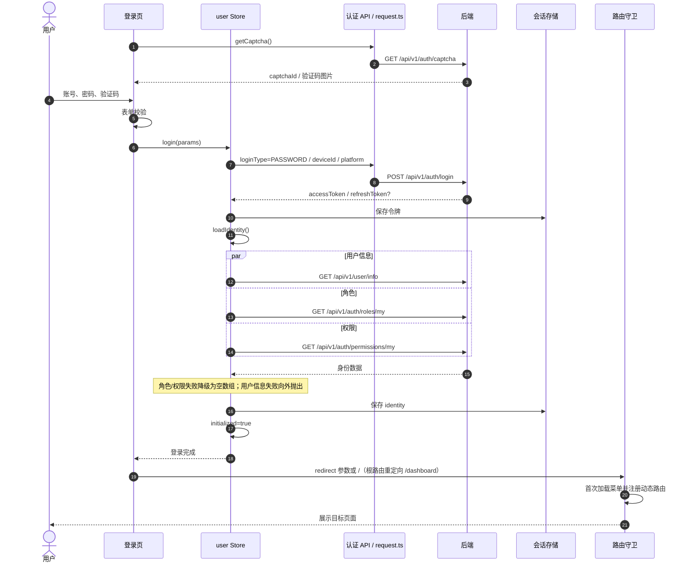

API 请求均通过请求层，图中并行请求直接指向后端是为了展示业务时序。不要把“登录接口成功”与“身份初始化成功”视为同一个状态。登出会调用后端登出 API，并在 finally 中执行本地清理，后端失败不阻塞本地退出。

### 4.2 路由守卫业务流程

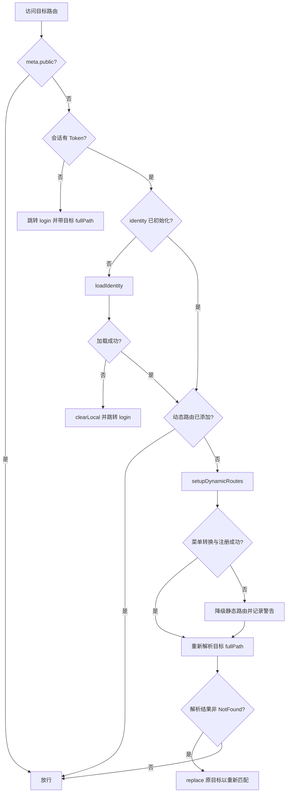

失败后未完成注册的动态路由可在后续导航再次尝试。身份加载失败的守卫分支直接返回 `/login`；无 Token 分支才明确携带 `redirect`，不要把所有失败分支都写成保留回跳。

### 4.3 菜单到路由与侧边栏的转换

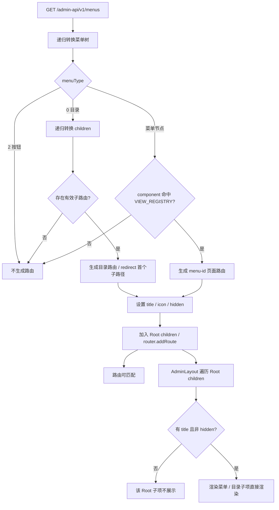

- 约定 `menuType=0/1/2` 分别是目录、菜单和按钮；当前转换函数在排除 0、2 后按页面处理，不额外验证类型枚举。
- `buildDynamicRoutes(_permissions)` 的参数未参与过滤，实际依据后端返回菜单树。
- 未登记的组件被跳过；空目录也被跳过。
- `status` 未参与过滤；`visible=0` 设置 hidden，仍保留可访问路由。侧边栏仅过滤 Root 子路由的 title/hidden，目录内子项未再次过滤 hidden，也未递归渲染更深层级。
- 菜单路径来自后端配置；模块路径表只是命名约定，不能当成所有环境固定 URL。

### 4.4 静态路由与动态路由

| 路由 | 实现边界 |
| --- | --- |
| `/login` | 公开登录入口 |
| `/oauth2/callback`、`/office/callback` | 公开授权回调 |
| `/dashboard` | 工作台 |
| `/workflow/monitor`、`/workflow/instances/:id` | 工作流监控与实例详情 |
| `/workflow/monitor/dashboard` | 工作流重定向入口 |
| `/demo/file-upload`、`/demo/file-upload-enhanced` | 隐藏演示页 |
| `/monitor/trace` | 链路追踪查询 |
| `/:pathMatch(.*)*` | NotFound 兜底 |

上述入口在 `router/index.ts` 中定义，不依赖后端菜单；具体 public/hidden 属性以该文件为准。系统、监控、办公、数据和个人中心等菜单页面依赖动态注册。`VIEW_REGISTRY` 同时含部分静态页面 loader，不应以注册表存在推断页面仅支持动态路由。

### 4.5 按钮权限的实际语义

`v-permission="'system:user:create'"` 使用 `permission` Store 检查权限。逗号分隔的多个权限码满足任意一个即可；**权限列表为空时当前实现直接放行**。角色和权限接口失败会降级为空数组，因此前端不是严格拒绝的安全边界。

指令在 mounted/updated 执行，无权限时移除 DOM；没有恢复锚点，后续权限变化不能可靠恢复被移除元素。路由 meta.perms 不能被描述为已实现全路由权限拦截。新增权限控制应同时核对后端鉴权，不能因按钮隐藏就省略服务端校验。

## 5. 请求处理、错误与令牌刷新

### 5.1 统一请求业务流程

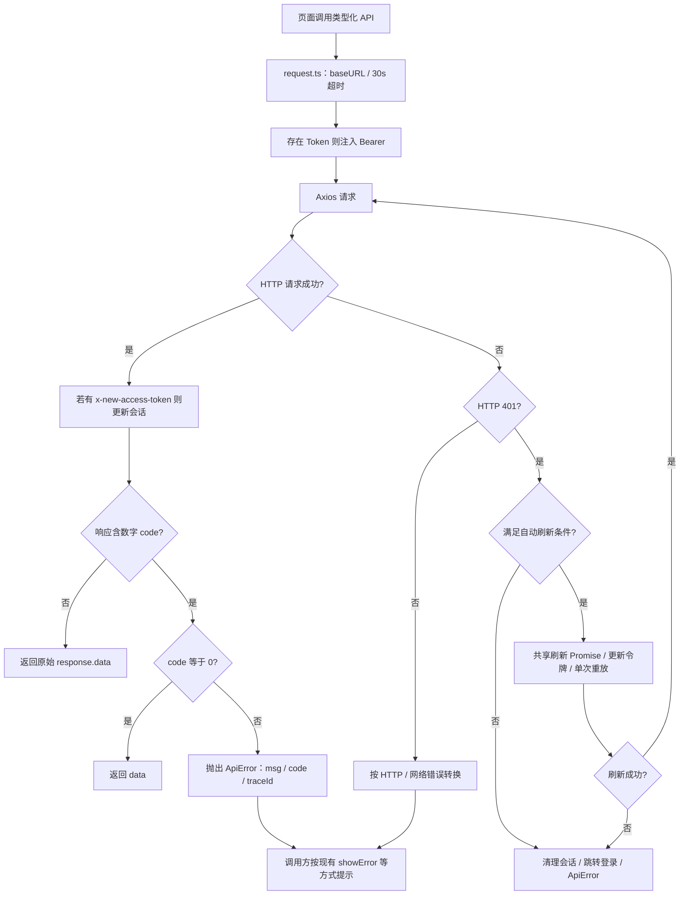

自动刷新由 HTTP 401 触发，不是所有业务 `Result.code` 都会进入刷新分支。统一请求层解包后，页面拿到的是 `data`，不要再访问 `response.data.data`。对于不含数字 code 的响应，请求层保留原始数据。

### 5.2 并发 401 单飞刷新时序

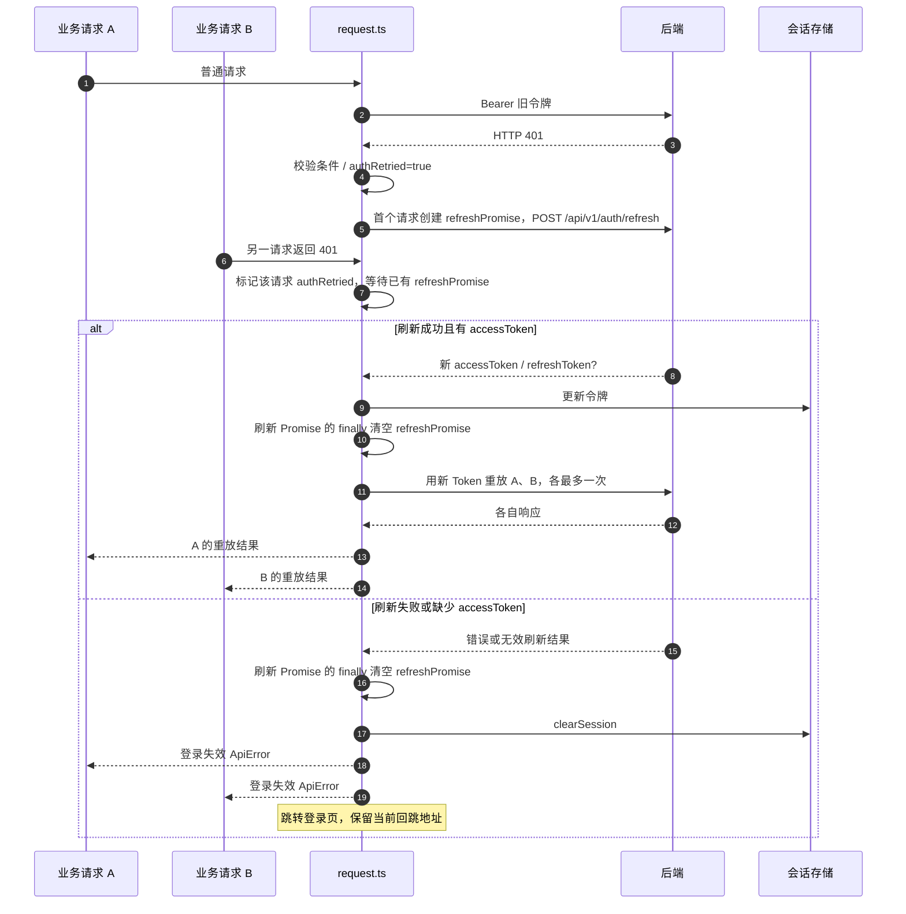

刷新必须同时满足：HTTP 401、有请求 config、未标记 authRetried、有 refreshToken，且路径不是 `/api/v1/auth/login`、`/api/v1/auth/refresh`、`/oauth2/token`。重放再次 401 时不继续刷新；重放返回其他错误时保留其错误语义。不要新增无限重试或独立并发刷新机制。

请求错误携带 traceId 时用于后端日志关联；不要输出密码、验证码、完整 Token 或办公平台密钥。请求层抛错不代表所有页面自动有统一提示，提示由具体调用方处理。

## 6. OAuth2 与办公平台业务

### 6.1 标准 OAuth2 授权码与 PKCE 时序

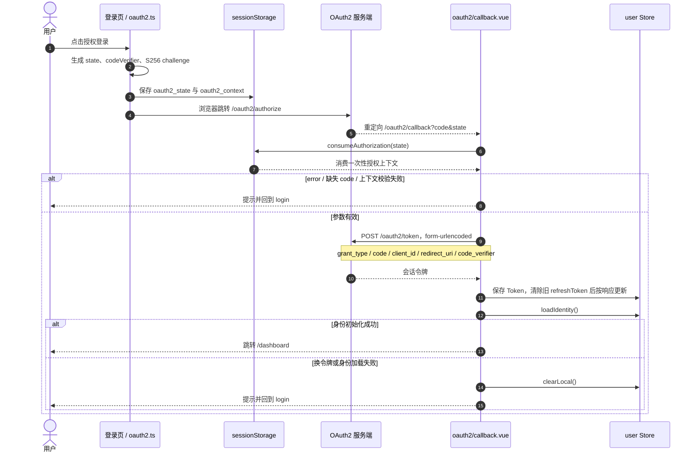

当前换令牌地址是 `/oauth2/token`，不要复制历史注释中的 `/api/v1/oauth2/callback`。请求未发送 clientSecret，浏览器采用 PKCE 公共客户端模式。上下文在校验前已消费，错误 state 也会使其失效；跨标签页和关闭标签页会丢失 sessionStorage 上下文。登录页社交入口目前统一使用标准授权 URL，不能据 provider 参数宣称已切换不同提供商 API。

### 6.2 办公平台登录与绑定审批流程


当前登录页社交入口统一走标准 OAuth2，未调用上述办公平台状态和登录 API；图中虚线表示接口能力或外部衔接。办公回调缺少 platform 时默认 FEISHU。前端依据错误 message 识别等待审批，绑定申请的生成由后端负责；没有前端轮询自动登录。办公回调当前 catch 展示错误或等待状态，并不像 OAuth2 回调一样统一执行 clearLocal，不要在图中补写不存在的回滚行为。

### 6.3 绑定审批时序与乐观锁

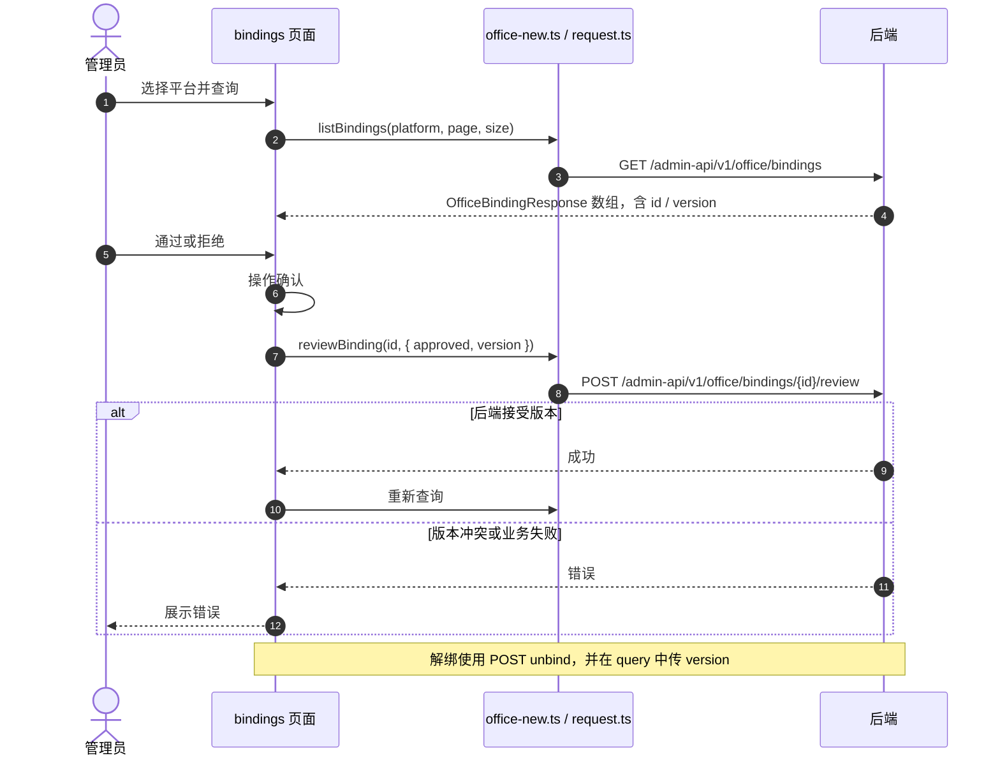

`office.ts` 负责办公业务，`office-new.ts` 负责平台状态、登录、应用配置和绑定。绑定列表当前返回数组，页面用数组长度作为 total；状态筛选未进入请求，查询函数会重置页码。不能描述为已具备可靠的标准服务端分页和状态过滤。修复这些行为属于代码任务，不应通过文档假设其已完成。

## 7. 常规业务、工作流与上传

### 7.1 CRUD 页面处理流程

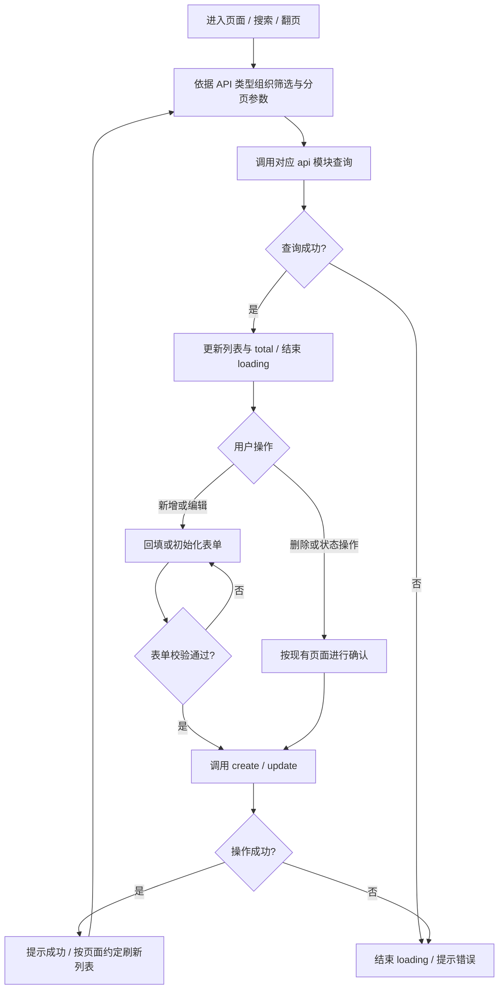

这是新增页面应核对的处理模式，不代表全部页面都通过同一个 composable 执行。`useCrud` 已实现但当前未发现实际页面调用；其适配器要求 `list/create/update/delete`，默认 `page=1,size=20`，返回 `list/total`。批量删除是并发单条请求，不具备事务回滚；工作流使用它时须显式转换分页和 ID 类型。

表单校验优先查看 `utils/validate.ts` 与 `utils/validate-rules.ts` 及相邻页面；以接口定义确定必填、长度、枚举和 null 语义，不能靠 TypeScript 类型替代运行时表单校验。

### 7.2 工作流实例操作时序

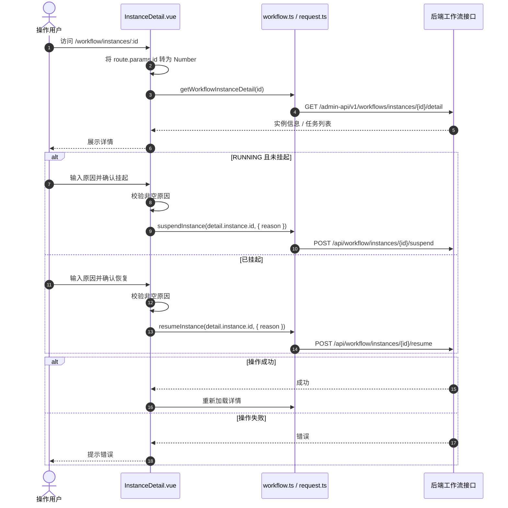

工作流列表查询使用 `pageNum/pageSize`，返回 `records/total`；普通 `Pagination` 组件的绑定参数不等于接口查询字段，需要页面适配。定义、实例、统计、待办、通过和驳回使用 `/admin-api/v1/workflows/**`；回退、转办、委派、挂起和恢复使用 `/api/workflow/**`。

### 7.3 TaskActions 能力边界

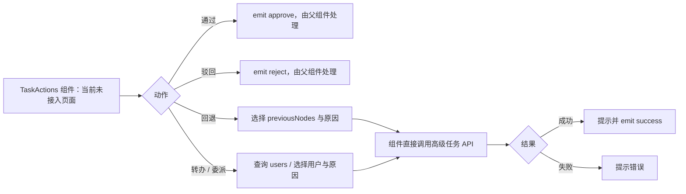

不能把该组件描述成已接入的审批闭环，也不能把实例挂起/恢复归入它。后续接入须明确通过/驳回事件的父级处理、权限判断、节点来源和操作后刷新。`previousNodes` 当前只在初始化复制，后续 prop 更新不会自动同步本地列表。

### 7.4 文件上传与响应处理流程

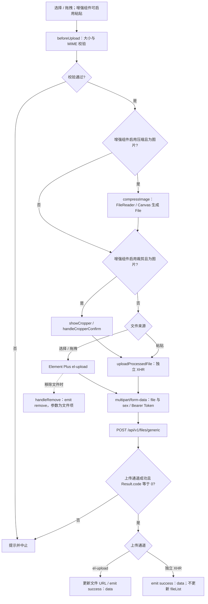

上传组件使用 Element Plus 传输，增强组件的裁剪/粘贴使用独立 XHR，均不能假定具备 Axios 的 401 自动刷新、统一错误转换或响应头 Token 更新。新增常规文件 API 仍应复用 `api/file.ts` 和请求封装。

默认 accept 为 JPEG/PNG/GIF/WebP，大小取 `MAX_UPLOAD_SIZE`（当前 10MB）；后端限制仍需单独核对。压缩按横竖方向选择宽度或高度上限进行等比缩小，不放大小图；当前算法不保证同时满足两个维度上限。remove 事件不等于后端删除。不要宣称默认支持视频预览或永久有效 URL。粘贴监听注册在 document 上，接入多个实例时需要考虑事件作用范围。

## 8. 编码与接口约定

- 遵循相邻模块的导入、命名、SFC 布局和错误处理方式。组件用 PascalCase，变量和函数用 camelCase，类型用 PascalCase，公共常量按现有 settings 风格命名。
- 新增 API 时先核对 HTTP 方法、路径、查询参数、请求 DTO 和响应 DTO，再定义返回类型。对象字段是否可选以实际契约为准。
- 不无依据使用 `any`、双重断言或忽略类型错误；已有历史 any 不代表新增代码可以复制。
- 查询、提交与删除分别管理 loading，异常分支须结束加载；取消确认不应显示成接口失败。
- 数字 ID 与字符串 ID 必须显式转换；日期、枚举和分页字段不可按 UI 文案推断。
- Tree 菜单、部门与普通列表不同；复制页面时核对递归 children 和节点字段。
- 错误提示优先使用现有 `showError` 或模块既有处理，保留 traceId 排查能力，避免重复弹窗。
- 图表随容器与主题变化调整，并在卸载时释放实例/监听；优先查看已有 ECharts 页面和主题工具。
- 对缓存、脱敏、XSS 工具和性能监控的描述须能找到调用点；不宣称已全局启用。
- Mock 只在 `import.meta.env.DEV` 时动态加载，不应作为生产业务数据来源。
- 不在未授权范围内修改后端契约、修复其他模块、升级依赖或扩大部署变更。

## 9. 环境、检查命令与验证边界

| 命令 | 用途 |
| --- | --- |
| `npm install` | 安装依赖，运行环境须满足依赖要求 |
| `npm run dev` | Vite 开发服务 |
| `npx vue-tsc --noEmit` | 单独类型检查 |
| `npm run build` | 类型检查与生产构建，输出 dist |
| `npx vitest run` | 单次测试 |
| `npm run test` | Vitest 默认交互/监听入口 |
| `npm run test:coverage -- --run` | 单次覆盖率检查，取决于覆盖率提供器可用性 |
| `npm run preview` | 本地预览构建产物 |
| `npm run analyze` | 构建并打开产物分析报告 |

当前 package.json 没有 lint 或独立 typecheck 脚本；类型检查使用上述 vue-tsc 或 build 命令。不得记录不存在的 `npm run lint`。Vitest 使用 happy-dom 和 `src/test/setup.ts`，覆盖率配置没有阈值；Playwright 已安装但尚无配置及 E2E 用例，不应宣称已有浏览器端自动化覆盖。

请求刷新测试覆盖认证端点排除、单次重放、并发单飞及重放错误保留；另有 OAuth2 PKCE/state、认证配置 API 和校验工具测试。DOM 模拟测试不能替代真实浏览器的 OAuth 跳转、剪贴板、Canvas、上传和 Nginx 反代验证。

`VITE_API_PROXY_TARGET` 用于开发代理；`VITE_API_BASE_URL` 用于 Axios baseURL；OAuth2 客户端相关变量参照 `.env.example` 和 `env.d.ts`。不输出真实环境文件中的密钥，不把构建期与运行期配置混为一谈。

## 10. 变更检查清单与排障

- [ ] 核对相关页面、API、DTO、配置和测试，修改范围符合用户要求。
- [ ] 动态页面已登记 VIEW_REGISTRY，后端 component 与键完全一致。
- [ ] API 经过统一封装或明确使用现有上传特例，分页字段与响应结构正确。
- [ ] 会话通过 auth 工具管理，没有新增不一致的存储键。
- [ ] 权限码来源和后端鉴权已核对，不把 visible/hidden 当成安全限制。
- [ ] 表单、loading、取消确认、失败提示、操作后刷新符合模块行为。
- [ ] 运行相关测试与类型检查；有构建变更时验证 build。
- [ ] 文档中的 Mermaid、链接、接口和接入状态与实际修改一致。
- [ ] 无密钥、产物或无关文件进入变更；仅用户明确要求时提交。

| 现象 | 优先核对 |
| --- | --- |
| 菜单页面 404 | 后端 component、VIEW_REGISTRY、有效 children、动态注册是否成功 |
| 侧边栏没有菜单但 URL 可访问 | visible=0 / meta.hidden，不是路由缺失 |
| 按钮权限未收敛 | 权限请求是否失败降级为空、当前 Store 是否为空、指令是否已移除节点 |
| 401 后仍未恢复 | refreshToken、认证端点排除、authRetried、刷新结果是否含 accessToken |
| 上传 401 与其他请求行为不同 | Element Plus/XHR 没有经过 request.ts 拦截器 |
| 工作流分页为空 | 是否误用 page/size 或 list/total |
| 办公绑定分页/筛选不符合预期 | 数组响应、total 计算、查询重置页码、status 未传入 |
| OAuth2 回调失败 | sessionStorage 上下文、state 一次性消费、redirect_uri、PKCE、token 代理 |
| Docker 首页正常但接口失败 | API_PROXY_PASS、外部网络、后端 DNS、代理 location |

## 11. 参考资料与维护方式

- [项目说明](README.md)
- [架构概览](docs/architecture/overview.md)
- [认证与路由](docs/architecture/auth-and-routing.md)
- [接口文档索引](docs/api/README.md)
- [部署指南](docs/guides/deployment.md)
- [测试说明](docs/reference/testing.md)
- [工具说明](docs/reference/toolkit.md)
- [注释规范](docs/reference/comment-style.md)

图示集中在本文件，其他资料用于扩展阅读。引用资料可能保留历史描述，例如 OAuth2 Token 地址和上传能力状态；遇到冲突需回到源码核对。注册表、端点和 DTO 的完整清单以 `router/dynamic.ts`、`api/*.ts`、`types/*.ts` 为准，不在本文件复制第二份易失同步的代码列表。

修改认证、路由、分页、传输或部署边界后，应同步本文件对应文字与图中的条件、参与者和失败分支；未接入能力完成接入时更新状态，不通过删去限制说明假装功能已完成。
