# AGENTS.md — apex-admin-web

本文件是本仓库的开发入口，说明当前实现、模块边界、关键业务链路和变更约束。修改前先定位相关源码；文档与实现不一致时，以执行代码、类型定义和配置为依据，并同步修正文档。历史分析文档和文件头注释不能代替实现核对。

**核对日期：2026-11-08。** 本次依据前端仓库（HEAD d381de0）与 apex-scaffold（HEAD 68e8cfe1）的前后端对照评审与代理链路修复核对（见 [评审报告](docs/archived/project-reports/frontend-backend-review-2026-11-08.md)）；图中的后端与第三方服务表示前端依赖的接口边界，不表示已审计其内部实现。

## 1. 开发入口与关键约束

- 项目版本为 `1.2.0`，声明 Node `>=18`；实际运行还须满足已安装依赖的 engines 要求。
- 技术栈：Vue 3.5、Vite 6、TypeScript ~5.7、Vue Router 4、Pinia 2、Element Plus 2、Axios、ECharts 5、CropperJS 1。
- 页面使用 `<script setup lang="ts">`；路径别名 `@` 指向 `src/`。
- 常规接口在 `src/api/` 按业务域封装，复用 `src/utils/request.ts` 的 `request/get/post/put/del`，页面不新建 Axios 实例。
- 新增菜单驱动页面必须同步 `src/router/dynamic.ts` 的 `VIEW_REGISTRY` 与后端菜单 `component` 字段；文件存在不等于路由已注册。后端菜单/权限种子脚本位于 `apex-system/src/main/resources/db/migration/{mysql,postgresql}/`（菜单 `path` 约定：目录用绝对路径如 `/platform`，子菜单用相对段如 `tenant`，由前端 `resolvePath` 与 Vue Router 共同拼接）。
- 普通列表通常用 `page/size` 和 `list/total`；工作流实例列表用 `pageNum/pageSize` 和 `records/total`，工作流待办任务用 `pageNum/pageSize` 但响应为 `PageResponse`，页面读 `list/total`。以具体 API 类型为准，不能全局替换。
- 会话读写使用 `src/utils/auth.ts`，不可自行引入 `access_token` 等存储键。
- 租户作用域由后端从令牌解析；前端仅在登录响应返回 `tenantId` 时记录（`apex.admin.tenant-id`）并附带 `X-Tenant-Id` 请求头，详见 `docs/guides/auth-tenant-adaptation.md`。平台运维侧的租户台账已提供 HTTP 端点 `/api/v2/platform/tenants`（分页/详情/创建/生命周期/配额），管理页见 `views/system/tenant/`；但**业务侧仍无租户切换器**，登录态绑定单一租户。后端开启 `apex.features.auth-center-permission` 时权限改由认证中心统一授权（带 ≤30s 短期缓存），前端权限码消费方式不变。
- 菜单展示、按钮展示和后端接口鉴权是三个不同层次。前端隐藏元素不能替代后端权限校验。
- 不在浏览器配置中保存客户端密钥、数据库密码等秘密；`VITE_*` 会进入前端产物。
- 优先复用现有组件、类型和工具；不把未接入的工具描述成全局机制。
- 除用户明确要求外，不新增代码注释，不创建额外文档，不提交 Git commit。

### 阅读导航

| 任务 | 首先阅读 | 重点约束 |
| --- | --- | --- |
| 登录与令牌 | `stores/user.ts`、`utils/auth.ts`、`utils/request.ts`、`api/auth.ts` | 身份初始化、401 单飞刷新、单次重放、租户声明（可选 `tenantId`，`VITE_AUTH_TENANT_ENABLED` 控制） |
| 页面与菜单 | `router/index.ts`、`router/dynamic.ts`、`layouts/AdminLayout.vue` | 静态/动态路由、注册表、hidden |
| 按钮权限 | `stores/permission.ts`、`directives/permission.ts` | 空列表放行、多码任一满足、移除 DOM |
| 常规 CRUD | 相邻页面、对应 `api/*.ts`、`types/index.ts` | DTO、分页、错误提示与刷新行为 |
| 工作流 | `api/workflow.ts`、`types/workflow.ts`、`views/workflow/` | 特殊分页、静态入口、发起流程（workflowCode 调用方提供）、待办办理语义、组件接入范围 |
| 站内信 | `api/message.ts`、`utils/message-socket.ts`、`views/office/message/`、`layouts/AdminLayout.vue` | 收件箱/模板契约、WebSocket 推送（ticket/pong/1h 重连）、数组响应口径；AdminLayout 未读角标 = 60s 轮询 + WS 推送触发刷新 |
| 通知中心 | `api/notification.ts`、`utils/notification-stream.ts`、`components/NotificationCenter/` | system 域 `/api/v1/notifications/**`；SSE（`/notifications/stream`）用 fetch 流式实现（网关仅认 Authorization 头，EventSource 不可用），请求必须带 `Accept: text/event-stream`（后端据此豁免 30s 响应超时）；断线 5s→30s 退避 |
| 数据脱敏 | `api/masking.ts`、`views/system/masking/` | 规则只读（启动配置）、批量试算；本仓库可确认前端路径与开发代理，目标网关路由需外部核验 |
| 租户管理 | `api/tenant.ts`、`views/system/tenant/` | `/api/v2/platform/tenants`、pageNum/pageSize 必填、生命周期动作小写枚举、配额 null=不限、version 乐观锁；开通向导可同时提交 `adminUsername`/`adminPassword`（后端成对使用） |
| 租户套餐 | `api/tenant-package.ts`、`views/system/tenant-package/` | `/api/v2/tenant-packages`；列表为裸数组、更新走无路径参数的 `PUT`（后端按请求体 `packageCode` 定位）；`menuIds`/`permissionCodes`/`features` **空集合 = 全量放行**；提交前补全菜单父链 |
| 能力运营 | `api/capability.ts`、`views/system/capability/` | `/api/v2/capabilities`（权限码 `tenant:read`）、`/capabilities/subscribed`、`/api/v2/capability-usage`（`capability` 必填、区间 ≤92 天、只读不计费） |
| 开放平台 | `api/open-app.ts`、`views/system/open-app/` | 管理面与 scope 目录同源 `/api/v1/open-apps/**`（`GET /scopes` 与创建校验共用 OpenPlatformScopeRegistry）；`page` 从 0 开始、返回数组无 total；明文 `clientSecret` 仅创建/重置响应返回一次 |
| 集成中心 | `api/integration.ts`、`views/integration/connector.vue` | `/integration/v1/connectors`（pageNum/pageSize）与 `/credentials`（**裸数组**）；凭据 `secret` 仅上行，轮换后旧版本立即失效 |
| 物联网 | `api/iot.ts`、`views/iot/` | `/integration/v1/iot/devices`（pageNum/pageSize）、`/devices/{id}/telemetry|shadow|commands`（影子只读、命令下发 commandId 幂等）、`/rules`（分页）；启停 `enabled` 为字符串；MQTT 认证钩子为 `/internal/v1/iot/**` 内部端点，管理端不调用 |
| 统一通知 | `api/notify.ts`、`views/office/notify/` | `/api/v2/office/notify/templates`（pageNum/pageSize）与 `/requests` 留痕；按模板投递走内部端点 `POST /internal/v1/notify`，管理端无发送入口 |
| 数据总览 | `api/overview.ts`、`views/dashboard/index.vue` | D5 聚合 `GET /api/v2/overview`（租户取可信上下文、权限码 `system:monitor:view`）；单源降级返回 `sources.{file,workflow,integration}.status=DEGRADED`；内部端点 `/internal/v1/overview` 网关 403，浏览器不可直连 |
| 在线会话 | `api/session.ts`、`views/monitor/session.vue` | `/auth/v1/sessions/**`：`online` 为**裸数组不分页**；单会话终止按 `sessionId`（会话唯一标识），详情按数字主键；全部端点要求管理员角色 |
| 账号安全 | `api/mfa.ts`、`api/ip-access-control.ts`、`api/auth-audit.ts`、`views/system/security/`、`views/system/role/` | MFA configs 与 IP 规则列表均为裸数组；IP 写操作走 query 参数（非 body）；认证审计（security 页第三 Tab）tenantId 必填、裸数组无分页、前端截断 200 条，清理需管理员角色；角色页权限 Tab 按钮挂 `system:permission:*`（V88） |
| 登录 MFA | `views/login/index.vue`、`stores/user.ts`、`api/auth.ts` | 登录响应 `mfaRequired=true` 时不签发令牌，须用 `challengeToken` 调 `POST /auth/v1/mfa/verify` 换取正式令牌（挑战一次性消费） |
| 授权同意 | `views/oauth2/consent.vue`、`api/oauth2.ts` | `POST /oauth2/consent`（form-urlencoded：client_id/scope/decision）；按方案 §12.3 登记 **public 匿名页**——页面可匿名打开，同意提交须登录（后端要求认证主体），未登录先登录后回跳 |
| 运维健康 | `api/operations.ts`、`views/monitor/operations/` | 前端封装 health-report、snapshots、trend、租户摘要和导出相关子路径；快照分页为 page/size；页面含报告/快照/趋势/导出/租户摘要五个页签；未封装根路径与导出任务列表，端点是否存在需以目标后端契约为准 |
| 办公平台 | `api/office-platform.ts`、`api/office-{approval,calendar,document}.ts`、`views/office/` | 平台标识与 `PLATFORM_NAMES` 唯一定义在 office-platform；业务接口按子域拆分、version、组织同步与部门 CRUD；绑定列表双接口并存（数组口径 / `/bindings/page` 真实分页） |
| 文件上传 | `api/file.ts`、两个上传组件 | Element Plus/XHR 路径不经过 Axios 拦截器；增强组件 `enableChunk` 开启时超限文件走分片上传（`/api/v1/file/chunk/**`，upload 为原始字节流、参数走 query） |
| 部署 | `vite.config.ts`、`Dockerfile`、`docker/nginx.conf` | 构建期变量与运行期反代变量 |

## 2. 项目结构与业务边界

```text
src/
├── main.ts / App.vue       应用启动与根视图
├── settings.ts / env.d.ts  公共常量与环境变量类型
├── router/                静态路由、守卫、菜单转换和组件注册表
├── layouts/               AdminLayout：菜单、顶栏、面包屑、主视图
├── views/                 login、oauth2、public（匿名分享/找回页）、dashboard、profile、error、demo
│                          system、monitor、data、office、workflow
├── components/            Pagination、GlobalSearch、NotificationCenter、EmptyState、上传组件
├── composables/           useCrud、useTableConfig、useFormDraft、useBreakpoint
├── stores/                user、permission、app、office
├── directives/            permission
├── api/                   按业务域拆分的类型化接口函数
├── types/                 index.ts 通用领域类型、workflow.ts 工作流类型
├── utils/                 请求、会话、存储、校验、错误、脱敏等工具
├── mock/                  仅开发环境动态加载
└── test/                  Vitest 全局准备
```

`src/api/` 没有统一的 `index.ts` 入口，按具体业务文件导入。工具目录还包含请求缓存、XSS 防护、ECharts 主题和性能监控能力；是否执行应检查调用点，不能仅凭文件存在就宣称所有页面自动使用。

| 业务域 | 主要源码 | 接口边界/页面职责 |
| --- | --- | --- |
| 认证与用户 | `auth.ts`、`user.ts`、`oauth2.ts` | 验证码、密码登录（可选租户声明）、我的角色/权限、系统角色与权限 CRUD、当前用户、用户导出、标准 OAuth2 |
| 系统管理 | `system.ts`、`database.ts` | 用户/角色/菜单/部门/字典/参数/定时任务、数据库配置与数据源管理 |
| 认证管理与 SSO | `auth-config.ts`、`sso.ts` | 管理端配置页面；与浏览器登录回调区分 |
| 代码生成器 | `generator.ts` | 数据源、已保存数据源连接测试、表扫描、生成配置、生成与按配置历史；向导页签提供模板目录、预检、预览与异步任务（提交/进度轮询/取消/产物清单/下载）；历史回滚无前端入口 |
| 监控与日志 | `monitor.ts`、`log.ts` | 登录/审计/API 日志、在线用户、大盘、运行和业务日志 |
| 数据管理 | `document.ts`、`chart.ts`、`file-share.ts` | 文档与图表 CRUD、状态操作、数据查询；文件分享含创建、列表（按文件 ID、仅所有者）、撤销、兑换和下载；匿名兑换独立页 `/share`（public 路由，token 即凭证） |
| 工作流 | `workflow.ts` | 发起实例、实例、统计、待办任务办理、高级操作与流程定义管理（`/api/v2/workflow-definitions`） |
| 租户管理 | `tenant.ts`、`tenant-package.ts` | `/api/v2/platform/tenants` 分页/详情/创建/生命周期/配额（权限码 tenant:*）；`/api/v2/tenant-packages` 套餐 CRUD |
| 能力运营 | `capability.ts` | 能力目录、当前租户订阅、按租户×能力的调用用量（只读） |
| 开放平台 | `open-app.ts` | 开放应用注册/更新/重置密钥（一次性明文 secret）与 scope 目录 |
| 集成中心 | `integration.ts` | 连接器配置 CRUD 与租户级凭据注册/轮换/删除（`/integration/v1`） |
| 物联网 | `iot.ts` | 设备分页/注册/注销/遥测历史、规则创建/详情/启停（`/integration/v1/iot`） |
| 统一通知 | `notify.ts` | 通知模板 CRUD 与投递留痕（`/api/v2/office/notify`） |
| 在线会话 | `session.ts` | 在线列表/统计、用户会话查询与批量下线、单会话终止（`/auth/v1/sessions`） |
| 账号安全 | `mfa.ts`、`ip-access-control.ts`、`auth-audit.ts` | MFA 配置与 IP 白/黑名单（`/api/mfa`、`/api/ip-access-control`）；认证中心审计事件查询与清理（`/api/v1/auth/audit-logs/**`） |
| 运维健康 | `operations.ts` | `/api/v2/operations/*` 报告/快照/趋势/租户摘要/导出 |
| 站内信 | `message.ts` | 收件箱/已发送/发送/未读数、WebSocket 推送与消息模板管理（`/api/v1/messages`、`/admin-api/v1/message-templates`）；游标增量收件箱（`/inbox/cursor`）与渠道投递记录（`/{id}/deliveries`，已发送页抽屉） |
| 通知中心 | `notification.ts` | 系统事件通知收件箱/未读/已读与 SSE 实时推送（`/api/v1/notifications/**`，system 域）；与 office 域站内信是两套独立通道 |
| 办公平台 | `office-platform.ts`、`office-approval.ts`、`office-calendar.ts`、`office-document.ts`、`office-sync-wizard.ts`、`meeting-room.ts` | 业务接口按子域拆分、version、组织同步（部门 CRUD/员工/同步历史/触发同步/映射）、同步向导（预检/预览/执行/重试）、会议室；绑定查询有 `/bindings`（数组）与 `/bindings/page`（真实分页 + status 过滤）两套 |
| 数据脱敏 | `masking.ts` | 规则只读查询与批量脱敏试算（`/api/v1/masking`） |
| 文件与搜索 | `file.ts`、`search.ts` | 文件接口（含分片上传）、上传组件、顶栏全文搜索与索引重建 |

后端路径按现有 API 区分：`/api/v1/**` 为认证、用户、文件、站内信和办公平台接入等接口；`/api/v2/**` 为租户管理、租户套餐、能力运营、工作流定义、运维健康、文件分享与办公会议室/同步向导/统一通知；`/admin-api/v1/**` 为管理接口；`/integration/v1/**` 为集成中心与物联网管理接口（`/internal/v1/**` 为其集群内部端点，网关强制拒绝外部访问）；`/auth/v1/sessions/**` 为认证中心会话管理；`/api/workflow/**` 为工作流高级操作；`/api/office/**` 为办公业务接口；`/api/mfa/**` 与 `/api/ip-access-control/**` 为认证中心安全能力；标准 OAuth2 使用 `/oauth2/authorize`、`/oauth2/token`、`/oauth2/consent`。本仓库可确认前端调用路径，目标环境网关是否暴露这些路径需外部核验。

## 3. 架构图

### 3.1 系统与部署边界

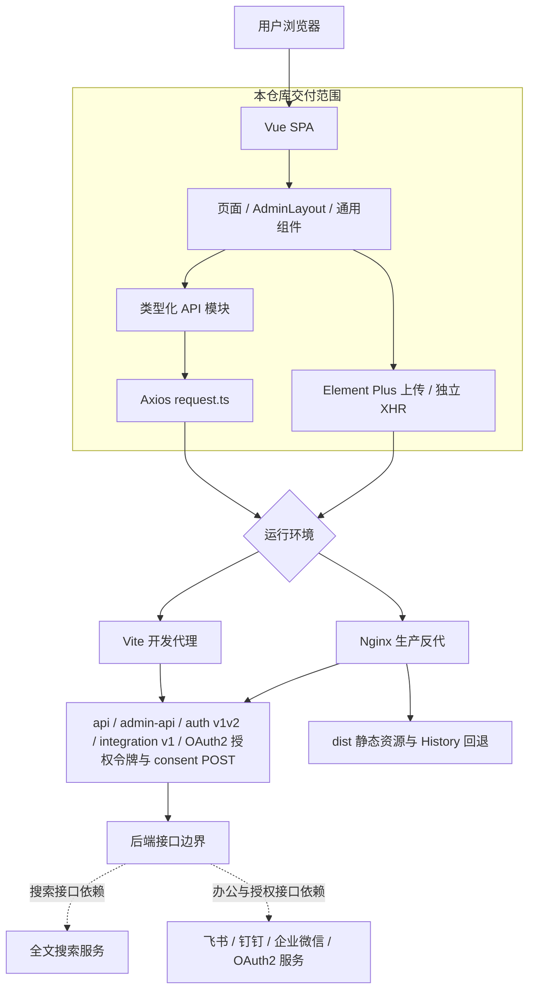

同域部署默认使用相对接口路径。若设置绝对 `VITE_API_BASE_URL`，Axios 请求可能直接访问该地址，绕过本地代理；不能保证所有请求一定经过 Nginx。搜索和第三方服务由后端接口承接，前端不直接维护其内部存储或工作流引擎。

### 3.2 前端分层与状态依赖

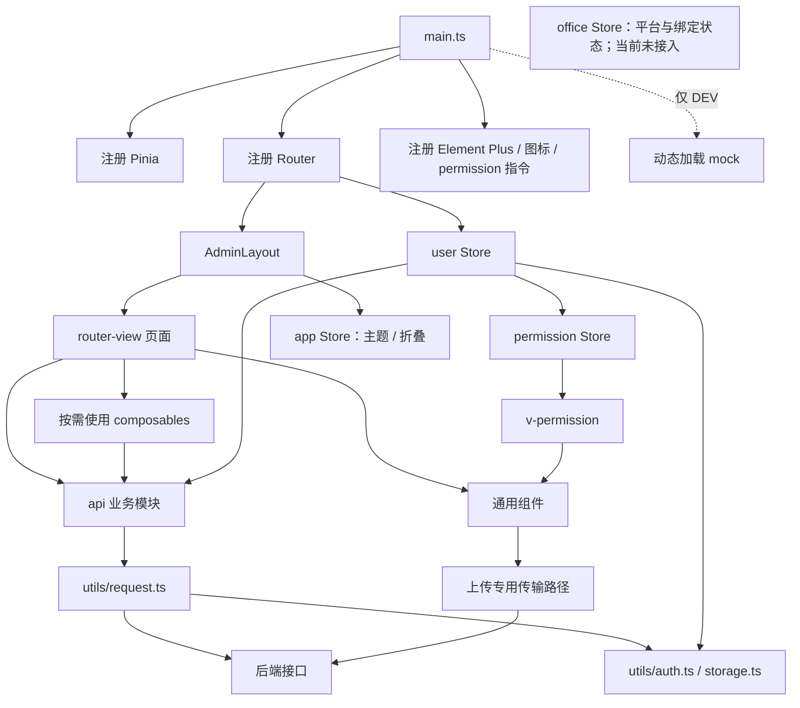

`user` Store 保存 token、identity、permissions 和 initialized；`permission` Store 从用户权限派生；`app` Store 管理 UI 状态；`office` Store 定义当前平台和绑定状态，当前未发现调用点。持久化会话与 Pinia 内存状态是两个层次，请求拦截器从会话工具读取 Token。

### 3.3 构建与发布流程

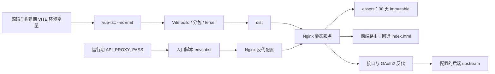

开发服务器默认 `0.0.0.0:5173`，代理目标取 `VITE_API_PROXY_TARGET`，缺省 `http://127.0.0.1:8080`。Vite 对 `/api`、`/admin-api`、`/auth/v1|v2`、`/integration/v1` 及 OAuth2 授权/令牌/consent（仅 POST，GET 回退 SPA）路径配置代理，nginx 同域反代口径一致。构建包含 vendor 分包，生产移除 console/debugger，分析报告为 `dist/stats.html`。

Docker 使用 Node 18 Alpine 构建和 Nginx 运行两个阶段；当前安装命令是 `npm install`。`VITE_API_BASE_URL` 在构建时注入，运行时修改不能重写已打包的 JavaScript；`API_PROXY_PASS` 只影响 Nginx upstream。Compose 依赖外部网络 `apex-scaffold_apex-network`；首页健康检查仅证明静态服务可访问。

站内信 WebSocket 需要额外代理配置：vite 开发代理 `/api` 已设 `ws: true`；nginx 有 `= /api/v1/messages/ws` 专用 location（转发 `Upgrade`/`Connection`，读超时 3600s，置于 `/api/` 之前）。生产还须由后端显式配置 `ROUTE_OFFICE_WS_URI`（与 `ROUTE_OFFICE_MESSAGE_URI` 指向同一 office 实例，票据与连接为单实例内存态），并在 office-service 的 `office.messages.allowed-origins` 中加入前端 Origin（缺省拒绝所有握手，403）。

## 4. 登录、路由与权限

### 4.1 密码登录时序

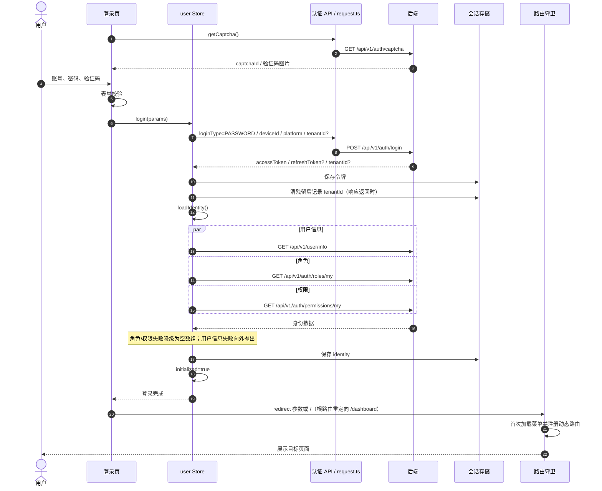

API 请求均通过请求层，图中并行请求直接指向后端是为了展示业务时序。不要把“登录接口成功”与“身份初始化成功”视为同一个状态。登出会调用后端登出 API，并在 finally 中执行本地清理，后端失败不阻塞本地退出。登录页租户标识输入由 `VITE_AUTH_TENANT_ENABLED` 控制（默认关闭）；`tenantId` 仅作登录时的租户匹配声明，租户作用域由后端从令牌解析，请求层仅在会话记录了 tenantId 时附带 `X-Tenant-Id` 头。

### 4.2 路由守卫业务流程

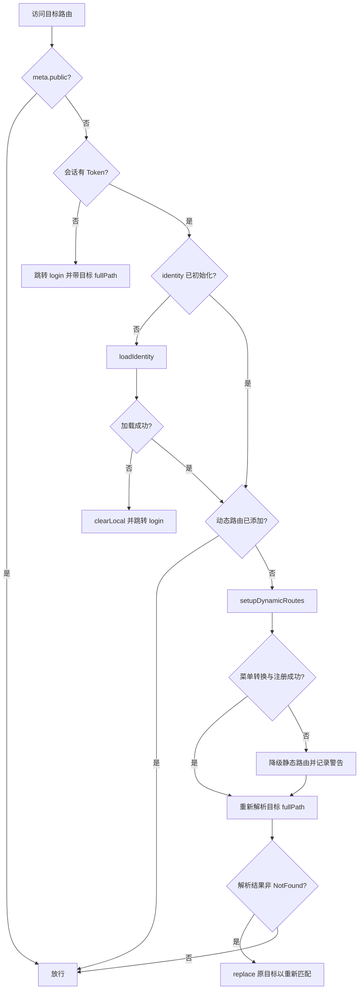

失败后未完成注册的动态路由可在后续导航再次尝试。身份加载失败的守卫分支直接返回 `/login`；无 Token 分支才明确携带 `redirect`，不要把所有失败分支都写成保留回跳。

### 4.3 菜单到路由与侧边栏的转换

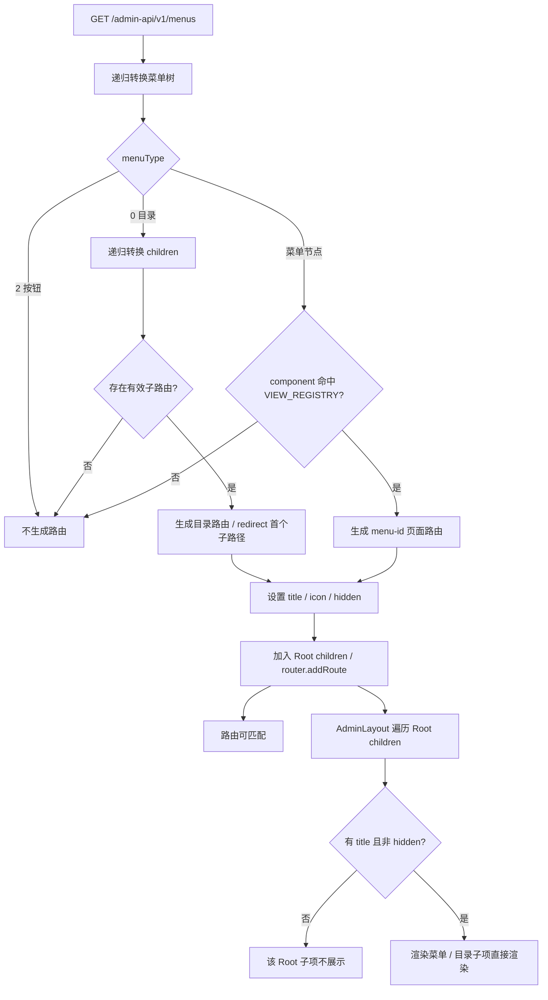

- 约定 `menuType=0/1/2` 分别是目录、菜单和按钮；当前转换函数在排除 0、2 后按页面处理，不额外验证类型枚举。
- `buildDynamicRoutes(_permissions)` 的参数未参与过滤，实际依据后端返回菜单树。
- 未登记的组件被跳过；空目录也被跳过。
- `status` 未参与过滤；`visible=0` 设置 hidden，仍保留可访问路由。侧边栏仅过滤 Root 子路由的 title/hidden，目录内子项未再次过滤 hidden，也未递归渲染更深层级。
- 菜单路径来自后端配置；模块路径表只是命名约定，不能当成所有环境固定 URL。

### 4.4 静态路由与动态路由

| 路由 | 实现边界 |
| --- | --- |
| `/login` | 公开登录入口 |
| `/oauth2/callback`、`/office/callback` | 公开授权回调 |
| `/oauth2/consent` | 授权同意页；public 匿名页（方案 §12.3 口径）——页面可匿名打开，同意提交须登录，未登录先登录后回跳 |
| `/password-recovery` | 密码找回公开页（public；调用 `/auth/v2/password-recovery/**`，依赖已绑定邮箱/手机号） |
| `/share` | 匿名分享兑换页（public、hidden；token 即凭证，调 `/api/v2/file-shares/exchange`） |
| `/dashboard` | 工作台 |
| `/workflow/monitor`、`/workflow/instances/:id` | 工作流监控与实例详情 |
| `/workflow/monitor/dashboard` | 工作流重定向入口 |
| `/demo/file-upload`、`/demo/file-upload-enhanced` | 隐藏演示页 |
| `/:pathMatch(.*)*` | NotFound 兜底 |

上述入口在 `router/index.ts` 中定义，不依赖后端菜单；具体 public/hidden 属性以该文件为准。系统、监控、办公、数据和个人中心等菜单页面依赖动态注册。`VIEW_REGISTRY` 同时含部分静态页面 loader，不应以注册表存在推断页面仅支持动态路由。

### 4.5 按钮权限的实际语义

`v-permission="'system:user:create'"` 使用 `permission` Store 检查权限。逗号分隔的多个权限码满足任意一个即可；**权限列表为空时当前实现直接放行**。角色和权限接口失败会降级为空数组，因此前端不是严格拒绝的安全边界。

指令在 mounted/updated 执行，无权限时移除 DOM；没有恢复锚点，后续权限变化不能可靠恢复被移除元素。路由 meta.perms 不能被描述为已实现全路由权限拦截。新增权限控制应同时核对后端鉴权，不能因按钮隐藏就省略服务端校验。

后端 `@RequirePermission` 为**权限码精确匹配**（逗号分隔多码按 `Logical.OR`/`AND` 组合，无通配符），权限来源为「用户 → 角色 → 权限」RBAC 查询；开启 `apex.features.auth-center-permission` 后改由认证中心统一授权（含 ≤30s 短期缓存），权限码语义不变。前端 `v-permission` 的任一满足语义与后端 OR 一致，但前端放行不代表后端放行——核对权限码时以「我的权限明细」（个人中心按模块分组展示）为准。

## 5. 请求处理、错误与令牌刷新

### 5.1 统一请求业务流程

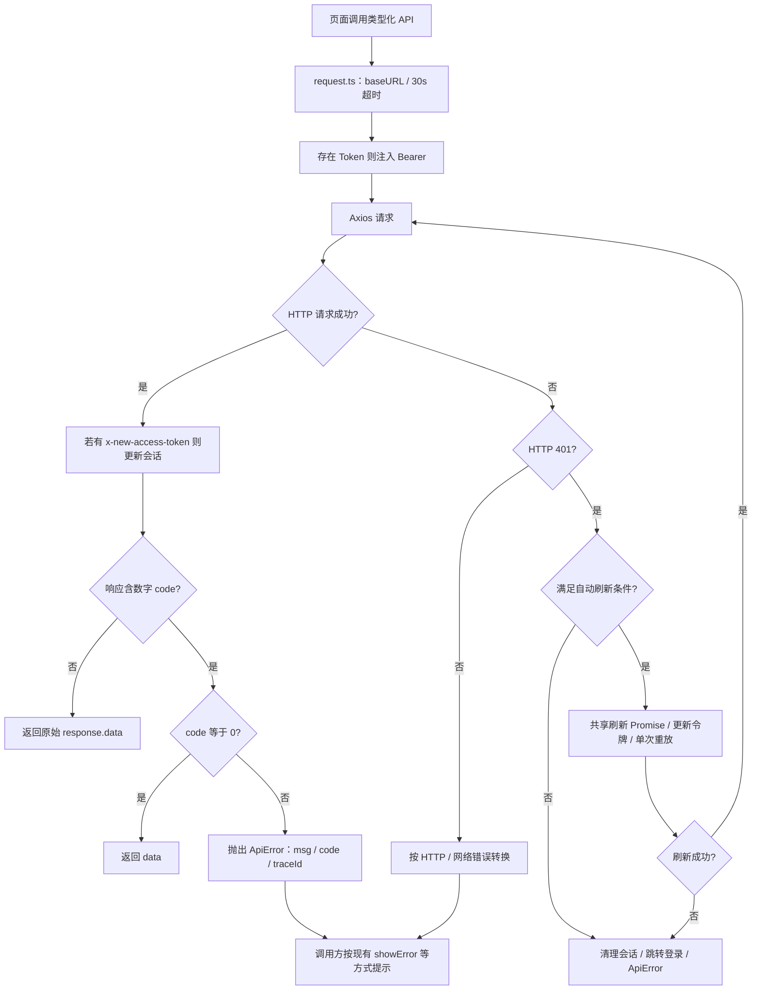

自动刷新由 HTTP 401 触发，不是所有业务 `Result.code` 都会进入刷新分支。统一请求层解包后，页面拿到的是 `data`，不要再访问 `response.data.data`。对于不含数字 code 的响应，请求层保留原始数据。

### 5.2 并发 401 单飞刷新时序

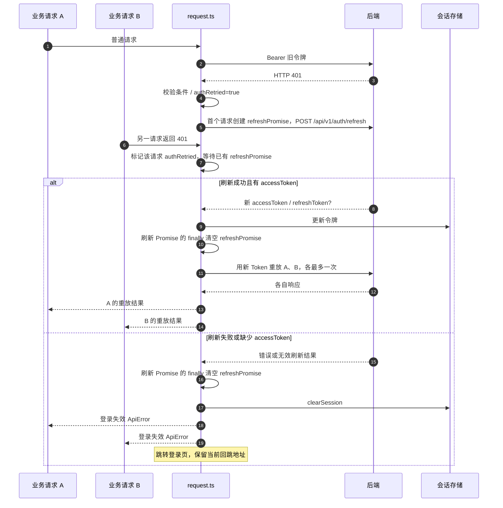

刷新必须同时满足：HTTP 401、有请求 config、未标记 authRetried、有 refreshToken，且路径不是 `/api/v1/auth/login`、`/api/v1/auth/refresh`、`/oauth2/token`。重放再次 401 时不继续刷新；重放返回其他错误时保留其错误语义。不要新增无限重试或独立并发刷新机制。

请求错误携带 traceId 时用于后端日志关联；不要输出密码、验证码、完整 Token 或办公平台密钥。请求层抛错不代表所有页面自动有统一提示，提示由具体调用方处理。

## 6. OAuth2 与办公平台业务

### 6.1 标准 OAuth2 授权码与 PKCE 时序

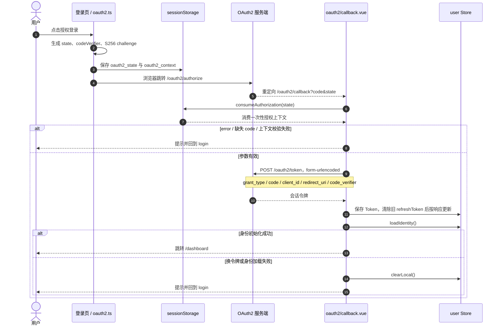

当前换令牌地址是 `/oauth2/token`，不要复制历史注释中的 `/api/v1/oauth2/callback`。请求未发送 clientSecret，浏览器采用 PKCE 公共客户端模式。上下文在校验前已消费，错误 state 也会使其失效；跨标签页和关闭标签页会丢失 sessionStorage 上下文。登录页社交入口目前统一使用标准授权 URL，不能据 provider 参数宣称已切换不同提供商 API。

### 6.2 办公平台登录与绑定审批流程

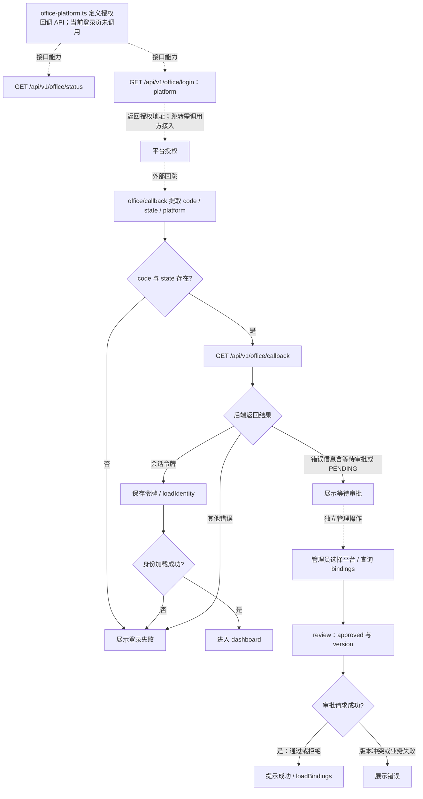

当前登录页社交入口统一走标准 OAuth2，未调用上述办公平台状态和登录 API；图中虚线表示接口能力或外部衔接。办公回调缺少 platform 时默认 FEISHU。前端依据错误 message 识别等待审批，绑定申请的生成由后端负责；没有前端轮询自动登录。办公回调当前 catch 展示错误或等待状态，并不像 OAuth2 回调一样统一执行 clearLocal，不要在图中补写不存在的回滚行为。

### 6.3 绑定审批时序与乐观锁

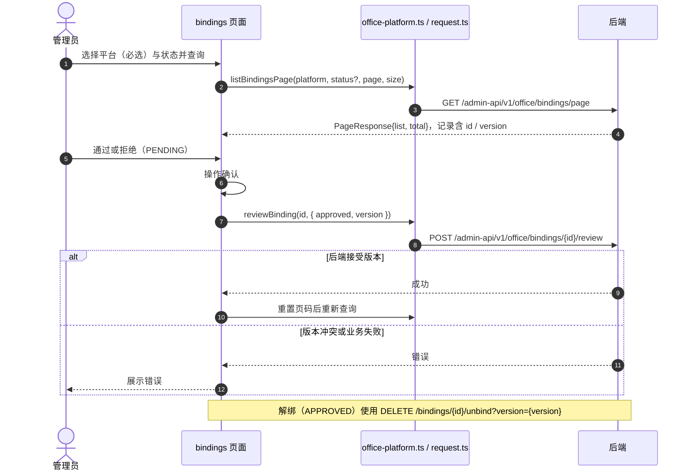

`office-platform.ts` 负责平台标识、授权回调、应用配置、绑定审批与组织同步；审批/日历/文档业务分别在 `office-approval.ts`、`office-calendar.ts`、`office-document.ts`。绑定审批页（`views/office/bindings/index.vue`）已使用 `listBindingsPage`（`GET /admin-api/v1/office/bindings/page`），具备真实 `total` 与 `status`（PENDING/APPROVED/REJECTED/REVOKED）服务端过滤，platform 为必选条件。`views/office/console/index.vue` 仍使用数组口径的 `listBindings`（`GET /admin-api/v1/office/bindings`，返回数组，调用时固定 `page=1,size=100`）。审批与解绑均携带 `version` 乐观锁，冲突由后端拒绝。

## 7. 常规业务、工作流与上传

### 7.1 CRUD 页面处理流程

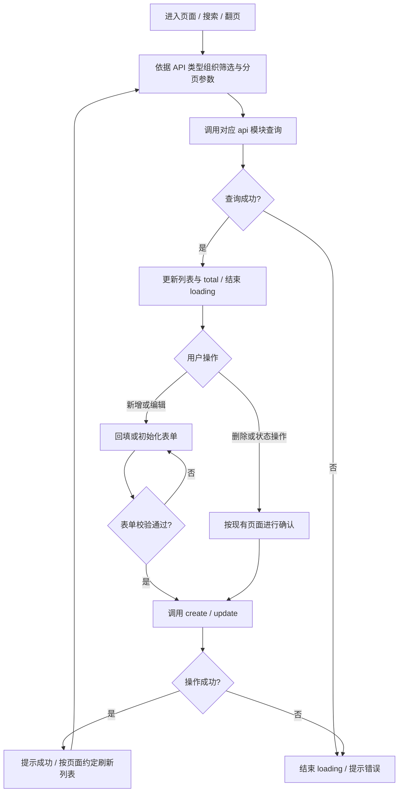

这是新增页面应核对的处理模式，不代表全部页面都通过同一个 composable 执行。`useCrud` 已实现但当前未发现实际页面调用；其适配器要求 `list/create/update/delete`，默认 `page=1,size=20`，返回 `list/total`。批量删除是并发单条请求，不具备事务回滚；工作流使用它时须显式转换分页和 ID 类型。

表单校验优先查看 `utils/validate.ts` 与 `utils/validate-rules.ts` 及相邻页面；以接口定义确定必填、长度、枚举和 null 语义，不能靠 TypeScript 类型替代运行时表单校验。

### 7.2 工作流实例操作时序

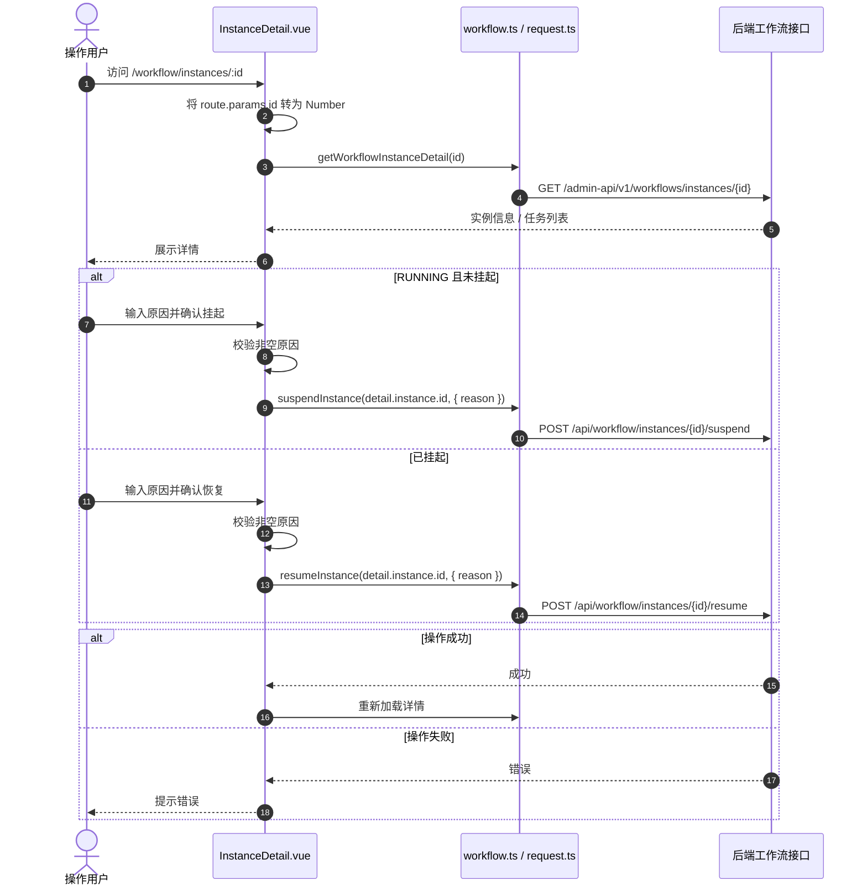

工作流实例列表使用 `pageNum/pageSize`，返回 `records/total`；待办任务同样使用 `pageNum/pageSize`，但响应为 `PageResponse`，页面读 `list/total`；普通 `Pagination` 组件的绑定参数不等于接口查询字段，需要页面适配。实例、统计使用 `/admin-api/v1/workflows/**`；待办任务查询与办理（complete，仅携带 `comment`，固定为通过语义）使用 `/api/v1/workflows/tasks/**`；回退、转办、委派、挂起和恢复使用 `/api/workflow/**`。流程定义管理已由 `/api/v2/workflow-definitions` 提供（写接口返回领域对象、查询接口返回 DTO，字段名不可混用）；当前前端未封装或未调用任务驳回与 `tasks/my` 接口，相关后端能力需以目标服务契约核验。待办任务在 `workflow/monitor` 页的「待办任务」Tab 中办理，回退、转办、委派均由该页直接调用对应 API（不经过 TaskActions 组件），回退目标节点取自实例详情的流程定义节点。

流程发起能力在 `workflow/monitor` 页的「发起流程」对话框：`startWorkflowInstance(workflowCode, { businessKey, contextJson? })` → `POST /api/v1/workflows/{workflowCode}/instances`。`businessKey` 必填（≤200 字符），`contextJson` 选填且必须是合法 JSON（≤10000 字符，前端校验），发起人取当前登录用户；流程定义可由 `/api/v2/workflow-definitions` 查询，但发起对话框仍由调用方手输 `workflowCode`。发起成功后重挂载实例列表 Tab 并切换到实例页签。

### 7.3 TaskActions 能力边界

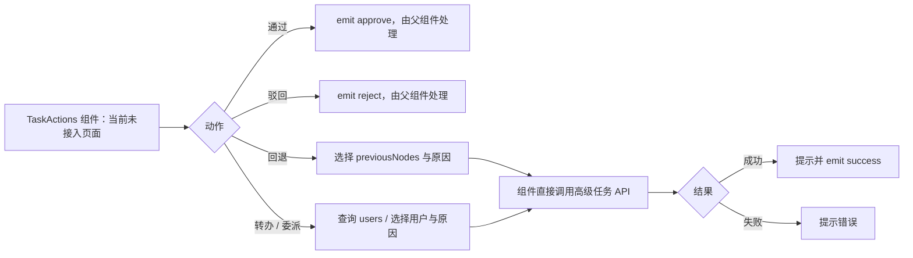

不能把该组件描述成已接入的审批闭环，也不能把实例挂起/恢复归入它。后续接入须明确通过/驳回事件的父级处理、权限判断、节点来源和操作后刷新。`previousNodes` 当前只在初始化复制，后续 prop 更新不会自动同步本地列表。

### 7.4 文件上传与响应处理流程

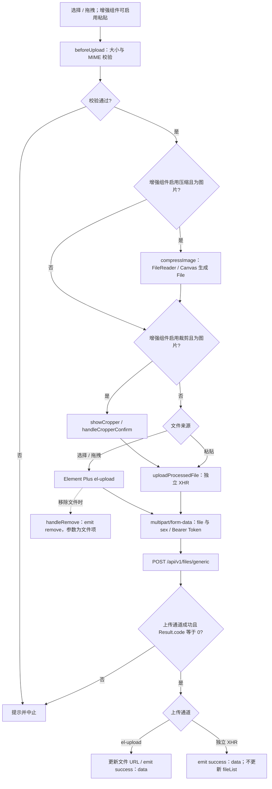

上传组件使用 Element Plus 传输，增强组件的裁剪/粘贴使用独立 XHR，均不能假定具备 Axios 的 401 自动刷新、统一错误转换或响应头 Token 更新。新增常规文件 API 仍应复用 `api/file.ts` 和请求封装。

默认 accept 为 JPEG/PNG/GIF/WebP，大小取 `MAX_UPLOAD_SIZE`（当前 10MB）；后端限制仍需单独核对。压缩按横竖方向选择宽度或高度上限进行等比缩小，不放大小图；当前算法不保证同时满足两个维度上限。remove 事件不等于后端删除。不要宣称默认支持视频预览或永久有效 URL。粘贴监听注册在 document 上，接入多个实例时需要考虑事件作用范围。

## 8. 编码与接口约定

- 遵循相邻模块的导入、命名、SFC 布局和错误处理方式。组件用 PascalCase，变量和函数用 camelCase，类型用 PascalCase，公共常量按现有 settings 风格命名。
- 新增 API 时先核对 HTTP 方法、路径、查询参数、请求 DTO 和响应 DTO，再定义返回类型。对象字段是否可选以实际契约为准。
- 不无依据使用 `any`、双重断言或忽略类型错误；已有历史 any 不代表新增代码可以复制。
- 查询、提交与删除分别管理 loading，异常分支须结束加载；取消确认不应显示成接口失败。
- 数字 ID 与字符串 ID 必须显式转换；日期、枚举和分页字段不可按 UI 文案推断。
- Tree 菜单、部门与普通列表不同；复制页面时核对递归 children 和节点字段。
- 错误提示优先使用现有 `showError` 或模块既有处理，保留 traceId 排查能力，避免重复弹窗。
- 图表随容器与主题变化调整，并在卸载时释放实例/监听；优先查看已有 ECharts 页面和主题工具。
- 对缓存、脱敏、XSS 工具和性能监控的描述须能找到调用点；不宣称已全局启用。
- Mock 只在 `import.meta.env.DEV` 时动态加载，不应作为生产业务数据来源。
- 不在未授权范围内修改后端契约、修复其他模块、升级依赖或扩大部署变更。

## 9. 环境、检查命令与验证边界

| 命令 | 用途 |
| --- | --- |
| `npm install` | 安装依赖，运行环境须满足依赖要求 |
| `npm run dev` | Vite 开发服务 |
| `npx vue-tsc --noEmit` | 单独类型检查 |
| `npm run build` | 类型检查与生产构建，输出 dist |
| `npx vitest run` | 单次测试 |
| `npm run test` | Vitest 默认交互/监听入口 |
| `npm run test:coverage` | 覆盖率检查（`@vitest/coverage-v8` 已安装，输出 `coverage/`） |
| `npm run test:report` | 单次运行并输出 JUnit XML + JSON + HTML/lcov 到 `reports/`（机器可读结果入库，HTML/lcov 不入库） |
| `npm run test:ui` | Vitest 浏览器 UI 交互界面 |
| `npm run check:comments` | 注释规范检查（`scripts/quality/check-comments.mjs`，仅检查注释存在性，查不出注释与实现的一致性） |
| `npm run generate:api` | openapi-generator-cli 生成 API 客户端（依赖 OpenAPI 描述源配置，当前非主链路） |
| `npm run audit` / `npm run audit:fix` | npm 依赖安全审计与自动修复 |
| `npm run preview` | 本地预览构建产物 |
| `npm run analyze` | 构建并打开产物分析报告 |

当前 package.json 没有 lint 或独立 typecheck 脚本；类型检查使用上述 vue-tsc 或 build 命令。不得记录不存在的 `npm run lint`。Vitest 使用 happy-dom 和 `src/test/setup.ts`，覆盖率配置没有阈值；Playwright 已安装但尚无配置及 E2E 用例，不应宣称已有浏览器端自动化覆盖。

截至 2026-11-05，共 22 个测试文件、185 个用例（`npx vitest run` 全绿），详见 [测试报告](docs/archived/project-reports/test-report-2026-11-05.md)。请求刷新测试覆盖认证端点排除、单次重放、并发单飞及重放错误保留；另有 OAuth2 PKCE/state、认证配置 API、脱敏/XSS/存储工具、`v-permission` 指令、`useCrud`/`useTableConfig`、user/app/permission Store、动态路由菜单转换和 `Pagination` 组件测试。API 层还有 `api/auth.test.ts`、`api/message.test.ts`、`api/workflow.test.ts`、`api/office-platform.test.ts`、`api/platform.test.ts`、`api/generator.test.ts`，断言函数以正确的 HTTP 方法/路径调用请求层并透传关键参数（如乐观锁 `version`、绑定分页 platform/status）。

覆盖率存在两个口径：默认配置不设 `coverage.include`，只统计被用例加载的模块（2026-11-05 行覆盖 73.12%）；强制 `--coverage.include='src/**/*.{ts,vue}'` 的全量口径行覆盖为 6.04%，因 62 个页面组件与多数 API/工具模块无用例。引用覆盖率须注明口径，不得以默认口径宣称整体覆盖水平。DOM 模拟测试不能替代真实浏览器的 OAuth 跳转、剪贴板、Canvas、上传和 Nginx 反代验证。

`VITE_API_PROXY_TARGET` 用于开发代理；`VITE_API_BASE_URL` 用于 Axios baseURL；OAuth2 客户端相关变量参照 `.env.example` 和 `env.d.ts`。不输出真实环境文件中的密钥，不把构建期与运行期配置混为一谈。

## 10. 变更检查清单与排障

- [ ] 核对相关页面、API、DTO、配置和测试，修改范围符合用户要求。
- [ ] 动态页面已登记 VIEW_REGISTRY，后端 component 与键完全一致。
- [ ] API 经过统一封装或明确使用现有上传特例，分页字段与响应结构正确。
- [ ] 会话通过 auth 工具管理，没有新增不一致的存储键。
- [ ] 权限码来源和后端鉴权已核对，不把 visible/hidden 当成安全限制。
- [ ] 表单、loading、取消确认、失败提示、操作后刷新符合模块行为。
- [ ] 运行相关测试与类型检查；有构建变更时验证 build。
- [ ] 文档中的 Mermaid、链接、接口和接入状态与实际修改一致。
- [ ] 无密钥、产物或无关文件进入变更；仅用户明确要求时提交。

| 现象 | 优先核对 |
| --- | --- |
| 菜单页面 404 | 后端 component、VIEW_REGISTRY、有效 children、动态注册是否成功 |
| 侧边栏没有菜单但 URL 可访问 | visible=0 / meta.hidden，不是路由缺失 |
| 按钮权限未收敛 | 权限请求是否失败降级为空、当前 Store 是否为空、指令是否已移除节点 |
| 401 后仍未恢复 | refreshToken、认证端点排除、authRetried、刷新结果是否含 accessToken |
| 上传 401 与其他请求行为不同 | Element Plus/XHR 没有经过 request.ts 拦截器 |
| 工作流分页为空 | 是否误用 page/size 或 list/total |
| 工作流待办为空或 404 | 是否使用 `/api/v1/workflows/tasks/pending`、办理仅 complete+comment、任务是否分配给当前用户 |
| 站内信收件箱为空或分页异常 | inbox/sent 返回纯数组（total 取数组长度）、接收人须为绑定办公员工的系统用户 ID、网关 office-message 路由 |
| 站内信无实时推送 | nginx/vite 是否支持 WS 升级、office-service `office.messages.allowed-origins` 是否含当前 Origin、`ROUTE_OFFICE_WS_URI` 是否与 HTTP 路由同实例 |
| 脱敏页 404 | 核对后端菜单 `component` 是否为 `system/masking/index`、`VIEW_REGISTRY` 是否登记，并在目标环境核验 `/api/v1/masking/**` 路由 |
| 租户页空列表或 400 | 分页参数必须是 pageNum/pageSize（非 page/size）且必填；生命周期动作只接受小写 disable/enable/freeze/unfreeze/deactivate/archive |
| 租户配额无法清空为不限 | 后端以 null 表示不限，前端须提交 null 而非 0 或省略 |
| MFA/IP 页无数据 | `/api/mfa/configs` 与 `/api/ip-access-control/whitelist|blacklist` 返回**裸数组**（无 Result 包装）；IP 写操作参数走 query string |
| 运维健康页 404 | 核对页面实际调用的 health-report、snapshots、trend 等子路径、菜单注册和目标环境路由；不能仅凭前端未封装根路径判断后端不存在 |
| 工作流定义编辑无数据 | 写接口返回领域对象（workflowCode/workflowName/dagJson/enabled:number），查询接口返回 DTO（code/name/enabled:boolean），字段名不可混用 |
| 办公审批列表空白或审批 400 | 列表元素字段为 processName/currentNode/createdAt（非 title/currentNodeName/createTime）；路径参数用 processInstanceId（非 approvalId）；approverId 必填且不能是空串（后端 @NotBlank） |
| 文件分享列表为空 | 需先输入文件 ID 查询（`GET /api/v2/files/{fileId}/shares`，仅所有者可见）；明文 token 仅创建响应返回一次，不存储 |
| 会议室列表设备为空 | 列表返回 Entity，equipment 可能是 JSON 字符串（详情接口才是数组），需前端解析 |
| 密码找回不可用 | 依赖 `/auth/v2/password-recovery/**` 与已绑定的邮箱/手机号；`sessionRevocation=PENDING` 表示会话撤销未完成，不代表失败 |
| 组织部门保存后无 ID 或层级为空 | createDepartment 返回体不含生成 id（须刷新列表）、deptLevel/deptPath 后端照抄不计算（前端推导） |
| 组织同步页无数据 | `/admin-api/v1/org/**` 与 `/api/v1/office/organization/**` 契约、同步任务为 page/size 且返回数组 |
| 办公绑定分页/筛选不符合预期 | 审批页走 `/bindings/page`（真实 total + status 过滤，platform 必选）；console 页为数组口径 `listBindings`（固定 page=1,size=100）；version 乐观锁冲突 |
| 办公文档列表为空或创建失败 | 文档列表数据源为 `GET /api/office/documents/my?ownerId=`（裸数组，平台/类型/关键词筛选与分页在前端完成）；创建须携带 ownerId/ownerName 且 platform 为小写（feishu/dingtalk/wecom），documentType 仅 DOC/SHEET/SLIDE/MINDMAP/FOLDER/FILE；后端无文档更新与分享端点，复制/移动的 targetFolderId 走 query 参数 |
| SSO 页面操作 403/404 | 提供商与页面的启用切换走整体 `PUT /providers/{id}`（后端全量覆盖，须携带完整字段）；会话撤销为 `POST /sessions/{id}/revoke`（按数字主键，批量前端并发）；会话/审计列表均为裸数组；统计走 `GET /sessions/statistics`；页面权限码为 `system:sso:provider:*`、`system:sso:session:*`、`system:sso:auditlog:*` |
| OAuth2 回调失败 | sessionStorage 上下文、state 一次性消费、redirect_uri、PKCE、token 代理 |
| 授权同意提交 401 | consent 页为 public 匿名页，但同意提交须登录主体（后端要求认证）；未登录时页面先跳登录并携带本页地址回跳 |
| 授权重试不生效 | 重试 authorize 要求 redirect_uri 与 PKCE（code_challenge/code_challenge_method=S256）齐全，缺失时页面提示从客户端重新发起 |
| 登录后直接报缺 accessToken | 登录响应 `mfaRequired=true` 时后端不签发令牌，须走 `POST /auth/v1/mfa/verify` 二步；store 的 `login()` 已按此分流 |
| 套餐保存后菜单少一层 | `menuIds` 须含父链；后端 `TenantPackageEntity.withParentChain` 与前端提交前补链都需生效，空集合 = 全量 |
| 套餐/能力/集成页 404 | 网关已显式覆盖 `/api/v2/tenant-packages|capabilities|capability-usage|overview` 与 `/integration/v1/**`（dev/prod/Nacos 三处 + `GatewayRouteProfileConfigTest` 契约）；仍 404 时核验目标环境是否滚动到新配置 |
| 数据总览无数据 | 页面消费 `GET /api/v2/overview`（权限 `system:monitor:view`）；单源降级为 DEGRADED 属正常（网关内部端点 `/internal/v1/overview` 本就 403，勿改调） |
| IoT 规则页 404 | 后端已补 `GET /integration/v1/iot/rules`（分页）与 `iot:rule:read` 权限码（V85/V86 种子）；存量环境需执行迁移 |
| IoT 设备影子不可用 | 设备注册时才会创建影子行；未上报过的设备影子字段为空属正常。desired 写接口后端未实现（API 文档 §10） |
| Docker 首页正常但接口失败 | API_PROXY_PASS、外部网络、后端 DNS、代理 location |
| 集成中心/IoT/在线会话/密码找回页 404 或接口返回 HTML | vite 与 nginx 须反代 `/integration/v1`、`/auth/v1|v2`（前缀带 API 版本，避免撞菜单目录 SPA 路由 `/integration`）；`/oauth2/consent` 仅 POST 反代、GET 回退 SPA |
| 站内信模板编辑/删除 404 | 网关 office-domain 路由须含 `/admin-api/v1/message-templates/**`（仅精确路径时 `{id}` 子路径落入 system 兜底 404），需后端随版本滚动 |
| 通知 SSE 30s 被掐断或不推送 | 请求须带 `Accept: text/event-stream`（后端豁免全局响应超时的开关）；网关须有 breaker-free 的 `notification-stream` 路由 + metadata `response-timeout`；后端 Sinks autoCancel=false 与 NettyConfig 读超时边界（请求读完成即解除）须在位 |
| Element Plus 组件无样式或函数式提示英文 | 模板组件经 unplugin-vue-components 深路径解析器按需引入（勿改回 `element-plus/es` 桶文件）；ElMessage/ElMessageBox 等函数式组件样式在 main.ts 全局补齐，语言包经应用级 provideGlobalConfig + `_context` 回填 |

## 11. 参考资料与维护方式

- [项目说明](README.md)
- [架构概览](docs/architecture/overview.md)
- [认证与路由](docs/architecture/auth-and-routing.md)
- [接口文档索引](docs/api/README.md)
- [部署指南](docs/guides/deployment.md)
- [测试说明](docs/reference/testing.md)
- [工具说明](docs/reference/toolkit.md)
- [注释规范](docs/reference/comment-style.md)

图示集中在本文件，其他资料用于扩展阅读。引用资料可能保留历史描述，例如 OAuth2 Token 地址和上传能力状态；遇到冲突需回到源码核对。注册表、端点和 DTO 的完整清单以 `router/dynamic.ts`、`api/*.ts`、`types/*.ts` 为准，不在本文件复制第二份易失同步的代码列表。

修改认证、路由、分页、传输或部署边界后，应同步本文件对应文字与图中的条件、参与者和失败分支；未接入能力完成接入时更新状态，不通过删去限制说明假装功能已完成。
