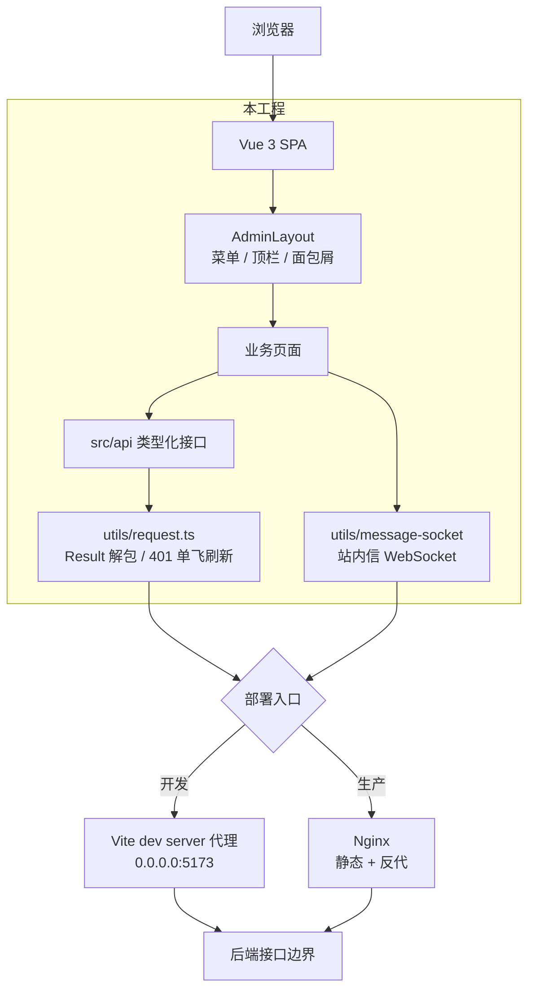
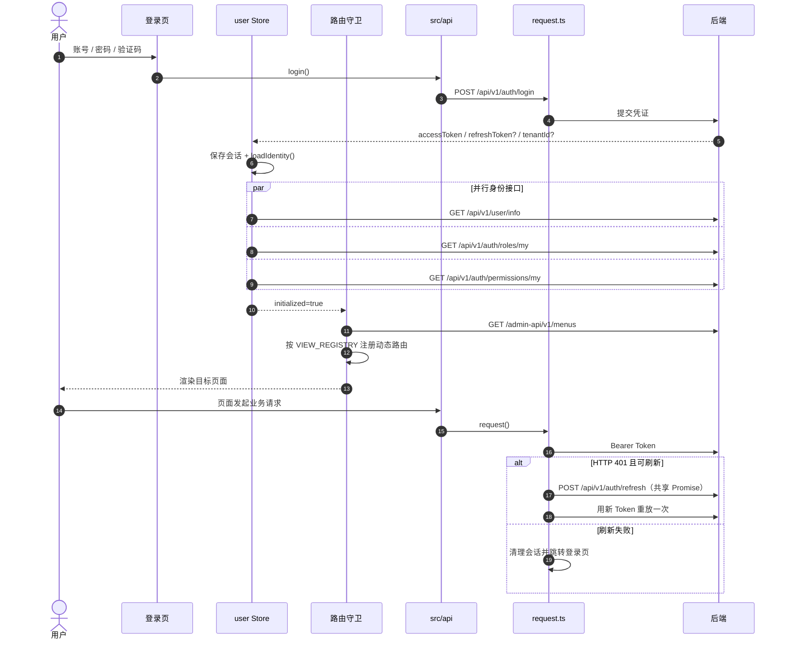
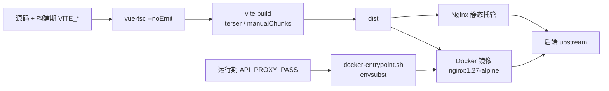

# Apex Admin Web

Apex Scaffold 管理后台前端（**前后端分离独立工程**）。

基于 **Vue 3.5 + Vite 6 + TypeScript + Pinia + Element Plus + ECharts**，与后端
[Apex Scaffold](https://github.com/your-org/apex-scaffold)（Spring Boot 3 WebFlux 函数式端点）通过
`/api/v1`、`/api/v2`（业务）、`/admin-api/v1`（管理后台）、`/api/workflow`（工作流高级操作）与
`/oauth2/*`（授权码登录）对接。

## 功能清单

| 模块 | 页面 | 后端接口前缀 |
|------|------|-------------|
| 认证 | 登录（账号密码 + 图形验证码，可选租户标识）、登出、标准 OAuth2（PKCE）、办公平台回调 | `/api/v1/auth`、`/oauth2/*` |
| 工作台 | 仪表盘（指标卡片 + 趋势图） | 身份派生 / 监控大盘接口 |
| 系统管理 | 用户 / 角色 / 菜单（树）/ 部门（树）/ 字典（两级）/ 参数 / 定时任务 | `/admin-api/v1/*` |
| 系统管理 | 租户台账（分页/生命周期/配额）、MFA 与 IP 访问控制、数据脱敏、认证管理与 SSO | `/api/v2/platform/tenants`、`/api/mfa`、`/api/ip-access-control`、`/api/v1/masking` |
| 监控 | 登录日志 / 操作审计日志 / API 调用日志 / 在线用户（强退）/ 运维健康 | `/admin-api/v1/*`、`/api/v2/operations/*` |
| 数据管理 | 文档 / 图表 CRUD 与数据查询 | `/admin-api/v1/*` |
| 办公平台 | 站内信（含 WebSocket 实时推送）、消息模板、平台绑定审批、组织同步、会议室 | `/api/v1/messages`、`/admin-api/v1/office/*`、`/api/v2/*` |
| 工作流 | 实例监控与详情、待办任务办理、流程定义管理、发起流程 | `/admin-api/v1/workflows/*`、`/api/v1/workflows/*`、`/api/v2/workflow-definitions`、`/api/workflow/*` |
| 代码生成器 | 数据源、表扫描、生成配置与生成 | `/admin-api/v1/*` |
| 个人中心 | 当前用户信息、我的角色与权限明细 | `/api/v1/user/info`、`/api/v1/auth/*/my` |

完整接口清单见 [`docs/api/README.md`](docs/api/README.md)。

核心机制：

- **动态路由**：登录后拉取后端菜单树（`/admin-api/v1/menus`），按 `component` 字段映射到视图并注册路由，侧边栏同步渲染。未在 `VIEW_REGISTRY` 登记的组件不会被注册。
- **按钮权限**：`v-permission="'system:user:create'"` 指令，基于用户权限码集合控制元素显隐；逗号分隔多码任一满足，**权限列表为空时放行**，不能替代后端鉴权。
- **请求封装**：统一解包 `Result{code,msg,data,traceId}`；HTTP 401 触发共享刷新 Promise（`refreshToken` 单飞刷新）并单次重放，刷新失败才清理会话并跳转登录页；业务错误提示携带 traceId。
- **站内信**：WebSocket `/api/v1/messages/ws` 推送 + 60s 轮询兜底，见部署指南 §6.3 的后端前置条件。
- **主题**：浅色/深色一键切换（localStorage 持久化）。

## 快速开始

```bash
# 1. 安装依赖（Node ≥ 18）
npm install

# 2. 配置环境变量（首次运行必须）
cp .env.example .env.development

# 3. 启动开发服务器（默认 http://localhost:5173，代理 /oauth2、/api、/admin-api 到后端 8080）
npm run dev

# 4. 生产构建（输出 dist/）
npm run build
```

> 开发代理目标可在 `.env.development` 中通过 `VITE_API_PROXY_TARGET` 调整；
> 生产网关地址在 `.env.production` 的 `VITE_API_BASE_URL` 配置（同域部署留空即可）。

## 环境变量配置

### 配置文件说明

本项目使用环境变量文件管理不同环境的配置，**所有 `.env.*` 文件（除 `.env.example`）都不会被提交到 Git 仓库**。

| 文件 | 用途 | 是否提交到 Git |
|------|------|---------------|
| `.env.example` | 配置模板，包含所有可用的环境变量说明 | ✅ 是 |
| `.env.development` | 开发环境配置（本地开发使用） | ❌ 否 |
| `.env.production` | 生产环境配置（部署时使用） | ❌ 否 |

### 首次配置步骤

1. **复制配置模板**：
   ```bash
   cp .env.example .env.development
   ```

2. **编辑 `.env.development`**，根据实际情况修改：
   ```env
   # 后端服务地址（开发环境）
   VITE_API_PROXY_TARGET=http://127.0.0.1:8080
   
   # OAuth2 客户端 ID（需与后端配置一致）
   VITE_OAUTH2_CLIENT_ID=apex-admin-web-dev
   ```

3. **生产环境配置**（部署前）：
   ```bash
   cp .env.example .env.production
   ```
   
   编辑 `.env.production`：
   ```env
   # 生产环境后端网关地址（同域部署可留空）
   VITE_API_BASE_URL=
   
   # OAuth2 客户端 ID（生产环境）
   VITE_OAUTH2_CLIENT_ID=apex-admin-web-prod
   ```

### 可用环境变量

| 变量名 | 说明 | 默认值 | 必填 |
|--------|------|--------|------|
| `VITE_API_PROXY_TARGET` | 开发环境后端代理目标地址（代理 `/api`、`/admin-api`、`/oauth2`，`/api` 已开启 WS） | `http://127.0.0.1:8080` | 可选（缺省 127.0.0.1:8080） |
| `VITE_API_BASE_URL` | 生产环境后端网关地址，同域部署留空 | `''` | 生产环境可选 |
| `VITE_OAUTH2_CLIENT_ID` | OAuth2 客户端 ID，须与后端注册值一致（浏览器端 PKCE，不含 clientSecret） | `apex-admin-web` | 可选 |
| `VITE_AUTH_TENANT_ENABLED` | 是否在登录页显示租户标识输入（多租户部署设为 `true`） | 空（关闭） | 可选 |

### 注意事项

⚠️ **安全提醒**：
- 不要将包含敏感信息的 `.env.development` 或 `.env.production` 文件提交到 Git 仓库
- 团队成员需要从后端团队获取正确的 OAuth2 客户端 ID
- 生产环境的配置应该通过 CI/CD 流程或环境变量注入，不要硬编码在代码中

💡 **团队协作**：
- 新成员加入时，参考 `.env.example` 创建自己的 `.env.development`
- 如果添加了新的环境变量，务必同步更新 `.env.example` 文件
- 配置变更应在团队内及时沟通

## 目录结构

```
apex-admin-web/
├── src/
│   ├── api/            # 接口层（按业务域拆分，见 docs/api/README.md 全量清单）
│   ├── types/          # 与后端 DTO 对齐的类型定义
│   ├── utils/          # 请求封装(含401无感刷新) / 会话存取 / 校验 / 脱敏 / XSS防护等
│   ├── stores/         # Pinia：用户会话 / 权限 / 应用 UI 状态 / 办公平台
│   ├── composables/    # 组合式函数（useCrud/useTableConfig/useFormDraft/useBreakpoint）
│   ├── router/         # 静态路由 + 菜单驱动动态路由
│   ├── directives/     # v-permission 按钮权限指令
│   ├── layouts/        # 管理后台主布局（侧边栏/顶栏/面包屑）
│   ├── components/     # 通用组件（Pagination/FileUpload/GlobalSearch 等）
│   ├── mock/           # Mock 数据服务（仅开发环境加载）
│   ├── test/           # 测试全局准备（setup.ts）
│   └── views/          # 页面（登录/工作台/系统管理/监控/数据/办公/工作流/个人中心）
├── docker/             # Nginx 模板与入口脚本（生产反代 /assets、/oauth2、/api、/admin-api，含站内信 WS）
├── scripts/            # 构建（build/）/ 数据库（database/ 与 database/archive/）/ 性能 / 质量（quality/）/ 安全（security/）
├── docs/               # 文档中心（架构/API/指南/功能/参考，见 docs/README.md）
├── vite.config.ts      # 构建与开发代理配置
├── vitest.config.ts    # 单元测试配置
├── tsconfig.json       # TypeScript 配置
└── package.json
```

## 与后端联调约定

1. **接口契约**：字段命名遵循后端 DTO camelCase；统一响应结构见 `src/types/index.ts`。
2. **鉴权**：登录接口返回 `accessToken`，后续请求自动携带 `Authorization: Bearer <token>`；HTTP 401 时请求层用 `refreshToken` 单飞刷新并重放一次。
3. **验证码**：登录前先调 `GET /api/v1/auth/captcha` 获取 `captchaId` + `image(base64)`，提交时回传。
4. **错误排查**：接口失败提示中携带 `traceId`，与后端日志（TraceId 贯穿）联动定位。
5. **菜单驱动路由**：后端新增菜单时，需在 `src/router/dynamic.ts` 的 `VIEW_REGISTRY` 注册对应 `component` 名。
6. **分页口径**：普通列表 `page/size` + `list/total`；工作流实例 `pageNum/pageSize` + `records/total`；工作流待办 `pageNum/pageSize` 但响应为 `PageResponse`（读 `list/total`）；租户 `/api/v2/platform/tenants` 必填 `pageNum/pageSize`。以 `src/api/*.ts` 类型为准，不可全局替换。
7. **多租户**：租户作用域由后端从令牌解析；前端仅在登录响应返回 `tenantId` 时记录并附带 `X-Tenant-Id`，详见 [`docs/guides/auth-tenant-adaptation.md`](docs/guides/auth-tenant-adaptation.md)。

## 架构概览



请求处理主链路（登录 → 动态路由 → 业务请求）：



### 构建与部署流程



> 更多图示（路由守卫、菜单转换、401 单飞刷新、OAuth2 PKCE、工作流时序、上传流程）见 [`AGENTS.md`](AGENTS.md)。

## 部署方式

> 本仓库是独立前端工程，生产构建产物为 `dist/`，应访问实际配置的前端源站。后端是否仍托管 `static/admin/`、是否提供 `/admin` 短入口重定向，需以后端工程和目标环境核验。完整构建与部署说明见 **[`docs/guides/deployment.md`](docs/guides/deployment.md)**。

- **独立部署（推荐生产）**：`npm run build` 后将 `dist/` 交给 Nginx/静态服务器，反向代理 `/oauth2`、`/api`、`/admin-api` 到后端，并为 `/api/v1/messages/ws` 单独配置 WebSocket 转发（详见 [`docs/guides/deployment.md`](docs/guides/deployment.md) §6）。
- **Docker 容器部署**：`docker compose up -d --build`（配置使用外部网络 `apex-scaffold_apex-network`，`API_PROXY_PASS` 默认 `http://apex-scaffold:8080`；网络是否已创建、`apex-scaffold` 服务名是否可解析，需在目标 Docker 环境核验），详见 deployment.md §7。
- **与后端网关同域**：前端走相对路径（`VITE_API_BASE_URL` 留空），由 Nginx 按 `/oauth2/`、`/api/`、`/admin-api/` 前缀分流到后端（详见 deployment.md §8）。

## 代码注释

除用户明确要求外，不新增代码注释。复杂逻辑确有必要时可添加简短说明；不为未修改代码补充文件头或 JSDoc，也不以注释要求驱动无关重构。
