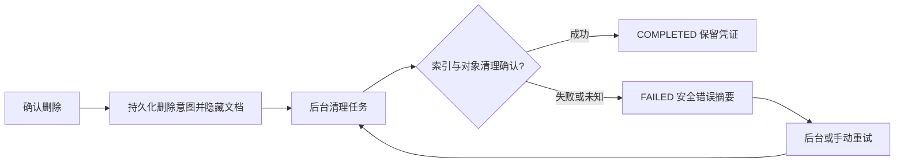

# API 接口目录

> 本文依据当前前端源码、类型定义、页面调用和代理配置核对（2026-11-11）。它记录前端已封装的接口及已确认的页面接入状态；后端实现、生产网关和第三方服务行为仍需在对应环境中外部核验。新增/修改接口后必须同步更新本文，否则视为文档缺陷。

## 1. 通用约定

### 1.1 统一响应与解包

请求层会识别含数字 `code` 的响应，并由 [src/utils/request.ts](../../src/utils/request.ts) 统一解包；不含该字段的响应按原始数据处理：

- `code === 0`：返回 `data`；
- `code !== 0`：抛出 `ApiError(message, code, traceId)`；
- 不含数字 `code` 的响应（如裸数组、文件流）原样返回；
- 超时 30s；`baseURL` 取 `VITE_API_BASE_URL`（生产同域部署留空）。

### 1.2 接口前缀对照

| 前缀 | 用途 | 代理（开发/生产） |
|------|------|-------------------|
| `/api/v1/**` | 业务接口：认证、当前用户、文件、办公平台接入、站内信、通知中心、工作流任务等 | Vite proxy `/api`、Nginx `/api/` |
| `/api/v2/**` | 第二代接口：租户管理、租户套餐、能力目录/用量、数据总览、工作流定义、运维健康、文件分享、办公会议室/同步向导/统一通知 | 同 `/api` |
| `/admin-api/v1/**` | 管理后台接口：系统管理、监控、日志、SSO、生成器、认证配置、消息模板、组织同步等 | Vite proxy `/admin-api`、Nginx `/admin-api/` |
| `/integration/v1/**` | 集成中心连接器/凭据与物联网设备/规则（`/internal/v1/**` 为集群内部端点，网关强制拒绝外部访问） | Vite proxy `/integration/v1`、Nginx `/integration/v1/` |
| `/auth/v1/**` | 认证中心：统一登录、令牌刷新、MFA 登录二步验证与在线会话管理 | Vite proxy `/auth/v1`、Nginx `/auth/v1/` |
| `/auth/v2/**` | 认证中心密码找回（`/auth/v2/password-recovery/**`） | Vite proxy `/auth/v2`、Nginx `/auth/v2/` |
| `/api/workflow/**` | 工作流高级操作（回退/转办/委派/挂起/恢复） | 同 `/api` |
| `/api/office/**` | 前端办公平台业务 API 使用的路径前缀（消息/审批/日历/文档）；仓库内仅能确认相关调用和开发代理配置 | 同 `/api` |
| `/api/mfa/**`、`/api/ip-access-control/**` | 认证中心的 MFA 与 IP 访问控制（参数走 query） | 同 `/api` |
| `/oauth2/authorize`、`/oauth2/token`、`/oauth2/consent` | OAuth2 标准端点与授权同意提交 | Vite/Nginx 代理 `authorize`、`token`（全方法）与 `consent`（仅 POST 反代，GET 回退 SPA 首页） |

### 1.3 分页口径（三套并存）

| 口径 | 请求 | 响应 | 使用范围 |
|------|------|------|---------|
| **常规分页** | 以具体 API 类型和页面调用为准，常见为 `page/size` | 以具体 API 类型为准，常见为 `list/total` | 系统、监控、数据等部分列表；不存在所有非工作流模块统一使用同一分页 DTO 的规则 |
| **工作流口径** | `{pageNum, pageSize}` | `{records, total}`（待办 `/api/v1/workflows/tasks/pending` 返回通用 PageResponse） | 响应 `records/total` 仅 [src/api/workflow.ts](../../src/api/workflow.ts) 实例列表；`pageNum/pageSize` 请求参数另见 database（数据源）、message（收件箱/已发送）、office-platform（组织部门/员工）、meeting-room（会议室）等模块 |
| **数组响应（无分页包装）** | 各接口自行携带分页参数 | 纯数组（total 以数组长度近似） | 站内信 inbox/sent（pageNum/pageSize）、组织同步任务（page/size）、办公绑定列表（page/size）、消息模板列表（无分页参数） |

### 1.4 认证

- 请求拦截自动注入 `Authorization: Bearer <accessToken>`；
- HTTP 401 且满足刷新条件（有请求 config、未标记 `authRetried`、会话持有 refreshToken）时自动触发**令牌无感刷新并重放一次**；`/api/v1/auth/login`、`/api/v1/auth/refresh`、`/auth/v1/login`、`/auth/v1/refresh`、`/oauth2/token` 不参与刷新（详见 [认证与路由架构](../architecture/auth-and-routing.md)）；统一登录的 401/403 透传后端原因，登录失败不自动清理会话；
- 响应头 `x-new-access-token` 自动更新本地令牌。

## 2. 接口清单（按业务域）

### 2.1 认证 [src/api/auth.ts](../../src/api/auth.ts)

| 方法 | 路径 | 函数 | 说明 |
|------|------|------|------|
| GET | `/api/v1/auth/captcha` | `getCaptcha()` | 图形验证码（captchaId + base64） |
| POST | `/auth/v1/login` | `login(payload)` | 统一认证中心密码登录，裸 LoginResponse；MFA 挑战不返回正式令牌，图形验证码、loginType 与 platform 为兼容透传字段 |
| POST | `/api/v1/auth/logout` | `logout()` | 登出 |
| POST | `/auth/v1/refresh` | `refreshToken(rt)` | 一次性刷新令牌轮换，裸 TokenPair；由 request.ts 401 单飞流程自动调用 |
| POST | `/auth/v1/mfa/verify` | `verifyMfaChallenge(challengeToken, code)` | MFA 二步验证：登录响应 `mfaRequired=true` 时不签发令牌，用 `challengeToken` + 动态码换取正式令牌（挑战一次性消费；store `login()` 已按此分流） |
| GET | `/api/v1/auth/roles/my` | `getMyRoles()` | 当前用户角色码 |
| GET | `/api/v1/auth/permissions/my` | `getMyPermissions()` | 当前用户权限码 |
| GET | `/api/v1/auth/roles` | `listSystemRoles()` | 系统角色列表（RoleDTO） |
| POST | `/api/v1/auth/roles` | `createSystemRole(payload)` | 创建角色（RoleRequest） |
| POST | `/api/v1/auth/roles/update` | `updateSystemRole(payload)` | 更新角色 |
| DELETE | `/api/v1/auth/roles/{id}` | `deleteSystemRole(id)` | 删除角色（409=存在关联数据） |
| GET | `/api/v1/auth/permissions` | `listSystemPermissions()` | 系统权限列表（PermissionDTO） |
| POST | `/api/v1/auth/permissions` | `createSystemPermission(payload)` | 创建权限（code 格式 模块:操作） |
| POST | `/api/v1/auth/permissions/update` | `updateSystemPermission(payload)` | 更新权限 |
| DELETE | `/api/v1/auth/permissions/{id}` | `deleteSystemPermission(id)` | 删除权限 |

### 2.2 当前用户与后台用户 [src/api/user.ts](../../src/api/user.ts)

| 方法 | 路径 | 函数 | 说明 |
|------|------|------|------|
| GET | `/api/v1/user/info` | `getCurrentUserInfo()` | 当前用户信息（UserIdentity） |
| GET | `/admin-api/v1/users` | `listUsers(query)` | 用户分页列表 |
| GET | `/admin-api/v1/users/{id}` | `getUserDetail(id)` | 用户详情（含 roles） |
| POST | `/admin-api/v1/users` | `createUser(payload)` | 创建用户 |
| PUT | `/admin-api/v1/users/{id}` | `updateUser(id, payload)` | 更新用户 |
| PUT | `/admin-api/v1/users/{id}/status` | `updateUserStatus(id, enabled)` | 启停用户 |
| POST | `/admin-api/v1/users/{id}/sessions/revoke` | `revokeUserSessions(id)` | 强退用户会话 |
| PUT | `/admin-api/v1/users/{id}/roles` | `assignUserRoles(id, roleIds)` | 分配角色（整体替换） |
| GET | `/admin-api/v1/staff-roles` | `listStaffRoles()` | 可分配角色列表 |
| GET | `/admin-api/v1/export/users` | `exportUsers()` | 导出用户 Excel（Blob，固定前 100 条） |

### 2.3 系统管理 [src/api/system.ts](../../src/api/system.ts)

**菜单**（`/admin-api/v1/menus`）：`listMenuTree`（GET 树）、`getMenuDetail`、`createMenu`、`updateMenu`、`deleteMenu`、`updateMenuStatus`。

**部门**（`/admin-api/v1/depts`）：`listDeptTree`、`createDept`、`updateDept`、`deleteDept`。

**字典**（`/admin-api/v1/dict/types`、`/dict/data`）：类型与数据的 CRUD + `updateDictTypeStatus`/`updateDictDataStatus`；数据列表按 `dictType` 查询。

**参数配置**（`/admin-api/v1/configs`）：`listConfigs`、`createConfig`、`updateConfig`、`deleteConfig`、`updateConfigStatus`。

**定时任务**（`/admin-api/v1/jobs`）：`listJobs`、`pageJobs`（GET `/jobs/page`，统一分页口径）、`createJob`、`updateJob`、`deleteJob`、`updateJobStatus`、`runJobOnce`、`listJobLogs(id, limit)`。

### 2.4 数据库配置 [src/api/database.ts](../../src/api/database.ts)

| 方法 | 路径 | 函数 | 说明 |
|------|------|------|------|
| POST | `/admin-api/v1/database/test` | `testDatabaseConnection(config)` | 连接测试 |
| POST | `/admin-api/v1/database/generate-config` | `generateDeploymentConfig(config)` | 生成部署配置（密码不落库，一次性采集） |
| GET | `/admin-api/v1/database/current` | `getCurrentDatabaseInfo()` | 当前数据库信息 |
| GET | `/admin-api/v1/database/datasources` | `listDataSources(pageNum, pageSize)` | 数据源分页列表（url/username 已脱敏） |
| POST | `/admin-api/v1/database/datasources` | `createDataSource(payload)` | 创建数据源（DataSourceRequest，密码必填） |
| PUT | `/admin-api/v1/database/datasources/{id}` | `updateDataSource(id, payload)` | 更新数据源；请求字段要求以 `DataSourceRequest` 和后端实际校验为准 |
| DELETE | `/admin-api/v1/database/datasources/{id}` | `deleteDataSource(id)` | 删除数据源 |
| GET | `/admin-api/v1/database/datasources/{id}/metrics` | `getDataSourceMetrics(id)` | 连接池指标 |

### 2.5 文件管理 [src/api/file.ts](../../src/api/file.ts)

| 方法 | 路径 | 函数 | 说明 |
|------|------|------|------|
| POST | `/api/v1/files/generic` | `uploadFile(file, sex)` | 通用上传（FormData；sex: 0=男/AM 1=女/AF） |
| DELETE | `/api/v1/file/delete` | `deleteFile(bucketName, fileName)` | 删除文件 |
| POST | `/api/v1/file/chunk/init` | `initChunkUpload(payload)` | 初始化分片会话 |
| POST | `/api/v1/file/chunk/upload?fileId=&chunkIndex=&chunkSize=[&md5=]` | `uploadChunk(params, chunk)` | 上传单个分片（⚠️ 请求体为原始字节流，参数走 query） |
| POST | `/api/v1/file/chunk/merge` | `mergeChunks({fileId, fileName?})` | 合并分片（请求体 `{fileId, fileName?}`） |
| GET | `/api/v1/file/chunk/status/{fileId}` | `getChunkStatus(fileId)` | 查询已上传分片（断点续传/秒传依据 uploaded 集合） |

> 上传结果字段是 `objectName`（不是 `fileName`）。删除函数实际传递 `bucketName` + `fileName`；`objectName` 与删除参数 `fileName` 的后端映射关系需在目标服务中外部确认。分片上传由 `FileUploadEnhanced` 组件 `enableChunk`（默认 false）在超过单发上限时启用；上传地址统一经 `utils/api-base.ts#apiUrl` 拼接，跨域部署自动携带 `VITE_API_BASE_URL`。

### 2.6 监控 [src/api/monitor.ts](../../src/api/monitor.ts)

| 方法 | 路径 | 函数 | 说明 |
|------|------|------|------|
| GET | `/admin-api/v1/login-logs` | `listLoginLogs(q)` | 登录日志分页 |
| GET | `/admin-api/v1/audit-logs` | `listAuditLogs(q)` | 审计日志分页 |
| GET | `/admin-api/v1/online-users` | `listOnlineUsers(q)` | 在线用户分页 |
| GET | `/admin-api/v1/monitor/overview` | `getMonitorOverview()` | 监控大盘总览 |
| GET | `/admin-api/v1/monitor/system` | `getMonitorSystem()` | 系统指标 |
| GET | `/admin-api/v1/monitor/middleware` | `getMonitorMiddleware()` | 中间件指标 |
| GET | `/admin-api/v1/monitor/governance` | `getMonitorGovernance()` | 治理指标 |
| GET | `/admin-api/v1/monitor/business` | `getMonitorBusiness()` | 业务指标 |
| GET | `/admin-api/v1/api-call-logs` | `listApiCallLogs(q)` | API 调用日志分页 |

### 2.7 日志查询 [src/api/log.ts](../../src/api/log.ts)

| 方法 | 路径 | 函数 | 说明 |
|------|------|------|------|
| GET | `/admin-api/v1/logs/runtime` | `queryRuntimeLogs(q)` | 运行时日志（无分页，返回数组） |
| GET | `/admin-api/v1/logs/runtime/count` | `countRuntimeLogs(q)` | 运行时日志计数 |
| GET | `/admin-api/v1/logs/business` | `queryBusinessLogs(q)` | 业务日志（统一分页口径） |
| GET | `/admin-api/v1/logs/business/count` | `countBusinessLogs(q)` | 业务日志计数 |

### 2.8 工作流 [src/api/workflow.ts](../../src/api/workflow.ts)（⚠️ 工作流分页口径）

**流程实例**：`listWorkflowInstances`（GET `/admin-api/v1/workflows/instances`）、`getWorkflowInstanceDetail`（GET `/admin-api/v1/workflows/instances/{id}`）。

**流程定义**（`/api/v2/workflow-definitions`）：`listWorkflowDefinitions`（GET，必填 `pageNum/pageSize`，返回 `PageResponse<WorkflowDefinitionInfo>`）、`getWorkflowDefinition(id)`（GET `/{id}`）、`createWorkflowDefinition(payload)`（POST）、`updateWorkflowDefinition(id, payload)`（PUT `/{id}`）、`validateWorkflowDefinition(id)`（POST `/{id}/validate`）、`publishWorkflowDefinition(id)`（POST `/{id}/publish`）、`toggleWorkflowDefinition(id, enabled)`（POST `/{id}/enable` 或 `/{id}/disable`）、`listWorkflowDefinitionVersions(id)`（GET `/{id}/versions`）。查询接口返回 DTO，写接口返回领域对象；两类字段不可混用。

**统计**：`getWorkflowStatistics`（GET `/admin-api/v1/workflows/statistics`）、`getWorkflowTrend(days)`（GET `/admin-api/v1/workflows/statistics/trend`）。

**待办任务**（前缀 `/api/v1/workflows/tasks`）：`getMyPendingTasks`（GET `/pending`，pageNum/pageSize→PageResponse）、`completeTask(taskId, comment)`（POST `/{taskId}/complete`，请求体仅 `comment`，后端固定为通过语义）。办理界面位于 `workflow/monitor` 页「待办任务」Tab。

**发起流程**：`startWorkflowInstance(workflowCode, { businessKey, contextJson? })`（POST `/api/v1/workflows/{workflowCode}/instances`，businessKey 必填 ≤200、contextJson 选填 JSON 字符串 ≤10000，发起人取当前登录用户）。入口位于 `workflow/monitor` 页顶部「发起流程」；虽然已有流程定义管理 API，但当前对话框仍由调用方手动输入 `workflowCode`，未接入定义列表选择。

**高级操作**（注意前缀是 `/api/workflow`，不是 `/admin-api/v1`）：

| 方法 | 路径 | 函数 |
|------|------|------|
| POST | `/api/workflow/tasks/{id}/rollback` | `rollbackTask` |
| POST | `/api/workflow/tasks/{id}/transfer` | `transferTask` |
| POST | `/api/workflow/tasks/{id}/delegate` | `delegateTask` |
| POST | `/api/workflow/instances/{id}/suspend` | `suspendInstance` |
| POST | `/api/workflow/instances/{id}/resume` | `resumeInstance` |

### 2.9 文档管理 [src/api/document.ts](../../src/api/document.ts)

`/admin-api/v1/documents`：`listDocuments`（GET 分页）、`getDocumentDetail`、`createDocument`、`updateDocument`、`deleteDocument`、`updateDocumentStatus`（PUT `/{id}/status`）、`downloadDocument`（GET `/{id}/download`，返回 Blob）。

### 2.10 图表管理 [src/api/chart.ts](../../src/api/chart.ts)

`/admin-api/v1/charts`：`listCharts`（GET 分页）、`getChartDetail`、`getChartData`（GET `/{id}/data`）、`createChart`、`updateChart`、`deleteChart`。后端若提供图表状态端点（如 `PUT /{id}/status`），前端当前未封装也未调用，可用性需以后端契约为准。

### 2.11 全文搜索 [src/api/search.ts](../../src/api/search.ts)

| 方法 | 路径 | 函数 | 说明 |
|------|------|------|------|
| GET | `/admin-api/v1/search` | `search(params)` | Meilisearch 检索（keyword + types + page + size），返回 PageResponse（list/total） |
| POST | `/admin-api/v1/search/rebuild` | `rebuildIndex(type?)` | 重建索引 |

### 2.12 OAuth2 [src/api/oauth2.ts](../../src/api/oauth2.ts)

| 方法 | 路径 | 函数 | 说明 |
|------|------|------|------|
| — | — | `buildAuthUrl(config)` | 前端构建授权 URL（S256 PKCE + 一次性 state） |
| POST | `/oauth2/token` | `exchangeToken(request)` | 表单编码换取令牌（PKCE 公共客户端，不发 clientSecret） |
| — | — | `consumeAuthorization(state)` | 一次性取出授权上下文（取出即失效） |
| — | — | `verifyState(state)` | state 校验 |
| POST | `/oauth2/consent` | `submitConsent(payload)` | 授权同意提交（form-urlencoded：client_id/scope/decision） |

当前页面接入：登录页各 provider 按钮均调用 `buildAuthUrl()`，统一走标准 OAuth2 授权码 + S256 PKCE；回调处理页面为 `/oauth2/callback`（静态路由，public）。授权同意页 `/oauth2/consent`（public 匿名页）调用 `submitConsent()`，同意提交须登录主体（后端要求认证），未登录先登录后回跳；代理仅对 `/oauth2/consent` 的 POST 反向代理，GET 回退 SPA。

### 2.13 认证配置管理 [src/api/auth-config.ts](../../src/api/auth-config.ts)（前缀 `/admin-api/v1/auth/config`）

| 子域 | 路径 | 函数 |
|------|------|------|
| JWT 配置 | GET/PUT `/admin-api/v1/auth/config/jwt`；POST `/admin-api/v1/auth/config/jwt/test` 配置测试 | `getJwtConfig` / `updateJwtConfig` / `testJwtConfig` |
| OAuth2 客户端 | GET `/admin-api/v1/auth/config/oauth2/clients`、POST/PUT/DELETE `/admin-api/v1/oauth2/clients[/{id}]`（写接口无 `auth/config` 前缀） | `listOAuth2Clients` 等；写前经 `validateOAuth2Settings` 前端校验 |
| 权限码 | GET `/admin-api/v1/auth/config/permissions`（全量拉取后**前端分页/筛选**）；写接口走 `/api/v1/auth/permissions`：POST 创建、POST `/update` 更新、DELETE `/{id}` 删除；POST `/admin-api/v1/auth/config/permissions/sync` 同步 | `listPermissions` / `createPermission` / `updatePermission` / `deletePermission` / `syncPermissions`（返回新增/移除清单） |
| 在线会话 | GET `/admin-api/v1/auth/config/sessions`；强退复用用户接口 POST `/admin-api/v1/users/{sessionId}/sessions/revoke`（批量在前端循环调用，无批量端点；`/auth/config/sessions/kickout` 为后端占位实现，勿调用） | `listOnlineUsers` / `forceLogout` / `batchForceLogout` |
| 会话配置 | GET/PUT `/admin-api/v1/auth/config/session` | `getSessionConfig` / `updateSessionConfig` |
| 安全策略 | GET/PUT `/admin-api/v1/auth/config/security` | `getSecurityPolicy` / `updateSecurityPolicy` |
| 登录尝试 | GET `/admin-api/v1/auth/config/login-logs` | `listLoginAttempts` |

### 2.14 SSO 单点登录 [src/api/sso.ts](../../src/api/sso.ts)（前缀 `/admin-api/v1/sso`）

| 方法 | 路径 | 函数 | 说明 |
|------|------|------|------|
| GET/POST | `/providers` | `listSSOProviders` / `createSSOProvider` | 提供商列表（⚠️ 裸数组）/ 创建 |
| GET/PUT/DELETE | `/providers/{id}` | `getSSOProvider` / `updateSSOProvider` / `deleteSSOProvider` | 提供商详情/更新/删除（更新为整体覆盖，须携带完整字段；启用切换也走整体 `PUT /providers/{id}`，无专用 toggle 端点） |
| POST | `/providers/{id}/test` | `testSSOConnection` | 连接测试 |
| GET | `/providers/{id}/metadata` | `getSSOMetadata` | 元数据（SAML 等） |
| GET | `/sessions` | `listSSOSessions` | SSO 会话列表（⚠️ 裸数组） |
| POST | `/sessions/{id}/revoke` | `terminateSSOSession(id)` | 强制终止（按数字主键） |
| — | — | `batchTerminateSSOSessions(ids)` | 批量终止（⚠️ 后端无批量端点，前端并发循环单条撤销） |
| GET | `/audit-logs` | `listSSOAuditLogs` | 审计日志（⚠️ 裸数组） |
| GET | `/sessions/statistics` | `getSSOStatistics` | 统计信息（注意前缀含 `/sessions`） |

支持协议：SAML 2.0 / CAS / LDAP / OAuth2 / OIDC。

### 2.15 代码生成器 [src/api/generator.ts](../../src/api/generator.ts)（前缀 `/admin-api/v1/generator`）

> 数据源测试由 `testDataSourceConnection(id)` 封装并由生成器页面调用；向导（模板目录/预检/预览）与异步任务（提交/进度/取消/产物清单/下载）已封装并被 `views/system/generator/` 页面调用。历史回滚当前没有前端入口，后端是否提供需在后端仓库或目标环境中核验。

| 子域 | 路径 | 函数 |
|------|------|------|
| 数据源 | GET/POST `/datasources`、PUT/DELETE `/datasources/{id}`、POST `/datasources/{id}/test`（按已保存数据源 ID 测试） | `listDataSources` 等 / `testDataSourceConnection(id)` |
| 表扫描 | GET `/datasources/{id}/tables`、GET `/datasources/{id}/tables/{name}/columns` | `listTables` / `getTableColumns` |
| 生成配置 | GET/POST `/configs`、PUT/DELETE `/configs/{id}` | `listGeneratorConfigs` 等（统一分页口径） |
| 代码生成 | POST `/configs/{id}/generate`（无请求体，返回 `GeneratedFile[]`） | `generateCode(configId)` |
| 历史 | GET `/configs/{id}/history`（按配置分页，返回 `GenHistoryDTO` 分页） | `listGenerateHistory(configId, query)` |
| 向导 | GET `/templates`（模板目录）、POST `/preflight`（预检，body `{configId}`）、POST `/preview`（预览，body `{configId}`） | `listGenTemplates` / `preflightGenerate` / `previewGenerate` |
| 异步任务 | POST `/tasks`（提交）、GET `/tasks/{taskId}`（进度轮询）、POST `/tasks/{taskId}/cancel`（取消）、GET `/tasks/{taskId}/artifacts`（产物清单）、GET `/artifacts/{artifactId}/download`（产物下载，Blob） | `submitGenTask` / `getGenTaskProgress` / `cancelGenTask` / `listGenTaskArtifacts` / `downloadGenArtifact` |

### 2.16 办公平台与站内信（按页面引用的 API 模块并存）

**[src/api/office-platform.ts](../../src/api/office-platform.ts)**（办公平台基础设施：平台标识 + 登录回调 + 应用配置 + 绑定审批 + 组织同步；被 `office/callback`、`office/config`、`office/bindings`、`office/console`、`office/organization`、`office/message`、`PlatformSelector` 引用）：

| 方法 | 路径 | 函数 | 说明 |
|------|------|------|------|
| — | — | `OfficePlatform` / `PLATFORM_NAMES` | 平台标识类型与中文名映射，各 office-* 模块共用 |
| GET | `/api/v1/office/callback?platform=&code=&state=` | `officeCallback(platform, code, state)` | 授权回调换会话（query 传参） |
| GET | `/admin-api/v1/office/apps` | `listApps()` | 应用配置列表 |
| GET | `/admin-api/v1/office/apps/{platform}` | `getApp(platform)` | 查询单平台配置 |
| POST | `/admin-api/v1/office/apps/{platform}` | `createApp(platform, req)` | 新建平台配置 |
| PUT | `/admin-api/v1/office/apps/{platform}` | `updateApp(platform, version, req)` | 更新配置（version 乐观锁随 body 回传） |
| DELETE | `/admin-api/v1/office/apps/{platform}?version=` | `deleteApp(platform, version)` | 删除配置（version 乐观锁） |
| GET | `/admin-api/v1/office/bindings` | `listBindings(platform, page, size)` | 账号绑定列表（数组响应，向后兼容） |
| GET | `/admin-api/v1/office/bindings/page` | `listBindingsPage(platform, status, page, size)` | 账号绑定分页（真实 total，支持 status 过滤） |
| POST | `/admin-api/v1/office/bindings/{id}/review` | `reviewBinding(id, req)` | 审批绑定（approved=true 通过 / false 驳回） |
| DELETE | `/admin-api/v1/office/bindings/{id}/unbind?version=` | `unbindBinding(id, version)` | 解绑（version 乐观锁） |
| GET | `/admin-api/v1/org/departments` | `listOrgDepartments(params)` | 同步部门分页（pageNum/pageSize） |
| GET | `/admin-api/v1/org/employees` | `listOrgEmployees(params)` | 同步员工分页（支持 deptId 过滤） |
| GET | `/admin-api/v1/org/sync-history` | `listOrgSyncHistory(params)` | 同步历史分页 |
| POST | `/api/v1/office/organization/sync` | `triggerOrgSync(payload)` | 触发组织同步（platform/syncType/fullSync） |
| GET | `/api/v1/office/organization/sync/tasks` | `listOrgSyncTasks(params)` | 同步任务列表（⚠️ page/size 口径，返回数组） |
| GET | `/api/v1/office/organization/mappings` | `listOrgMappings(platform?)` | 平台组织映射列表（apex 侧 ID 为字符串） |
| POST | `/admin-api/v1/org/departments` | `createOrgDepartment(payload)` | 创建部门（后端 DTO 无校验注解；返回体不含生成 id，须刷新列表） |
| PUT | `/admin-api/v1/org/departments/{id}` | `updateOrgDepartment(id, payload)` | 更新部门（deptLevel/deptPath 由前端推导，后端照抄存储） |
| DELETE | `/admin-api/v1/org/departments/{id}` | `deleteOrgDepartment(id)` | 删除部门；前端未实现级联关系预检，实际删除约束需以后端响应为准 |
| GET | `/admin-api/v1/org/employees/{id}` | `getOrgEmployee(id)` | 员工详情 |

**办公业务 API 按子域拆分**（分别被对应页面引用）：

| 模块 | 前缀 | 函数 | 引用页面 |
|------|------|------|---------|
| [office-approval.ts](../../src/api/office-approval.ts) | `/api/office/approvals/**`（发起/详情/同意/撤销/pending/initiated） | `initiateApproval` / `getApprovalDetail` / `approveProcess` / `cancelApproval` / `getPendingApprovals` / `getMyInitiatedApprovals`；常量 `APPROVAL_STATUS_NAMES`、`APPROVAL_ACTION_NAMES` | `office/approval` |
| [office-calendar.ts](../../src/api/office-calendar.ts) | `/api/office/calendar/events/**`（CRUD/列表） | `createCalendarEvent` / `getCalendarEvent` / `updateCalendarEvent` / `deleteCalendarEvent` / `getCalendarEvents` | `office/calendar` |
| [office-document.ts](../../src/api/office-document.ts) | `/api/office/documents/**`（创建/详情/删除/复制/my） | `createDocument` / `getDocument` / `deleteDocument` / `copyDocument` / `getMyDocuments` | `office/document` |

> 审批列表元素字段为 `processName`/`currentNode`/`createdAt`，路径参数为 `processInstanceId`，`approverId` 必填。文档列表为「我的文档」裸数组，平台/类型/关键词筛选与分页在前端完成；后端无文档更新与分享端点，复制的 `targetFolderId` 走 query。
>
> 多模块按职责拆分：`office-platform.ts` 覆盖平台标识、登录回调、应用配置、绑定管理与组织同步，`office-approval.ts` / `office-calendar.ts` / `office-document.ts` 覆盖审批/日历/文档业务，`office-sync-wizard.ts` 覆盖同步向导（预检/预览/执行/重试），`message.ts` 覆盖站内信与模板，`meeting-room.ts` 覆盖会议室。当前仓库可确认这些 API 封装、页面调用和开发代理配置；生产网关是否完整转发对应路径需在部署环境核验。新增办公页面时优先查看页面实际 import 的模块，不要凭前缀猜测。

**[src/api/message.ts](../../src/api/message.ts)**（站内信与消息模板，被 `office/message` 页与 `layouts/AdminLayout.vue` 引用）：

| 方法 | 路径 | 函数 | 说明 |
|------|------|------|------|
| POST | `/api/v1/messages` | `sendMessage(payload)` | 发送站内信（subject/content/recipientIds 必填） |
| GET | `/api/v1/messages/inbox` | `listInboxMessages(pageNum, pageSize)` | 收件箱（⚠️ 返回纯数组非分页对象） |
| GET | `/api/v1/messages/sent` | `listSentMessages(pageNum, pageSize)` | 已发送（⚠️ 返回纯数组） |
| GET | `/api/v1/messages/{id}` | `getMessageDetail(id)` | 消息详情 |
| PUT | `/api/v1/messages/{id}/read` | `markMessageRead(id)` | 标记已读 |
| PUT | `/api/v1/messages/read-all` | `markAllMessagesRead()` | 全部已读 |
| GET | `/api/v1/messages/unread/count` | `getUnreadCount()` | 未读数（顶栏 60s 轮询兜底 + WebSocket 推送刷新） |
| POST | `/api/v1/messages/ws-ticket` | `issueMessageSocketTicket()` | 签发 30s 一次性 WebSocket 握手票据（供 `utils/message-socket.ts` 消费） |
| GET | `/api/v1/messages/{messageId}/deliveries` | `listMessageDeliveries(messageId)` | 渠道投递记录（发送人可见全部接收人，接收人仅本人；⚠️ 返回纯数组；已发送页抽屉使用） |
| GET | `/admin-api/v1/message-templates` | `listMessageTemplates()` | 启用模板列表（数组，无分页） |
| POST | `/admin-api/v1/message-templates` | `createMessageTemplate(payload)` | 创建模板 |
| PUT | `/admin-api/v1/message-templates/{templateId}` | `updateMessageTemplate(id, payload)` | 更新模板 |
| DELETE | `/admin-api/v1/message-templates/{templateId}` | `deleteMessageTemplate(id)` | 删除模板 |

> 站内信 WebSocket：`utils/message-socket.ts` 以 `POST ws-ticket`（Bearer）换一次性票据，握手 `WS /api/v1/messages/ws?ticket=`；服务端 20s 推 `{"type":"ping"}`，客户端回文本 `pong`；连接寿命上限 1h，断线由管理器自动重连（5s→30s 退避）。前置条件：vite `/api` 代理已开 `ws:true`，nginx 有 `= /api/v1/messages/ws` 专用 location，office-service 的 `office.messages.allowed-origins` 须包含前端 Origin。

**[src/api/masking.ts](../../src/api/masking.ts)**（数据脱敏，被 `system/masking` 页引用；前端 API 和页面调用已确认，生产网关路由需外部核验）：

| 方法 | 路径 | 函数 | 说明 |
|------|------|------|------|
| GET | `/api/v1/masking/rules` | `listMaskingRules()` | 当前租户授权的规则（Map<版本, Map<字段路径, {type, customRule}>>） |
| POST | `/api/v1/masking/batch` | `maskBatch(version, documents)` | 批量脱敏（1~100 个 JSON 文档，请求体上限 256KB） |


### 2.16.1 文件分享 [src/api/file-share.ts](../../src/api/file-share.ts)（使用 `/api/v2/files/{fileId}/shares` 与 `/api/v2/file-shares/**`）

| 方法 | 路径 | 函数 | 说明 |
|------|------|------|------|
| POST | `/api/v2/files/{fileId}/shares` | `createFileShare(fileId, expireSeconds?)` | 创建分享（返回一次性明文 token 与 shareId） |
| GET | `/api/v2/files/{fileId}/shares` | `listFileShares(fileId, query)` | 分享列表（仅所有者；page/size/status；不返回令牌与摘要） |
| DELETE | `/api/v2/file-shares/{shareId}` | `revokeFileShare(shareId)` | 撤销分享（幂等） |
| POST | `/api/v2/file-shares/exchange` | `exchangeFileShare(token)` | 凭 token 换取元信息（匿名） |
| POST | `/api/v2/file-shares/download` | `downloadFileShare(token)` | 凭 token 下载（匿名，二进制流） |

> 页面 `data/file-share/` 提供「我的分享」按文件 ID 查询与撤销；明文 token 仅创建响应返回一次。

**分片上传契约（`/api/v1/file/chunk/**`；前端 [src/api/file.ts](../../src/api/file.ts) 已封装 `initChunkUpload`/`uploadChunk`/`mergeChunks`/`getChunkStatus` 四个函数，`FileUploadEnhanced` 组件 `enableChunk`（默认 false）超过单发上限时启用）**：init 校验分片大小 ≤64MB（`file.upload.max-chunk-bytes`）、分片总数上限（`file.upload.max-total-chunks`）与 `chunkSize*totalChunks ≥ fileSize`；upload 请求体为原始字节流、参数走 query（fileId/chunkIndex/chunkSize/可选 md5），校验单片不超过初始化 chunkSize 与剩余字节数，并计算/校验分片 MD5（32 位 hex）；merge 请求体为 `{fileId, fileName?}`，在上传流中计算最终 MD5，不匹配时删除最终对象并释放会话；status 为 `GET /chunk/status/{fileId}`，返回已上传分片集合（断点续传跳过已传分片、uploaded 齐全可秒传）。后端侧：`(file_id, chunk_index, deleted)` 唯一约束（file-service V7）+ 仓储 `saveIfAbsent` 保证并发幂等，败者删除临时对象后返回已保存分片；非法数字查询参数统一返回 400；Sentinel 限流规则已对齐实际 `/api/v1/file/chunk/**` 前缀。

### 2.16.2 会议室 [src/api/meeting-room.ts](../../src/api/meeting-room.ts)（前缀 `/api/v2/office/meeting-rooms`）

| 方法 | 路径 | 函数 | 说明 |
|------|------|------|------|
| GET | `/api/v2/office/meeting-rooms` | `listMeetingRooms(query)` | 分页（pageNum/pageSize/status/keyword；列表元素 equipment 可能是 JSON 字符串） |
| GET | `/api/v2/office/meeting-rooms/available` | `listAvailableMeetingRooms(startTime, endTime)` | 时间段可用（返回数组） |
| POST/PUT/DELETE | `/api/v2/office/meeting-rooms[/{id}]` | `createMeetingRoom` / `updateMeetingRoom` / `deleteMeetingRoom` | 台账创建/更新/删除（写操作需 `office:meeting-room:manage`） |
| POST | `/api/v2/office/meeting-rooms/{id}/bookings` | `bookMeetingRoom(id, payload)` | 预订（需 `office:meeting-room:book`） |

> 前端仅封装上述 6 个函数；无 `/enabled`、`GET /{id}`、取消预订端点的封装，如后端提供需另行核验后接入。页面 `views/office/` 会议室管理。

### 2.16.3 组织同步向导 [src/api/office-sync-wizard.ts](../../src/api/office-sync-wizard.ts)（前缀 `/api/v2/office/sync`）

| 方法 | 路径 | 函数 | 说明 |
|------|------|------|------|
| POST | `/api/v2/office/sync/preflight` | `preflightOrgSync(platform)` | 预检（返回 ready 与缺失项） |
| POST | `/api/v2/office/sync/preview` | `previewOrgSync(platform, syncType)` | 预览变更规模（不落库） |
| POST | `/api/v2/office/sync/tasks` | `executeOrgSync(payload)` | 创建同步任务 |
| POST | `/api/v2/office/sync/tasks/{taskId}/retry` | `retryWizardSyncTask(taskId)` | 重试失败任务 |

> 同步向导仅封装预检/预览/执行/重试 4 个函数；同步任务分页查询由组织同步接口 `office-platform.ts#listOrgSyncTasks` 承担，向导模块不重复封装。

### 2.16.4 密码找回 [src/api/password-recovery.ts](../../src/api/password-recovery.ts)（前缀 `/auth/v2/password-recovery`）

| 方法 | 路径 | 函数 | 说明 |
|------|------|------|------|
| POST | `/auth/v2/password-recovery/requests` | `initiatePasswordRecovery(channel, contact)` | 提交申请（channel 仅 EMAIL/SMS），返回 recoveryId |
| POST | `/auth/v2/password-recovery/verifications` | `verifyPasswordRecovery(recoveryId, code)` | 校验验证码，返回一次性 confirmToken |
| POST | `/auth/v2/password-recovery/confirmations` | `confirmPasswordRecovery(recoveryId, confirmToken, newPassword)` | 确认重设；`sessionRevocation=PENDING` 表示会话撤销未完成 |

> 入口在登录页「忘记密码？」。前端按当前 API 类型和页面表单调用密码找回接口；限流策略及账号存在性响应语义需以后端实现和实际环境核验。

### 2.17 租户管理 [src/api/tenant.ts](../../src/api/tenant.ts)（前缀 `/api/v2/platform/tenants`）

| 方法 | 路径 | 函数 | 说明 |
|------|------|------|------|
| GET | `/api/v2/platform/tenants` | `listTenants(query)` | 租户分页（⚠️ pageNum/pageSize 必填；tenantCode/tenantName 模糊，status 精确） |
| POST | `/api/v2/platform/tenants` | `createTenant(payload)` | 创建租户（套餐必选；可同时提交 `adminUsername`/`adminPassword`，后端成对使用）；编码唯一性和后续可变更性需以后端契约核验 |
| POST | `/api/v2/platform/tenants/{id}/actions` | `changeTenantStatus(id, {action, expectedVersion?})` | 生命周期（disable/enable/freeze/unfreeze/deactivate/archive，小写）；`expectedVersion` 可选，用于乐观锁校验 |
| PUT | `/api/v2/platform/tenants/{id}/quota` | `updateTenantQuota(id, {maxUsers?, maxStorageMb?, expectedVersion?})` | 配额调整；`maxUsers`/`maxStorageMb` 可省略或传 `null`，`null` 表示不限；`expectedVersion` 可选，用于乐观锁校验 |

> 权限码：`tenant:read` / `tenant:create` / `tenant:lifecycle` / `tenant:quota`。页面 `views/system/tenant/`。详情端点（如 `GET /{id}`）未在前端封装与使用。

### 2.18 账号安全（MFA 与 IP 访问控制）[src/api/mfa.ts](../../src/api/mfa.ts)、[src/api/ip-access-control.ts](../../src/api/ip-access-control.ts)

**MFA**（前缀 `/api/mfa`，用户与租户取自可信请求属性）：

| 方法 | 路径 | 函数 | 说明 |
|------|------|------|------|
| POST | `/api/mfa/totp/enable` | `enableTotp()` | 生成 TOTP 密钥与二维码 |
| POST | `/api/mfa/totp/activate?code=` | `activateTotp(code)` | 动态码激活，返回备用码 |
| POST | `/api/mfa/sms/enable?phoneNumber=` | `enableSmsMfa(phone)` | 启用短信 MFA |
| POST | `/api/mfa/email/enable?email=` | `enableEmailMfa(email)` | 启用邮箱 MFA |
| DELETE | `/api/mfa/{type}` | `disableMfa(type)` | 关闭（TOTP/SMS/EMAIL） |
| GET | `/api/mfa/configs` | `listMfaConfigs()` | 我的配置（⚠️ 裸数组） |
| POST | `/api/mfa/backup-codes/regenerate` | `regenerateBackupCodes()` | 重生成备用码 |

> 前端仅封装上述 7 个函数；动态码校验/发送、MFA 状态查询、备用码校验与管理员解锁等端点未在管理端封装。另有一组需显式传 userId/tenantId 的 `/api/v1/mfa/**` 契约，管理端不使用。

**IP 访问控制**（前缀 `/api/ip-access-control`，⚠️ 写操作参数全部走 query string）：

| 方法 | 路径 | 函数 | 说明 |
|------|------|------|------|
| GET | `/api/ip-access-control/whitelist` / `blacklist` | `listIpRules(type)` | 列表（⚠️ 裸数组） |
| POST | `/api/ip-access-control/whitelist?ipAddress=&description=` | `addIpRule('WHITELIST', ...)` | 新增白名单 |
| POST | `/api/ip-access-control/blacklist?ipAddress=&description=&durationMinutes=` | `addIpRule('BLACKLIST', ...)` | 新增黑名单（不传时长为永久） |
| DELETE | `/api/ip-access-control/{ruleId}` | `deleteIpRule(id)` | 按 ID 删除 |
| PUT | `/api/ip-access-control/{ruleId}/enable|disable` | `toggleIpRule(id, enabled)` | 启停规则 |
| POST | `/api/ip-access-control/cleanup` | `cleanupIpRules()` | 清理过期（返回数量） |
| POST | `/api/ip-access-control/check?ipAddress=` | `checkIpAccess(ip)` | 放行检查 |

> 页面 `views/system/security/`（两个 Tab）。MFA 配置与 IP 规则列表均为裸数组，无 `Result` 包装。

### 2.19 运维健康 [src/api/operations.ts](../../src/api/operations.ts)（前缀 `/api/v2/operations`）

| 方法 | 路径 | 函数 | 说明 |
|------|------|------|------|
| GET | `/health-report` | `getHealthReport()` | 实时健康报告（分组条目含建议） |
| POST | `/health-snapshots` | `captureHealthSnapshot()` | 现场采集快照 |
| GET | `/health-snapshots` | `listHealthSnapshots(query)` | 快照分页（⚠️ page/size 口径） |
| GET | `/health-trend` | `getHealthTrend(query)` | 趋势（from 缺省回看 7 天，limit ≤500） |
| GET | `/tenant-health-summary` | `getTenantHealthSummary()` | 租户健康汇总 |
| POST | `/health-snapshots/export-tasks` | `createHealthExportTask(query)` | 提交异步导出任务（⚠️ 参数走 query string，非请求体） |
| GET | `/health-snapshots/export-tasks/{id}` | `getHealthExportTask(id)` | 查询任务（⚠️ 无列表端点） |
| GET | `/health-snapshots/export-tasks/{id}/download` | `downloadHealthExportTask(id)` | 下载结果（CSV 流） |
| GET | `/health-snapshots/export` | `exportHealthSnapshots(query)` | 同步导出（CSV 流，上限 5000 行） |

> 当前前端仅封装 health-report、snapshots、trend 等运维健康子路径，未封装 `GET /api/v2/operations` 根路径。页面位于 `views/monitor/operations/`；根路径是否提供由后端接口契约决定。

### 2.20 通知中心 [src/api/notification.ts](../../src/api/notification.ts)（前缀 `/api/v1/notifications`，system 域）

| 方法 | 路径 | 函数 | 说明 |
|------|------|------|------|
| GET | `/api/v1/notifications/inbox` | `listNotifications(query)` | 收件箱分页（PageResponse） |
| GET | `/api/v1/notifications/unread-count` | `getNotificationUnreadCount()` | 未读数（60s 轮询 + SSE 推送触发刷新） |
| POST | `/api/v1/notifications/{id}/read` | `markNotificationRead(id)` | 标记已读 |
| POST | `/api/v1/notifications/read-all` | `markAllNotificationsRead()` | 全部已读（返回处理数） |

> 实时推送由 [src/utils/notification-stream.ts](../../src/utils/notification-stream.ts) 以 fetch 流式消费 `GET /api/v1/notifications/stream`（SSE）：请求必须带 `Accept: text/event-stream`（后端据此豁免 30s 响应超时）与 `Authorization` 头（网关仅认 Authorization 头，EventSource 不可用），断线 5s→30s 退避；地址经 `utils/api-base.ts#apiUrl` 拼接。nginx 需 `= /api/v1/notifications/stream` 精确匹配 location（buffering off）。面板组件 `components/NotificationCenter/`；与 office 域站内信是两套独立通道。

### 2.21 统一通知 [src/api/notify.ts](../../src/api/notify.ts)（前缀 `/api/v2/office/notify`）

| 方法 | 路径 | 函数 | 说明 |
|------|------|------|------|
| GET/POST | `/api/v2/office/notify/templates` | `listNotifyTemplates(query)` / `createNotifyTemplate(payload)` | 模板分页（pageNum/pageSize）/ 创建 |
| PUT/DELETE | `/api/v2/office/notify/templates/{templateId}` | `updateNotifyTemplate` / `deleteNotifyTemplate` | 模板更新 / 删除 |
| GET | `/api/v2/office/notify/requests` | `listNotifyRecords(query)` | 投递留痕分页（pageNum/pageSize） |

> 按模板投递走内部端点 `POST /internal/v1/notify`（网关拒绝外部访问），管理端无发送入口。页面 `views/office/notify/`。

### 2.22 在线会话 [src/api/session.ts](../../src/api/session.ts)（前缀 `/auth/v1/sessions`；全部端点要求管理员角色）

| 方法 | 路径 | 函数 | 说明 |
|------|------|------|------|
| GET | `/auth/v1/sessions/online` | `listOnlineSessions()` | 在线列表（⚠️ 裸数组不分页） |
| GET | `/auth/v1/sessions/statistics` | `getOnlineStatistics()` | 在线统计 |
| GET | `/auth/v1/sessions/user/{userId}` | `listUserSessions(userId, tenantId?)` | 用户会话列表（裸数组，tenantId 可选 query） |
| DELETE | `/auth/v1/sessions/user/{userId}` | `terminateUserSessions(userId, tenantId?)` | 下线用户全部会话 |
| DELETE | `/auth/v1/sessions/{sessionId}` | `terminateSession(sessionId)` | 终止单会话（⚠️ `sessionId` 为会话唯一标识字符串，非数字主键） |

页面 `views/monitor/session.vue`；批量下线由前端并发单条调用。

### 2.23 租户套餐 [src/api/tenant-package.ts](../../src/api/tenant-package.ts)（前缀 `/api/v2/tenant-packages`；权限码 `tenant:package:*`）

| 方法 | 路径 | 函数 | 说明 |
|------|------|------|------|
| GET | `/api/v2/tenant-packages` | `listTenantPackages()` | 套餐列表（⚠️ 裸数组） |
| POST | `/api/v2/tenant-packages` | `createTenantPackage(payload)` | 创建套餐 |
| PUT | `/api/v2/tenant-packages` | `updateTenantPackage(payload)` | 更新套餐（⚠️ 无路径参数，后端按请求体 `packageCode` 定位） |

> `menuIds`/`permissionCodes` **空集合 = 该维度全量放行**；`features` **空集合 = 未订阅任何能力**（全量须显式提交能力目录全部编码）。提交前由 [src/utils/tenant-package.ts](../../src/utils/tenant-package.ts) `withParentChain` 补全菜单父链（防环，最多 32 层）。页面 `views/system/tenant-package/`。

### 2.24 能力运营 [src/api/capability.ts](../../src/api/capability.ts)

| 方法 | 路径 | 函数 | 说明 |
|------|------|------|------|
| GET | `/api/v2/capabilities` | `listCapabilities()` | 能力目录（权限码 `tenant:read`） |
| GET | `/api/v2/capabilities/subscribed` | `listSubscribedCapabilities()` | 当前租户已订阅能力（套餐 `features` 空集合 = 未订阅） |
| GET | `/api/v2/capability-usage` | `queryCapabilityUsage(query)` | 按租户×能力的调用用量分页（`capability` 必填、区间 ≤92 天、只读不计费） |

页面 `views/system/capability/`。

### 2.25 开放平台 [src/api/open-app.ts](../../src/api/open-app.ts)（管理面 `/api/v1/open-apps`；迁移走 `/admin-api/v1/open-apps/migration`）

| 方法 | 路径 | 函数 | 说明 |
|------|------|------|------|
| GET | `/api/v1/open-apps` | `listOpenApps(query)` | 应用列表（⚠️ `page` 从 0 开始，返回数组无 total） |
| POST | `/api/v1/open-apps` | `createOpenApp(payload)` | 注册应用（⚠️ 明文 `clientSecret` 仅本响应返回一次） |
| PUT | `/api/v1/open-apps/{clientId}` | `updateOpenApp(clientId, payload)` | 更新应用 |
| POST | `/api/v1/open-apps/{clientId}/reset-secret` | `resetOpenAppSecret(clientId)` | 重置密钥（明文仅返回一次） |
| GET | `/api/v1/open-apps/scopes` | `listOpenAppScopes()` | scope 目录（与创建校验共用 OpenPlatformScopeRegistry） |
| GET/POST | `/admin-api/v1/open-apps/migration/export`、`/import` | `exportOpenAppMigration` / `importOpenAppMigration` | 迁移导出（数组）/ 导入（返回摘要） |

页面 `views/system/open-app/`。

### 2.26 集成中心 [src/api/integration.ts](../../src/api/integration.ts)（前缀 `/integration/v1`）

| 方法 | 路径 | 函数 | 说明 |
|------|------|------|------|
| GET | `/integration/v1/connectors` | `listConnectors(query)` | 连接器分页（pageNum/pageSize） |
| POST/PUT/DELETE | `/integration/v1/connectors[/{id}]` | `createConnector` / `updateConnector` / `deleteConnector` | 连接器 CRUD |
| GET | `/integration/v1/credentials` | `listCredentials(credentialType?)` | 凭据列表（⚠️ 裸数组） |
| POST | `/integration/v1/credentials` | `registerCredential(payload)` | 注册凭据（`secret` 仅上行，响应不回传） |
| PUT | `/integration/v1/credentials/{id}/rotate` | `rotateCredential(id, secret)` | 轮换凭据（旧版本立即失效） |
| DELETE | `/integration/v1/credentials/{id}` | `deleteCredential(id)` | 删除凭据 |

页面 `views/integration/connector.vue`。

### 2.27 物联网 [src/api/iot.ts](../../src/api/iot.ts)（前缀 `/integration/v1/iot`）

**设备**（`/devices`）：`listDevices`（分页，pageNum/pageSize）、`getDevice(id)`、`registerDevice(payload)`（注册，注册时创建影子行）、`deregisterDevice(id)`、`listDeviceTelemetry(id, pageNum, pageSize, ...)`（遥测历史分页）、`getDeviceShadow(id)`（⚠️ 影子只读，desired 写接口后端未实现）、`listDeviceCommands(id, pageNum, pageSize, ...)`（命令历史分页）、`dispatchDeviceCommand(id, payload)`（命令下发，`commandId` 幂等）。

**规则**（`/rules`）：`listIotRules(query)`（分页）、`createIotRule(payload)`、`getIotRule(id)`、`toggleIotRule(id, enabled)`（⚠️ `enabled` 以字符串传输）。

页面 `views/iot/`（设备页 + 规则页）。MQTT 认证钩子 `/internal/v1/iot/**` 为集群内部端点，管理端不调用。

### 2.28 认证审计 [src/api/auth-audit.ts](../../src/api/auth-audit.ts)（前缀 `/api/v1/auth/audit-logs`）

| 方法 | 路径 | 函数 | 说明 |
|------|------|------|------|
| GET | `/api/v1/auth/audit-logs/failed`、`/high-risk` | `listFailedAuthEvents` / `listHighRiskAuthEvents` | 失败/高风险事件（⚠️ `tenantId` 必填，裸数组无分页，前端截断 200 条） |
| GET | `/user/{userId}`、`/event-type/{type}`、`/ip/{ip}` | `listAuthEventsByUser` 等 | 按用户/事件类型/IP 查询（tenantId 必填） |
| GET | `/user/{userId}/login-failures` | `countUserLoginFailures(...)` | 用户登录失败计数（startTime/tenantId） |
| POST | `/time-range`、`/count` | `listAuthEventsByTimeRange` / `countAuthEvents` | 时间范围查询 / 计数 |
| GET | `/{id}` | `getAuthEventDetail(id)` | 事件详情 |
| DELETE | `/cleanup?beforeTime=` | `cleanupAuthLogs(beforeTime)` | 清理历史日志（需管理员角色，返回数量） |

页面 `views/system/security/` 第三 Tab。

### 2.29 数据总览 [src/api/overview.ts](../../src/api/overview.ts)

| 方法 | 路径 | 函数 | 说明 |
|------|------|------|------|
| GET | `/api/v2/overview` | `getCrossDomainOverview()` | D5 聚合总览（租户取可信上下文，权限码 `system:monitor:view`；单源降级返回 `sources.{file,workflow,integration}.status=DEGRADED`） |

页面 `views/dashboard/index.vue`。内部端点 `/internal/v1/overview` 网关强制 403，浏览器不可直连。

### 2.30 知识库 [src/api/knowledge.ts](../../src/api/knowledge.ts)

管理端前缀为 `/admin-api/v1/kb`，业务检索与问答为 `/api/v1/kb`，分页请求使用 `page/size`、响应读取 `list/total`。

| 方法 | 路径 | 函数 | 说明 |
|------|------|------|------|
| GET/POST | `/admin-api/v1/kb/spaces` | `listSpaces` / `createSpace` | 空间分页 / 创建 |
| GET/PUT/DELETE | `/admin-api/v1/kb/spaces/{spaceId}` | `getSpace` / `updateSpace` / `deleteSpace` | 空间详情 / 更新 / 删除；有文档时拒绝删除 |
| GET | `/admin-api/v1/kb/documents` | `listDocuments` | 文档分页，按空间、解析状态、标题过滤 |
| GET | `/admin-api/v1/kb/documents/{docId}` | `getDocument` | 文档详情与分块预览 |
| POST | `/admin-api/v1/kb/spaces/{spaceId}/documents` | `uploadDocument` | multipart 上传，登记后独立摄取 |
| POST | `/admin-api/v1/kb/manual-documents` | `createManualDocument` | 纯文本录入 |
| POST | `/admin-api/v1/kb/documents/{docId}/reindex` | `reindexDocument` | 重置处理状态并触发摄取，响应不等待完成 |
| DELETE | `/admin-api/v1/kb/documents/{docId}` | `deleteDocument` | 布尔结果表示删除意图已接受，外部资源由后台清理 |
| GET | `/admin-api/v1/kb/document-cleanups` | `listDocumentCleanups` | 删除清理记录分页（`kb:doc:read`） |
| GET | `/admin-api/v1/kb/document-cleanups/{docId}` | `getDocumentCleanup` | 当前租户文档的清理状态 |
| POST | `/admin-api/v1/kb/document-cleanups/{docId}/retry` | `retryDocumentCleanup` | 接受清理重试（`kb:doc:delete`），不代表已完成 |
| GET | `/api/v1/kb/spaces` | `listKbSpaces` | 正常空间数组 |
| GET | `/api/v1/kb/search` | `searchKnowledge` | JSON 检索结果 items/total/hybridUsed；向量不可用时词法兜底 |
| GET | `/api/v1/kb/chat/conversations` | `listConversations` | 当前用户会话分页 |
| GET | `/api/v1/kb/chat/conversations/{conversationId}/messages` | `getConversationMessages` | 最近消息数组，按消息 ID 升序返回 |
| DELETE | `/api/v1/kb/chat/conversations/{conversationId}` | `deleteConversation` | 删除当前用户会话 |

问答 `POST /api/v1/kb/chat/ask` 由 [聊天页](../../src/views/knowledge/chat/index.vue) 直接 fetch 消费 SSE，携带 `Authorization`、`Accept: text/event-stream`，不经过 Axios 的 401 刷新。事件为 citations（引用 JSON）→ delta（文本）→ done（完成 JSON）；error 统一 `{code: string, message: string}`，页面兼容旧纯文本错误，保留部分答案并显示失败，终止后取消读取并释放锁，不自动重连。

文档页提供删除清理记录与手动刷新/重试。`PENDING/PROCESSING/COMPLETED/FAILED` 分别表示待清理、处理中、最近一轮清理已确认、待重试；COMPLETED 不表示历史对象已物理擦除或永久无晚到索引任务。后台凭证保留以便定向复核。历史未知存储位置不自动猜测，具体恢复与租户范围配置以后端为准。



### 2.31 自动生成接口

`npm run generate:api`（openapi-generator-cli 7.2.0，typescript-axios，配置见 [openapitools.json](../../openapitools.json)）依据 `glob: "openapi.json"` 从根目录 `openapi.json` 生成代码到 `src/api/generated/`。该 OpenAPI 规范文件由后端接口导出提供，当前仓库未内置（`.gitignore` 也未忽略），执行前须先将其放到根目录；`src/api/generated/` 亦为生成目录，当前仓库不存在。生成物为辅助参考，业务代码仍以手写 [src/api/](../../src/api/) 模块为准。

## 3. 错误处理约定

```typescript
import { showError, ApiError } from '@/utils/request'

try {
  await someApi()
} catch (error) {
  // ApiError：展示 message + traceId，便于与后端日志联动
  showError(error, '操作失败，请稍后重试')
}
```

- `ApiError` 携带 `code` 与 `traceId`；`showError()` 统一以 `ElMessage.error` 展示；对授权类 403（message 含「能力未开通」/「scope」）自动追加「可在能力运营页查看当前租户订阅」引导；
- 401（刷新失败后）自动清会话跳登录并携带 redirect；
- 表单校验失败由 Element Plus 自行提示，catch 中勿重复弹错。

## 4. 新增接口规范

1. 在对应业务域文件（或新建 `src/api/{domain}.ts`）中封装**类型化函数**，禁止页面直接调用 axios；
2. 复用 `get/post/put/del`，泛型标注返回类型（禁止 `Promise<any>`）；
3. 分页接口必须按对应 API 类型、页面调用和后端契约定义参数及响应结构；不能将 `page/size`、`pageNum/pageSize` 或数组响应全局互换；
4. 对新增或确需说明的复杂接口补充与实现一致的 JSDoc；文件头只写稳定的职责概述，易漂移的接口清单以函数实现和本文为准；
5. 同步更新本文与 [AGENTS.md](../../AGENTS.md) 的模块清单。

---

**最后更新**：2026-11-15（本次增量核对统一认证、知识问答错误协议与删除清理接口；其余业务保留此前基线，后端及生产部署状态需外部核验）
