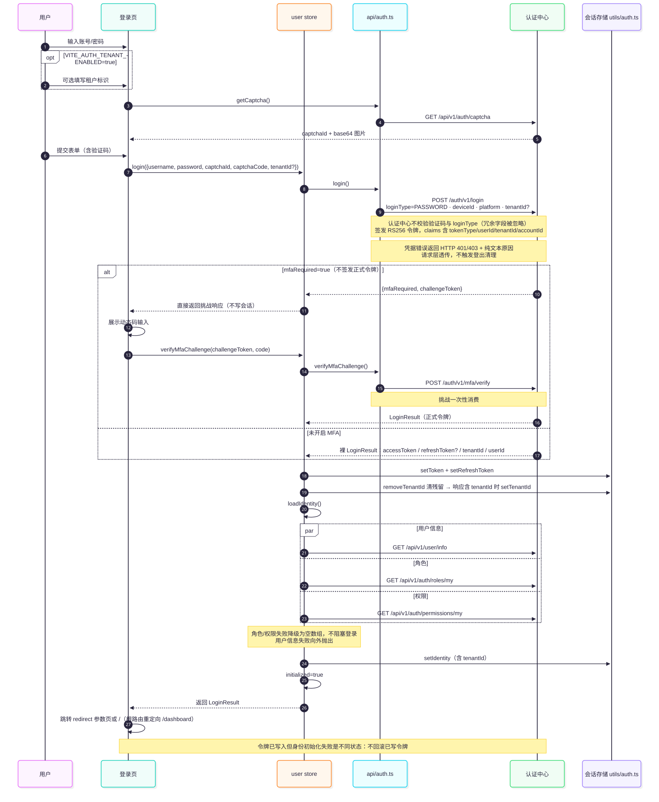
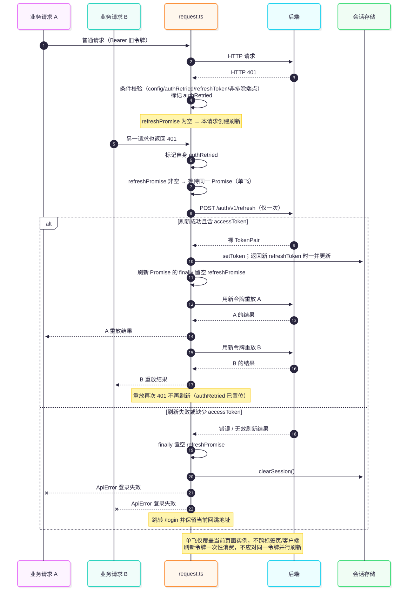
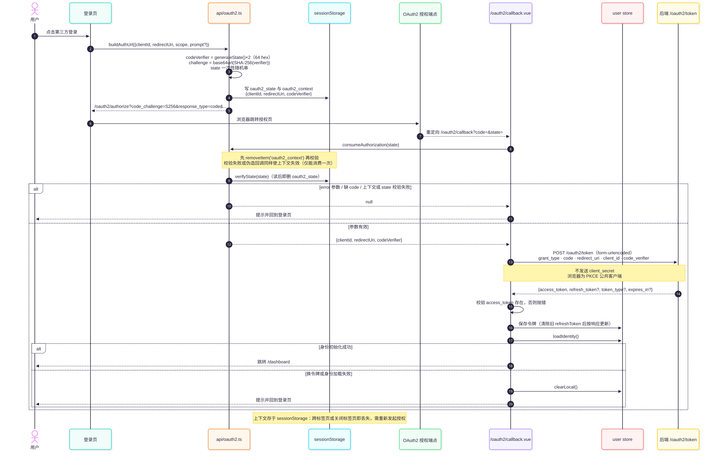
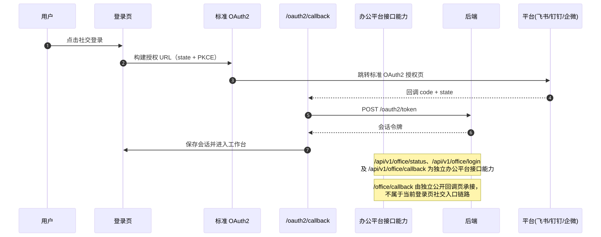

# 认证与路由架构

> 本文描述登录认证、令牌无感刷新、OAuth2 授权、菜单驱动动态路由及办公平台接口能力的实现，依据 [src/utils/request.ts](../../src/utils/request.ts)、[src/router/index.ts](../../src/router/index.ts)、[src/router/dynamic.ts](../../src/router/dynamic.ts)、[src/stores/user.ts](../../src/stores/user.ts) 当前代码核对。当前登录页的社交入口使用标准 OAuth2；办公平台登录 API 与 `/office/callback` 是独立能力，不应视为该登录入口的实际调用链。

## 1. 会话数据存储

Token 与身份信息统一由 [src/utils/auth.ts](../../src/utils/auth.ts) 存取，键名收敛于 [src/settings.ts](../../src/settings.ts)：

| 键 | 常量 | 内容 |
|----|------|------|
| `apex.admin.token` | `TOKEN_KEY` | 访问令牌 |
| `apex.admin.refresh-token` | `REFRESH_TOKEN_KEY` | 刷新令牌 |
| `apex.admin.identity` | `IDENTITY_KEY` | 用户身份缓存（UserIdentity） |
| `apex.admin.tenant-id` | `TENANT_ID_KEY` | 当前租户 ID（登录响应返回 `tenantId` 时记录） |
| `apex.admin.sidebarCollapsed` | `SIDEBAR_KEY` | 侧边栏折叠状态 |
| `apex.admin.theme` | `THEME_KEY` | 明暗主题 |

UI 偏好通过 `utils/storage.ts` 读写（app store 不直接触碰 localStorage）。

## 2. 账号密码登录流程

入口 [src/views/login/index.vue](../../src/views/login/index.vue) → [src/stores/user.ts](../../src/stores/user.ts) `login()`。



> 图源：[architecture-auth-and-routing-01.mmd](../diagrams/architecture-auth-and-routing-01.mmd)（Mermaid 源码；导出件同名 `.svg`，由 `mmdc` 生成）

登录后请求层（`utils/request.ts`）在会话存在租户 ID 时附带 `X-Tenant-Id` 请求头，仅作匹配声明：租户作用域始终由后端从令牌解析，网关会剥离并重建该头。租户适配的完整评审结论见 [统一权限认证与多租户适配](../guides/auth-tenant-adaptation.md)。MFA 二步分支中 `mfaRequired=true` 时 store 不写会话直接返回挑战信息，由登录页引导输入动态码后调 `POST /auth/v1/mfa/verify` 换取正式令牌。

## 3. 路由守卫流程

全局守卫位于 [src/router/index.ts](../../src/router/index.ts)（`router.beforeEach`）。


> 图源：[architecture-auth-and-routing-02.mmd](../diagrams/architecture-auth-and-routing-02.mmd)（Mermaid 源码；导出件同名 `.svg`，由 `mmdc` 生成）

失败后未完成注册的动态路由会在后续导航再次尝试；只有「无 Token」分支明确保留 `redirect` 回跳地址。

## 4. 令牌无感刷新（已实现）

> 注意：早期文档写"401 直接清会话"，与现状不符。当前 [request.ts](../../src/utils/request.ts) 响应拦截器已实现**单次重放的无感刷新**。

触发条件（同时满足才刷新）：

1. HTTP 状态码 401；
2. 请求未带 `authRetried` 标记（防死循环）；
3. URL 不属于排除端点：`/api/v1/auth/refresh`、`/api/v1/auth/login`、`/auth/v1/login`、`/auth/v1/refresh`、`/oauth2/token`；
4. 本地存在 refreshToken。



> 图源：[architecture-auth-and-routing-03.mmd](../diagrams/architecture-auth-and-routing-03.mmd)（Mermaid 源码；导出件同名 `.svg`，由 `mmdc` 生成）

补充：后端也可通过响应头 `x-new-access-token` 主动下发新令牌，拦截器收到后直接 `setToken`。

前端单飞只覆盖当前页面实例，不覆盖其他标签页或客户端；不要在页面自行建立并行刷新机制。统一登录的 401/403 透传纯文本原因，不触发登出。身份初始化失败与令牌签发成功是不同状态：Store 先写入令牌，再请求用户信息，失败不会自动回滚已写令牌。

## 5. OAuth2 授权码登录

接口封装 [src/api/oauth2.ts](../../src/api/oauth2.ts)，回调页 `/oauth2/callback` 为静态路由（`public: true`）。客户端 ID 来自 `VITE_OAUTH2_CLIENT_ID`（默认 `apex-admin-web`；`apex-admin-web-dev` / `apex-admin-web-prod` 仅为 .env.example 注释中的建议值，以各环境实配为准）。



> 图源：[architecture-auth-and-routing-04.mmd](../diagrams/architecture-auth-and-routing-04.mmd)（Mermaid 源码；导出件同名 `.svg`，由 `mmdc` 生成）

安全要点：

- `state` 一次性消费（`consumeAuthorization` 取出后即失效，`verifyState` 校验）。
- 授权码一次性，后端校验；PKCE（S256）防授权码拦截。
- Token 只入 localStorage，不出现在 URL。

授权同意：`/oauth2/consent` 为 public 匿名静态页，调用 `submitConsent()`（`POST /oauth2/consent`，form-urlencoded）；同意提交须登录主体，未登录先登录后回跳。代理仅对 consent 的 POST 反代，GET 回退 SPA。

## 6. 办公平台接口与独立授权回调（飞书/钉钉/企微）

当前登录页的社交入口实际调用 [src/api/oauth2.ts](../../src/api/oauth2.ts) 并进入 `/oauth2/callback`，不调用办公平台状态或登录接口。办公平台能力由 [src/api/office-platform.ts](../../src/api/office-platform.ts) 提供，`/office/callback` 是独立的公开回调入口；是否由外部系统或其他页面触发，需结合目标部署和调用方核验。



> 图源：[architecture-auth-and-routing-05.mmd](../diagrams/architecture-auth-and-routing-05.mmd)（Mermaid 源码；导出件同名 `.svg`，由 `mmdc` 生成）

绑定审批流转（管理员侧）仍是办公平台管理流程：绑定申请 `PENDING → APPROVED / REJECTED`，见 [office-platform.ts](../../src/api/office-platform.ts) `reviewBinding()` 与 [绑定管理页](../../src/views/office/bindings/index.vue)。

## 7. 菜单驱动动态路由

实现：[src/router/dynamic.ts](../../src/router/dynamic.ts)。数据源为后端菜单树 `GET /admin-api/v1/menus`。



> 图源：[architecture-auth-and-routing-06.mmd](../diagrams/architecture-auth-and-routing-06.mmd)（Mermaid 源码；导出件同名 `.svg`，由 `mmdc` 生成）

### status 与 visible 语义（易踩坑）

| 字段 | 取值 | 路由可达性 | 侧边栏显示 | 说明 |
|------|------|-----------|-----------|------|
| `status` | 0=停用 / 1=正常 | **不受影响** | **不受影响** | 历史种子数据取值与后端枚举不一致，路由生成刻意不按 status 过滤，避免全量菜单丢失 |
| `visible` | 0=隐藏 / 1=显示 | 仍注册、可直接访问 | 仅 `visible=1` 显示 | 隐藏只写 `meta.hidden` |

### VIEW_REGISTRY 全量清单（与 dynamic.ts:21-69 一致）

系统管理：`system/user/index`、`system/role/index`、`system/menu/index`、`system/dept/index`、`system/dict/index`、`system/config/index`、`system/database/index`、`system/job/index`、`system/job/query`、`system/generator/index`、`system/auth/index`、`system/sso/index`、`system/masking/index`、`system/tenant/index`、`system/tenant-package/index`、`system/capability/index`、`system/open-app/index`、`system/security/index`

监控：`monitor/loginlog/index`、`monitor/audit/index`、`monitor/api-call-log/index`、`monitor/online/index`、`monitor/dashboard/index`、`monitor/runtime-log/index`、`monitor/operations/index`、`monitor/business-log/index`、`monitor/session/index`

数据管理：`data/document/index`、`data/chart/index`、`data/file-share/index`

办公平台：`office/message/index`、`office/approval/index`、`office/config/index`、`office/bindings/index`、`office/console/index`、`office/organization/index`、`office/calendar/index`、`office/document/index`、`office/meeting-room/index`、`office/notify/index`

集成与物联网：`integration/connector/index`、`iot/device/index`、`iot/device-rule/index`

工作流：`workflow/monitor/index`、`workflow/definition/index`

其他：`profile/index`、`dashboard/index`

> **新增页面三步**：建视图文件 → 在 VIEW_REGISTRY 登记 loader → 后端菜单 `component` 字段同名。缺一步即 404。

## 8. 静态路由清单（不依赖后端菜单）

| 路径 | 组件 | meta | 说明 |
|------|------|------|------|
| `/login` | login/index.vue | `public: true` | 登录页 |
| `/oauth2/callback` | oauth2/callback.vue | `public: true, hidden: true` | OAuth2 回调 |
| `/oauth2/consent` | oauth2/consent.vue | `public: true, hidden: true` | 授权同意匿名页（同意提交 `POST /oauth2/consent` 须登录，未登录先登录后回跳） |
| `/office/callback` | office/callback.vue | `public: true, hidden: true` | 办公平台（飞书/钉钉/企微）授权回调：用 code/state 调 `GET /api/v1/office/callback` 换会话，未绑定账号时提示等待管理员审批 |
| `/dashboard` | dashboard/index.vue | `title: 工作台` | 工作台 |
| `/password-recovery` | public/password-recovery.vue | `title: 密码找回, public: true` | 密码找回页（`/auth/v2/password-recovery/**` 契约，与登录页找回弹窗共用） |
| `/share` | public/share-exchange.vue | `title: 文件分享兑换, public: true, hidden: true` | 文件分享匿名兑换页：凭分享令牌兑换元信息并下载 |
| `/workflow/monitor/dashboard` | — | redirect → `/workflow/monitor` | 旧路径兼容 |
| `/workflow/monitor` | workflow/monitor/index.vue | `hidden: true` | 工作流监控 |
| `/workflow/instances/:id` | workflow/monitor/InstanceDetail.vue | `hidden: true, activeMenu: /workflow/monitor` | 流程详情 |
| `/demo/file-upload` | demo/FileUploadDemo.vue | `hidden: true` | 上传演示 |
| `/demo/file-upload-enhanced` | demo/FileUploadEnhancedDemo.vue | `hidden: true` | 增强上传演示 |
| `/:pathMatch(.*)*` | error/NotFound.vue | — | 404 兜底 |

`/office/callback`（办公平台授权回调）为静态路由（public），页面位于 [src/views/office/callback.vue](../../src/views/office/callback.vue)。

## 9. 按钮权限指令

[src/directives/permission.ts](../../src/directives/permission.ts)：

```html
<el-button v-permission="'system:user:create'">新增</el-button>
```

- 基于用户权限码集合控制元素显隐，无权限时**从 DOM 移除**；
- 支持逗号分隔多码，满足其一即放行；
- 空权限集合视为"未配置"，放行。

## 10. 关联文档

- [总体架构](overview.md) · [API 接口目录](../api/README.md)
- [认证集成分析](../archived/auth-integration-2026-09-08.md)（历史分析快照，含后端权限模型对照；当前认证实现以本文为准）

---

**最后更新**：2026-11-11（依据 src/ 当前实现核对：登录时序补 MFA 二步分支、OAuth2 节补 consent 公开页与提交通道、VIEW_REGISTRY 清单补套餐/能力/开放平台/在线会话/统一通知/集成/IoT 并对齐 dynamic.ts:21-69、静态路由补 /oauth2/consent）
