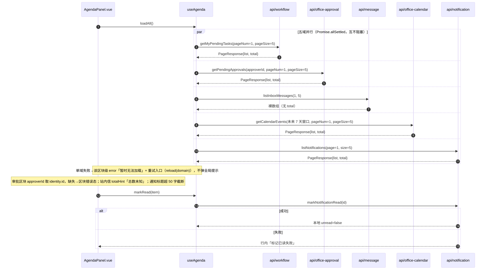
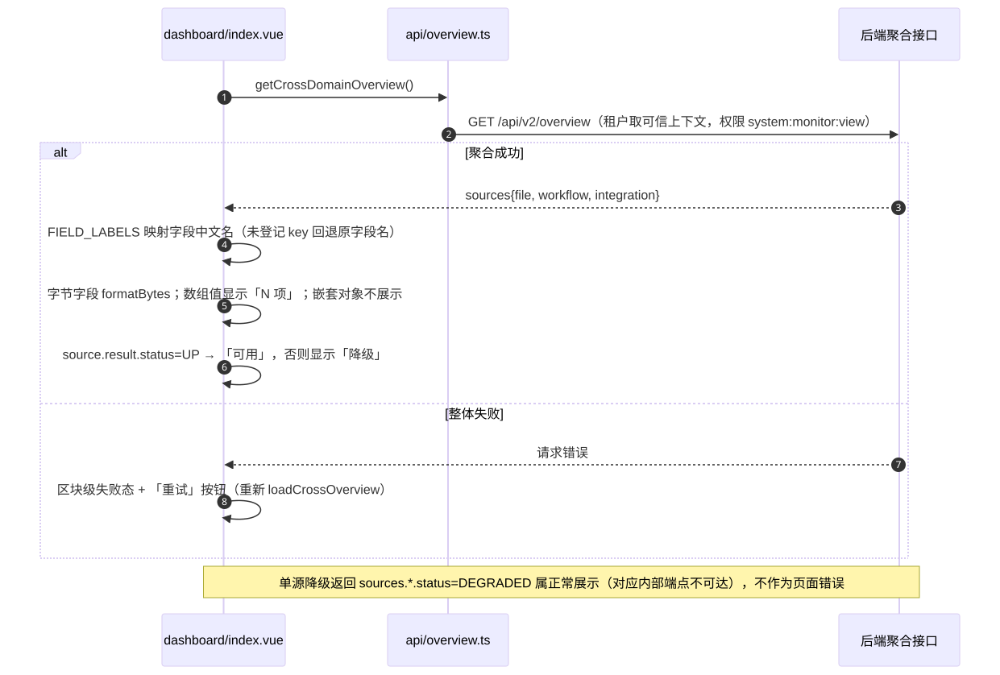

# 领域模型与状态机图

> 本文补齐 classDiagram（类图）、stateDiagram（状态机）与两份聚合时序图，全部依据 `src/types/`、`src/api/`、`src/composables/` 当前实现绘制；发现偏差以代码为准并回改本文。字段为选摘（非全量复制），完整定义以 [src/types/index.ts](../../src/types/index.ts)、[src/types/workflow.ts](../../src/types/workflow.ts) 为准。既有 flowchart/时序图集中在 [AGENTS.md](../../AGENTS.md) 与 [总体架构](overview.md)、[认证与路由](auth-and-routing.md)。

## 1. 核心领域模型

覆盖统一响应契约、RBAC（用户/角色/菜单/部门）、租户域（租户/套餐/能力）、工作流域与办公平台绑定五个截面：

> 图源：[architecture-domain-and-state-diagrams-01.mmd](../diagrams/architecture-domain-and-state-diagrams-01.mmd)（Mermaid 源码；导出件同名 `.svg`，由 `mmdc` 生成）

要点：

- `Result`/`PageResponse` 是统一包装契约；**部分端点返回裸数组**（如 MFA 配置、IP 规则、站内信收件箱、SSO 会话等，见 [API 目录](../api/README.md) 各表 ⚠️ 标注），调用方不得假设都有 `Result` 包装。
- `MenuNode.menuType`：0=目录、1=菜单、2=按钮，仅 0/1 参与动态路由转换；`visible=0` 仅隐藏侧边栏，路由仍可访问。
- `TenantPackage` 的集合字段语义不一致：`menuIds`/`permissionCodes` 空集合=全量放行，`features` 空集合=未订阅。
- `OfficeBindingResponse.userId` 关联系统用户，`platform` 为 `FEISHU/DINGTALK/WECOM`；审批与解绑均携带 `version` 乐观锁。

## 2. 状态机

### 2.1 工作流实例状态

状态枚举见 [src/types/workflow.ts:103](../../src/types/workflow.ts)；前端仅封装发起（固定 `RUNNING`）、挂起与恢复三个实例级动作，其余迁移由后端引擎驱动：

> 图源：[architecture-domain-and-state-diagrams-02.mmd](../diagrams/architecture-domain-and-state-diagrams-02.mmd)（Mermaid 源码；导出件同名 `.svg`，由 `mmdc` 生成）

- 枚举中的 `DRAFT` 为后端契约保留值；前端发起的实例固定为 `RUNNING`，页面不产生 `DRAFT`。
- 任务级操作（`/api/workflow/**`）：回退（rollback）、转办（transfer）、委派（delegate）；任务办理仅 complete+comment（固定为通过语义）。任务状态枚举为 `PENDING/APPROVED/REJECTED/ROLLED_BACK/DELEGATED/CANCELLED`。

### 2.2 租户生命周期

状态枚举见 [src/api/tenant.ts](../../src/api/tenant.ts) `TENANT_STATUS_NAMES`；前端仅提交小写动作枚举，**迁移合法性由后端状态机校验**（`expectedVersion` 可选乐观锁），下图体现动作语义的主要路径：

> 图源：[architecture-domain-and-state-diagrams-03.mmd](../diagrams/architecture-domain-and-state-diagrams-03.mmd)（Mermaid 源码；导出件同名 `.svg`，由 `mmdc` 生成）

- 配额调整（`PUT /{id}/quota`）不改变状态；`maxUsers`/`maxStorageMb` 提交 `null` 表示不限。
- 其他状态（如 `DISABLED`/`FROZEN`）出发的 deactivate/archive 迁移以后端实现为准，图中未画。

### 2.3 办公平台账号绑定

状态过滤枚举见 [src/api/office-platform.ts](../../src/api/office-platform.ts) `listBindingsPage`（`/bindings/page` 服务端过滤）；绑定申请由后端在平台授权登录时生成：

> 图源：[architecture-domain-and-state-diagrams-04.mmd](../diagrams/architecture-domain-and-state-diagrams-04.mmd)（Mermaid 源码；导出件同名 `.svg`，由 `mmdc` 生成）

- 审批/解绑携带 `version` 乐观锁，并发修改由后端拒绝。
- 办公控制台统计走 `listBindingsPage`：每平台两个 `page=1,size=1` 计数请求（全部状态 / `PENDING`）读取真实 `total`。

## 3. 聚合时序图

### 3.1 我的事项：五域并行聚合

实现见 [src/composables/useAgenda.ts](../../src/composables/useAgenda.ts)，由工作台 [AgendaPanel.vue](../../src/views/dashboard/components/AgendaPanel.vue) 消费：

> 图源：[architecture-domain-and-state-diagrams-05.mmd](../diagrams/architecture-domain-and-state-diagrams-05.mmd)（Mermaid 源码；导出件同名 `.svg`，由 `mmdc` 生成）

面板只做展示与跳转（各域原页面办理），无轮询、无办理操作。

### 3.2 数据总览：D5 跨域聚合

实现见 [src/views/dashboard/index.vue](../../src/views/dashboard/index.vue) `loadCrossOverview`，消费 [src/api/overview.ts](../../src/api/overview.ts)：

> 图源：[architecture-domain-and-state-diagrams-06.mmd](../diagrams/architecture-domain-and-state-diagrams-06.mmd)（Mermaid 源码；导出件同名 `.svg`，由 `mmdc` 生成）

---

**最后更新时间**：2026-11-13
