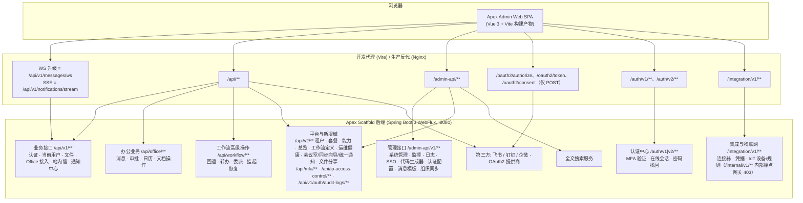
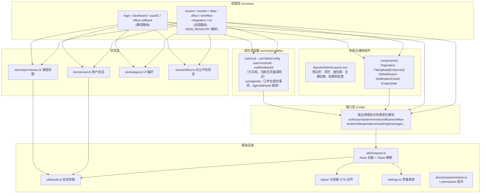
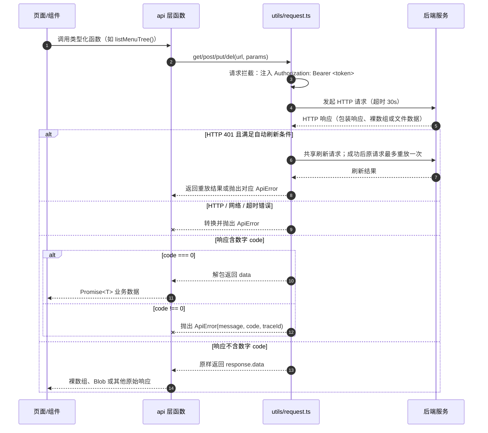

# 总体架构

> 适用版本：1.2.0（[package.json](../../package.json)）。本文与代码实现保持对齐，若发现偏差以代码为准并请回改本文。

## 1. 技术栈

| 层次 | 技术 | 版本 | 说明 |
|------|------|------|------|
| 视图层 | Vue | ^3.5.13 | `<script setup lang="ts">` 单文件组件 |
| 构建 | Vite | ^6.0.7 | 开发代理 + 生产构建（terser 压缩、manualChunks 分包） |
| 类型 | TypeScript | ~5.7.2 | `strict` 全开，`vue-tsc --noEmit` 前置于构建 |
| 路由 | vue-router | ^4.5.0 | 静态路由 + 菜单驱动动态路由 |
| 状态 | Pinia | ^2.3.0 | Setup Store 写法；会话类持久化（token/identity/tenantId）经 `utils/auth.ts` 直写 localStorage，UI 偏好走 `utils/storage.ts` |
| UI | Element Plus | ^2.9.1 | 中文语言包 + 全量图标注册（[main.ts](../../src/main.ts)） |
| 图表 | ECharts | ^5.6.0 | 监控大盘、图表管理页 |
| HTTP | Axios | ^1.7.9 | 统一封装于 [src/utils/request.ts](../../src/utils/request.ts) |
| 图片处理 | cropperjs | ^1.6.3 | FileUploadEnhanced 裁剪 |
| 测试 | Vitest | ^5.0.1 | happy-dom 环境（[vitest.config.ts](../../vitest.config.ts)） |
| Mock | mockjs | ^1.1.0 | 仅开发环境动态加载（[src/mock/index.ts](../../src/mock/index.ts)） |
| E2E | Playwright | ^1.63.0 | `playwright.config.ts` + `e2e/`（`npm run test:e2e`）：核心链路浏览器端集成测试，后端接口在用例内经 `page.route` 打桩，不依赖真实后端 |

运行环境要求：Node >= 18。

## 2. 系统总体架构

前端为独立 SPA 工程，与后端 Apex Scaffold（Spring Boot 3 WebFlux）前后端分离，通过网关/代理按前缀分流。



站内信 WebSocket 与通知 SSE 都需要专用代理：Vite 开发代理 `/api` 已设 `ws: true`；Nginx 必须为 `= /api/v1/messages/ws` 单独配置 `Upgrade`/`Connection`（置于 `/api/` 之前），为 `= /api/v1/notifications/stream` 配置 SSE 精确匹配（buffering off），否则实时推送分别退化为 60 秒轮询兜底或被响应超时掐断。详见 [部署指南](../guides/deployment.md) §6.2/§6.3。

## 3. 前端分层架构



## 4. 请求处理时序

所有接口调用统一经过 [src/utils/request.ts](../../src/utils/request.ts)，禁止裸写 axios。



补充规则（见 request.ts 实现）：

- 响应头携带 `x-new-access-token` 时自动更新本地访问令牌。
- 只有 HTTP 401 按认证端点排除、重试标记及 refreshToken 条件进入刷新；业务响应中的非零 `code` 不触发刷新。
- 响应含数字 `code` 时按 `code === 0` 解包 `data`，非零时抛出 `ApiError`；不含数字 `code` 的响应（包括裸数组、Blob 和文件流）原样返回。
- `baseURL` 取自 `VITE_API_BASE_URL`（生产同域部署留空）。

## 5. 构建与产物

`npm run build` = `vue-tsc --noEmit && vite build`（类型检查是构建前置条件，失败即终止）。

| 配置项 | 值 | 出处 |
|--------|-----|------|
| 产物目录 | `dist/`，按 js/css/images/fonts/media 分目录 | vite.config.ts |
| 分包策略 | manualChunks：vue/pinia、element-plus、@element-plus/icons-vue（独立 `element-icons` chunk）、echarts、axios、@vueuse、其余 vendor | vite.config.ts:133 |
| 压缩 | terser，生产移除 `console`/`debugger` | vite.config.ts:193-200 |
| Chunk 警告阈值 | 1000 KB | vite.config.ts:191 |
| 产物分析 | rollup-plugin-visualizer → `dist/stats.html`（`npm run analyze` 打开） | vite.config.ts:71-77 |
| 路径别名 | `@` → `src/` | vite.config.ts:80 |

## 6. 部署架构

三种形态，详细操作见 [部署指南](../guides/deployment.md)。

```mermaid
flowchart LR
    subgraph Dev["开发环境 npm run dev (:5173)"]
        V["Vite Dev Server<br/>host 0.0.0.0"] -->|proxy /api /admin-api /auth/v1\|v2 /integration/v1 /oauth2| D["VITE_API_PROXY_TARGET<br/>(默认 http://127.0.0.1:8080)"]
    end

    subgraph Prod["生产环境（同域部署，推荐）"]
        U["用户浏览器"] --> N["Nginx (前端静态资源 + 反代)"]
        N -->|/ try_files → index.html| SPA["SPA 静态产物"]
        N -->|/api/ /admin-api/ /auth/v1\|v2/ /integration/v1/ ^/oauth2/(authorize\|token)<br/>= /oauth2/consent 仅 POST| BE2["API_PROXY_PASS<br/>(默认 http://apex-scaffold:8080)"]
        N -->|= /api/v1/messages/ws<br/>Upgrade + 3600s| BE2
        N -->|= /api/v1/notifications/stream<br/>SSE buffering off| BE2
        N -->|/assets/ 等产物目录 30 天 immutable| U
    end

    subgraph Docker["Docker 部署"]
        DC["docker-compose.yml"] --> IMG["apex-admin-web 镜像<br/>两阶段: node:18 构建产物 → nginx:1.27 运行"]
        IMG --> NET["外部网络 apex-scaffold_apex-network<br/>按服务名访问后端"]
    end
```

要点：

- **同域部署**：`VITE_API_BASE_URL` 留空走相对路径，Nginx 按前缀反代后端，无 CORS 问题。
- **Nginx 长缓存**：`/assets/` 30 天 immutable；`location /` try_files 回退 index.html 支撑 history 路由。
- **构建参数注入**：`scripts/build/build-image.sh --api-base-url <url>` 可在镜像构建时覆盖 `.env.production` 的 `VITE_API_BASE_URL`；运行时 `API_PROXY_PASS` 通过 envsubst 注入 nginx.conf 模板。
- **健康检查**：容器内 HEALTHCHECK 使用 `wget` 访问 `/`，只验证 Nginx/前端静态首页可访问，不代表 API 反代、后端服务或 WebSocket 已可用。

## 7. 质量保障体系

| 手段 | 命令/位置 | 说明 |
|------|-----------|------|
| 类型检查 | `vue-tsc --noEmit`（build 前置） | tsconfig `strict` + `noUnusedLocals` + `noUnusedParameters` |
| 单元测试 | `npm run test`（Vitest + happy-dom） | 65 个测试文件（2026-11-13 实测 475 用例全绿）：39 个 API 模块全部有契约用例，utils/stores/composables/通用组件全覆盖，详见 [测试指南](../reference/testing.md) |
| E2E | `npm run test:e2e`（Playwright + chromium） | `e2e/` 6 条核心链路打桩集成测试（未登录跳转/登录/退出/动态菜单/401 刷新），后端接口在用例内 `page.route` 打桩 |
| 产物分析 | `npm run analyze` | rollup-plugin-visualizer |
| 性能测试 | `npm run test:perf`（Lighthouse desktop） | 构建产物静态基线口径，报告输出 `./reports/lighthouse`（`scripts/performance/lighthouse-test.sh` 为其底层脚本） |
| 压力测试 | `npm run test:stress`（autocannon） | 静态服务两档并发承载基线，报告输出 `./reports/stress`；业务接口压测属后端/网关范畴 |
| 依赖安全 | `scripts/security/security-scan.sh`、`npm run audit` | `npm run audit` 输出 JSON + HTML 到 `./reports/audit.html`；security-scan.sh 控制台输出 npm audit 结果，其中仅 snyk 为可选步骤（未安装自动跳过），npm-check-updates 经 npx 无条件执行 |
| 上线验证 | `npm run verify:deploy` | `scripts/verify/post-deploy-check.sh`（C1–C13 检查项，需 `BASE_URL`） |
| API 契约 | `npm run generate:api` | openapi-generator-cli（typescript-axios）；当前 `src/api/*.ts` 为手写封装，生成目录不参与运行时 |

> 仓库当前**未配置** ESLint/Prettier/Husky/CI 流水线；代码风格靠 [AGENTS.md](../../AGENTS.md) 约定与 `.editorconfig` 约束。

## 8. 关联文档

- [认证与路由架构](auth-and-routing.md) — 登录、令牌刷新、OAuth2、动态路由全流程图
- [API 接口目录](../api/README.md) — 与代码对齐的全量接口清单
- [测试指南](../reference/testing.md) · [工具库参考](../reference/toolkit.md)
- [部署指南](../guides/deployment.md) · [前后端集成](../guides/frontend-backend-integration.md)

---

**最后更新**：2026-11-11（依据 src/ 与 package.json 当前实现核对：系统图/部署图补 /auth、/integration、consent POST、通知 SSE 与新增业务域，构建表行号刷新，质量保障表按实际 script 改写）
