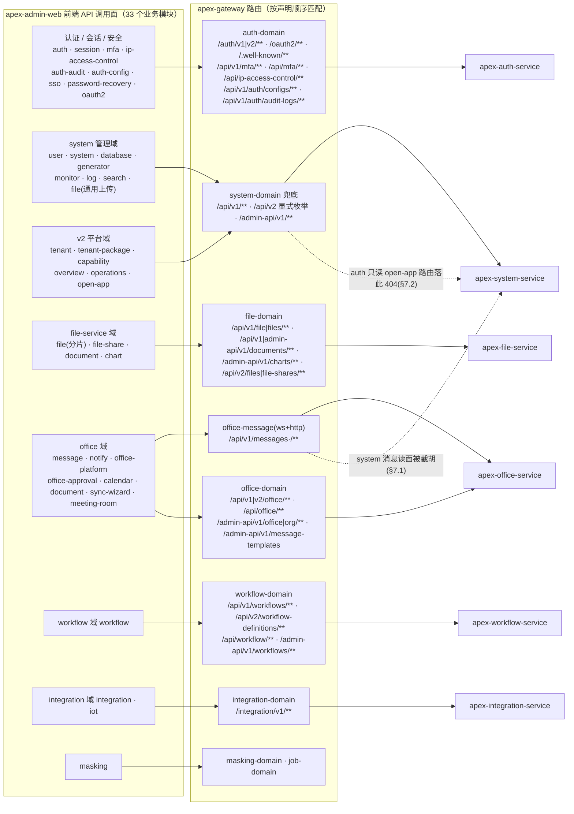
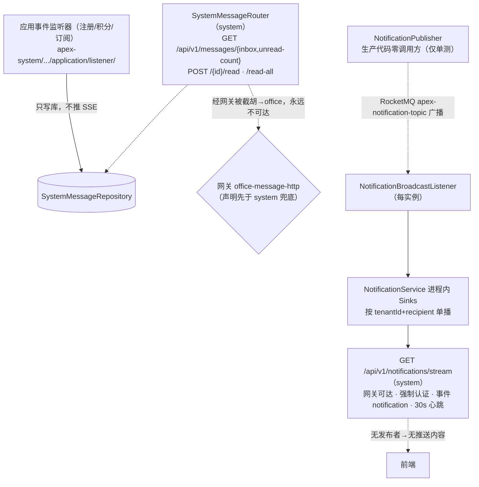

# 前后端对照评审报告（2026-11-06）

> 评审对象：`apex-admin-web`（HEAD `99202fd`，工作区干净）× `apex-scaffold`（HEAD `953426d0`；上一轮评审基线 `c675a746`）。
> 评审方法：后端以网关路由表（`application.yml` / `application-prod.yml` / Nacos 三处）与各服务 RouterFunctions 源码为准，前端以 `src/api/` 全部 33 个业务模块调用面、`VIEW_REGISTRY`（47 键）、62 个页面与 composables/utils 调用点为准，逐条对照。全部结论附源码出处；验证命令与结果见 §11。
> 评审执行日 2026-11-06，验证与报告落盘 2026-11-07。

## 1. 结论摘要

**前端不需要为支持后端正常运行做阻塞性扩充。** 自上一轮评审（2026-11-05，P0–P3 已收口）以来，后端无新增 REST 端点、无网关路由增删、无前端相关新迁移；前端全部业务端点经网关可达（§4）；上一轮修复全部在位。本轮落地修改仅两类（P1 代码、P2 文档），其余为移交后端与记录性结论：

| 级别 | 发现 | 处置 | 状态 |
| --- | --- | --- | --- |
| P1 缺陷 | `api/file.ts` `getChunkStatus` 调用后端不存在的 `GET /api/v1/file/status/{fileId}`（实际为 `GET /api/v1/file/chunk/status/{fileId}`） | 修正路径并补头注 | 已修复（§5） |
| P2 文档漂移 | `AGENTS.md` 三处与代码不符 | 修订 | 已修订（§6） |
| 移交后端 | 通知中心 SSE 通道无生产发布者、system 消息读面被网关截胡；auth-service 只读 open-app 路由被网关架空 | 移交 apex-scaffold，前端不动 | §7 |
| 维持不做 | 自助 MFA `/api/v1/mfa/**`、SkyWalking 链路追踪、workflow `tasks/my` 与任务驳回 | 记录依据 | 不变（§8） |
| 可选未执行 | 零引用 composables/utils 死代码；`FileUploadEnhanced` 断点续传接入 | 本轮拍板保留，待需求 | §9 |

## 2. 评审方法与范围

- 后端侧：`apex-scaffold` 自基线 `c675a746` 起的提交与变更文件、网关路由三处配置一致性、八个服务的端点全景（system/auth/workflow/file/office/integration/job/masking）、Flyway 迁移编号、定时任务 / WebSocket / 内部端点、权限事件化进展。
- 前端侧：`src/api/` 33 个业务模块全部端点调用面、`src/router/dynamic.ts` 的 47 键 `VIEW_REGISTRY` 与静态路由、62 个 `.vue` 页面、composables 与 utils 的实际调用点、遗留标记（TODO/FIXME 为 0）。
- 核对口径沿用既定方法：网关 dev/prod/Nacos 三处为**整表覆盖**语义（非增量合并），必须三处一致；Spring Cloud Gateway **按声明顺序匹配**（office-message 路由排在 office-domain 之前）；服务端函数式路由为嵌套 `path()` 拼接，grep 完整路径字符串会漏，须顺着源码读。

## 3. 后端基线以来的变化（`c675a746` → `953426d0`，共 11 提交）

| 提交 | 性质 | 前端相关度 |
| --- | --- | --- |
| `1101f5bf` fix(openapi): 收敛开放文件路由别名并补齐 users 精确路径 | 网关谓词微调 | 无（前端不调 `/open-api`） |
| `43319c59` fix(auth): MFA 验证请求的挑战凭据改为按端点区分必填 | 契约收紧 | 已核对兼容（§4.3） |
| `e8e6436a` fix(auth): 修复 MFA 二步登录、自助越权与认证中心启动链路 | 缺陷修复 | 无端点变化 |
| `80e75166` fix(license): License 公钥纳入版本控制 | 工程 | 无 |
| `b8711472` build(release): 统一发布打包、容器构建与环境初始化 | 工程化 | 无 |
| `2b619502` / `ffa51772` / `5730e4e9` docs | 文档 | 无 |
| `ab59f841` test(gateway): 认证中心匿名/受保护路径回归 | 测试 | 无 |
| `906cc03a` build(gitignore) | 工程 | 无 |
| `953426d0` feat(build): 新增 apex-tools-build 构建发布管理模块 | 新构建模块（35 模块注册表 + apex.sh + 防漂移门禁） | 无（部署侧） |

**契约级变化仅三项：**

1. `MfaVerifyRequest`（`apex-auth/.../application/dto/MfaVerifyRequest.java`）`challengeToken` 按端点区分必填：`POST /auth/v1/mfa/verify`（登录二步）必填；`/api/v1/mfa/**` 自助端点不再消费该字段，且 `tenantId` 越权收口。
2. 网关 open-api 谓词：`open-api-file` 收敛为仅 `Path=/open-api/file/**`；`open-api-system` 显式列入 `/open-api/users`（精确）、`/open-api/users/**`、`/open-api/user/**`。影响第三方开放调用方，前端不消费。
3. auth-service 新增修复性迁移 `V63__widen_auth_token_value.sql`（`auth_token.token_value` 扩 TEXT）与 `V64__fix_default_user_password_hash.sql`（恢复 admin 默认密码可登录），对前端透明。

**明确无变化清单**：无新增 REST 端点（含内部端点、WebSocket、SSE、定时任务）；无网关路由条目增删；无前端相关新 Flyway（system 最大仍 V89）；无 PermissionChangedEvent 事件化（权限传播仍走令牌撤销流 `/internal/v1/tokens/revocations`）。后端工作区另有未提交痕迹（`docs/diagrams/` 再生成产物、`.env`、`MEMORY-CARD.md`、`.DS_Store`），与本评审无关，记录在案。

## 4. 前端调用面 × 网关可达性核对

### 4.1 路由组映射总览

前端 33 个模块的全部端点按上表落位核对，**全部经网关可达**；`/internal/**` 不在任何路由组，网关强制 403（含旧别名 `/internal/**`），前端也不应调用。

### 4.2 重点契约核对（无问题项）

| 核对点 | 结论 | 证据 |
| --- | --- | --- |
| MFA 二步登录 | 前端 `POST /auth/v1/mfa/verify` 请求体 `{ challengeToken, code }` 与后端收紧后「该端点 challengeToken 必填」语义吻合 | 前端 `src/api/auth.ts`（verifyMfaChallenge）+ `stores/user.ts`（login 按 `mfaRequired` 分流）；后端 `MfaVerifyRequest.java`、`AuthenticationRouter.java` |
| open-app 管理面 | `/api/v1/open-apps/**`（CRUD/scopes）与 `/admin-api/v1/open-apps/migration/export|import` 均在 apex-system（`OpenAppAdminRouter`、`OpenAppMigrationRouter`），经网关 system 兜底可达；与 auth-service 只读路由无路径重叠 | 后端两 Router 源码；前端 `src/api/open-app.ts` |
| 分片上传主链路 | `POST /api/v1/file/chunk/init|upload|merge` 路径、octet-stream + query 参数契约一致 | 后端 `apex-file-service/.../ChunkRouter.java`；前端 `src/api/file.ts`、`FileUploadEnhanced.vue`（init→upload→merge 三步） |
| 站内信 | 前端全部走 office 侧 `/api/v1/messages/**`（含 ws-ticket、WS），与网关 office-message 路由一致；system 侧同名前缀端点前端不调用（见 §7.1） | 后端 `MessageRouter.java`；前端 `src/api/message.ts` |

## 5. P1：分片状态端点路径错位（已修复）

- **现象**：`src/api/file.ts` 的 `getChunkStatus(fileId)` 调用 `GET /api/v1/file/status/{fileId}`；后端 `ChunkRouter.java` 中分片状态端点实际为 `GET /api/v1/file/chunk/status/{fileId}`（嵌套在 `.path("/api/v1/file/chunk", …)` 之下，返回 `ChunkInitResult` 同构的 `ChunkSessionResult`），且全服务不存在任何 `/api/v1/file/status/**` 形态路由。
- **影响面**：该函数当前全仓零调用点（`FileUploadEnhanced.vue` 仅 import 并调用 init/upload/merge 三个函数），不会触发运行期 404；但一旦接入断点续传即必失败，且 `api/file.ts` 头注端点清单同步失实。
- **修复**：`getChunkStatus` 路径改为 `` get(`/api/v1/file/chunk/status/${fileId}`) ``，头注补 status 端点行。断点续传的组件级接入为可选扩充，本轮不实施（§9）。

## 6. P2：AGENTS.md 文档漂移（已修订）

1. §4.4 静态路由表缺 `/password-recovery`（public）与 `/share`（public、hidden）两条实际存在的公开路由——已补行。
2. §1 仍要求「不修改残留备份 `src/router/dynamic.ts.bak`」，该文件在当前 HEAD 已不存在——已删除该约束行。
3. §9 命令表缺 package.json 实际存在的 `test:ui`、`check:comments`、`generate:api`、`audit`、`audit:fix` 五个脚本——已补行（并标注 `check:comments` 仅检查注释存在性、查不出一致性）。
4. 核对日期更新为 2026-11-06，并链接本报告。

## 7. 移交后端清单（apex-scaffold，前端无法自修）

### 7.1 通知中心：SSE 通道「有通道、无发布者」，system 消息读面被网关截胡

- 事实：`NotificationPublisher` 在生产代码中没有任何调用方（唯一引用是自身单测）；真正的站内通知写库方（`UserRegisteredEventListener`、`CreditEventListener`、`SubscriptionEventListener`）只写 `SystemMessageRepository`，不经过 SSE。system 的 `/api/v1/messages/{inbox,unread-count,{id}/read,read-all}` 四条读端点与 office 侧同前缀不同实现，经网关被 `office-message-http`（`Path=/api/v1/messages,/api/v1/messages/**`）按声明顺序截胡，实际不可达。
- 前端影响：无（前端不调用这些端点，站内信走 office 契约正常）。**建议后端**：若产品需要「系统通知」进管理端，需先解决 system/office 消息前缀冲突（改路径或调谓词），并把业务事件接到 `NotificationPublisher`，之后前端再评估接入 SSE（可复用 `utils/message-socket.ts` 的重连模式另建 EventSource 封装）。

### 7.2 auth-service 只读 open-app 路由被网关架空

- `apex-auth-service/.../OpenAppRouter.java` 注册了 `GET /admin-api/v1/open-apps`、`GET /admin-api/v1/open-apps/scopes`、`GET /admin-api/v1/open-apps/{clientId}` 三条只读路由；网关 auth-domain 谓词不含 `/admin-api/**`，请求落入 system 兜底后 404。system 侧另有完整管理面（§4.2），无路径重叠冲突，属死路由。**建议后端**删除或为 auth 谓词补精确路径（前者更干净，管理面已统一在 system）。

### 7.3 无需处理

上轮移交项（Nacos open-api 谓词、`/open-api/files/**` 空实现、`MfaVerifyRequest` 占位值怪点）已由后端在 `1101f5bf`/`43319c59` 自修，本轮核实闭环。

## 8. 维持不做项与依据

| 项 | 依据 |
| --- | --- |
| 自助 MFA `/api/v1/mfa/**`（setup/verify/verify-code/verify-backup/disable/status） | 管理端 security 页已通过 `/api/mfa/**` 管理 12 条端点覆盖 TOTP 启用闭环；自助集是并存冗余（上轮 P2-2 结论维持）。后端本轮仅做越权收口，未新增端点 |
| SkyWalking 链路追踪卡片 | 后端无 trace 查询端点（TraceQuery 已移除）；`monitor/dashboard` 已按 6 字段契约显示「未接入」空态，与后端现实一致 |
| workflow `tasks/my` 与任务驳回 | 后端管理端无驳回端点（语义走 `POST /api/workflow/tasks/{taskId}/rollback` 回退）；`tasks/my` 仅存在于 `/open-api/workflow/**`，管理端不消费 |
| system SSE 通知接入 | 见 §7.1，待后端接通后再评估 |

## 9. 可选未执行项（本轮拍板保留）

1. **零引用死代码**（整文件级，均有 AGENTS.md「未接入」类如实标注，保留作工具箱）：
   - composables 4 个：`useCrud`、`useTableConfig`、`useFormDraft`、`useBreakpoint`（前两个有自身测试，后两个连测试都没有）；
   - utils 6 个：`request-cache`、`xss-protection`（仅测试引用）、`echarts-theme`、`monitoring/performance`（文件头自述未接入）、`mask`（仅测试引用）、`error-handler`（0 引用）。
   - 若日后决定清理，需连带删除对应测试并同步 AGENTS.md 相关行。
2. **`FileUploadEnhanced` 断点续传接入**：后端能力已就绪（`GET /api/v1/file/chunk/status/{fileId}` + upload 幂等跳过），前端 `getChunkStatus` 封装已修复；当前组件按「init→逐片 upload（服务端 `uploaded=false` 幂等跳过）→merge」设计，失败仅报错不恢复现场。待有真实需求再接入（失败重试前先查已上传分片并跳过）。

## 10. 变更记录（本报告对应的落地修改）

| 文件 | 修改 |
| --- | --- |
| `src/api/file.ts` | `getChunkStatus` 路径 `/api/v1/file/status/{fileId}` → `/api/v1/file/chunk/status/{fileId}`；头注端点清单补 status 行 |
| `AGENTS.md` | §6 四项修订（核对日期+本报告链接、删 dynamic.ts.bak 行、§4.4 补两条公开路由、§9 补五个脚本行） |

无其他逻辑改动；未删除文件；未提交 Git commit。

## 11. 验证记录

| 命令 | 结果 |
| --- | --- |
| `npx vue-tsc --noEmit` | 通过（0 error） |
| `npx vitest run` | 22 个测试文件 / 185 个用例全部通过（2026-11-07 执行） |

测试基线与覆盖率口径见 [测试报告](test-report-2026-11-05.md)；本轮无测试增删。
