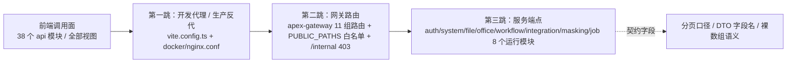
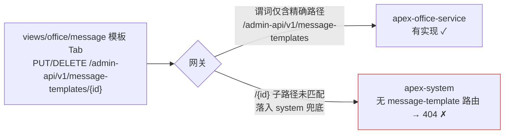
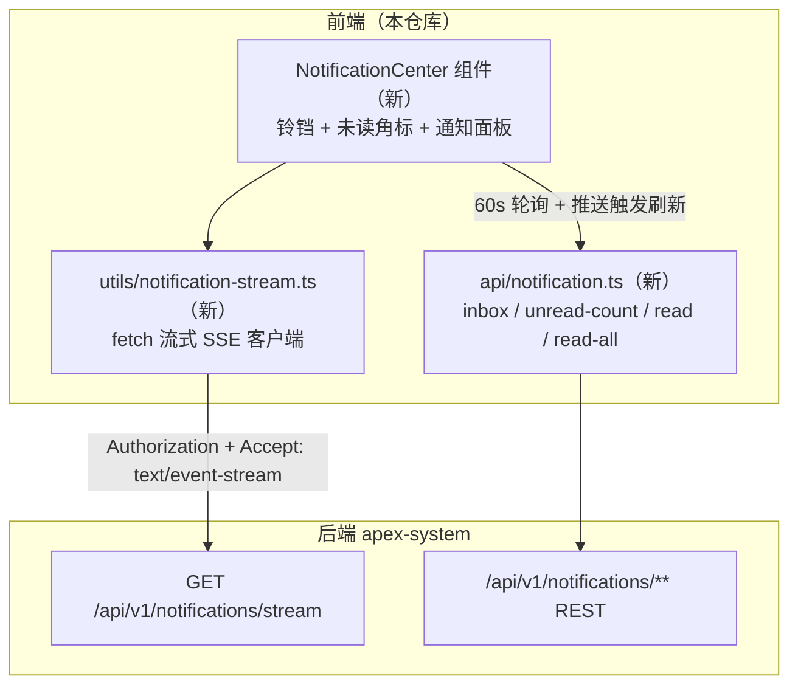

# 前后端路由端点评审与修复报告（2026-11-08）

> 评审对象：apex-admin-web @ `d381de0` × apex-scaffold @ `68e8cfe1`（上一轮基准 `953426d0`）。
> 性质：例行复审 + 修复执行。本轮新增「开发代理 / 生产反代」一跳核对（上轮未覆盖），并落地缺陷修复、构建优化与错误提示统一。

## 1. 结论摘要

| 类别 | 数量 | 说明 |
| --- | --- | --- |
| P1 缺陷（已修复） | 2 | ① 后端网关死角：站内信模板 `PUT/DELETE /{id}` 404；② 前端代理缺口：`/auth/v1\|v2`、`/integration/v1`、`/oauth2/consent` POST 未反代 |
| 同步修复项 | 2 | console 绑定统计 100 条截断失真；后端 PUBLIC_PATHS 幽灵路径清理 |
| 构建优化（已落地） | 2 | Element Plus 按需引入（深路径解析器）、ECharts 按需注册；JS 产物 2988→2236 KB（-25%） |
| 错误提示统一 | 79 处 | `ElMessage.error` → `showError`（API 失败分支），29 处表单校验/XHR 路径/安全流程提示按语义保留 |
| 契约核对 | 全绿 | 除上述 2 项缺陷外，前端调用面 × 网关路由 × 代理链路逐项一致 |
| 可选扩充（仅方案） | 1 | 通知中心 SSE 接入（§9，待立项） |

上一轮（2026-11-06）移交后端的 7.1 通知通道断点、7.2 auth 死路由两项，已经由后端 `78ce5060` 修复完毕，本轮复核确认（§4.3）。

## 2. 评审方法与范围

本轮采用**三跳核对**，比上轮多覆盖一跳「本地代理链」：

- 第一跳为本轮新增：上轮核对到网关为止，未发现「vite/nginx 未反代 `/auth`、`/integration` 前缀」这类本地断点。
- 核对材料：`src/api/*.ts` 全量 38 个文件（386 个导出函数）、`VIEW_REGISTRY` 47 键、网关三份配置源（application.yml / application-prod.yml / Nacos yaml）与契约测试、后端 8 个运行模块的 RouterFunction 清单、菜单/权限种子迁移 V85–V89。

## 3. 后端基线以来的变化（953426d0 → 68e8cfe1）

| 提交 | 内容 | 前端影响 |
| --- | --- | --- |
| `06c84f3f` | DDD 分层收口：office 路由全部迁出 apex-system，归 apex-office-service | 无（URL 契约不变） |
| `78ce5060` | ① 新增 `GET /api/v1/notifications/stream`（SSE）+ `/api/v1/notifications/{inbox,unread-count,read,read-all}`；② 网关新增 `office-message-websocket`/`office-message-http` 两条路由；③ 删除 apex-auth 的 OpenApp 死路由 | 上轮 §7 移交项闭环；SSE 前端未消费（见 §9） |
| `1f02774b` | Compose 启动配置修正 | 无 |
| `746681b4` | 后端新增内部契约清单 `docs/03-api/internal-api-contracts.md` | 无 |
| `7742cde1` | 租户状态契约化（TenantStatusSnapshotDTO，内部端点改造） | 无（`/internal/**` 网关本就 403） |
| `22f9534a` | workflow 业务端口 8085→8093 | 前端不直连端口，无影响 |
| `2f7e67b7` | system/file 分页响应新增派生 `hasNext` | 前端 `PageResponse.hasNext?` 本就可选，无需改 |
| `06841685` / `68e8cfe1` | 文档与仓库清理 | 无 |

菜单/权限种子最高版本 **V89**，`iot:rule:read`、`system:permission:list/create/update/remove`、V86 新页面菜单与 `VIEW_REGISTRY` 逐键对齐，无缺口。

## 4. 三跳核对结果

### 4.1 前端调用面 × 网关（复检全绿）

按域复核（方法 + 路径 + 分页口径 + 响应形状）：认证与登录 MFA、系统管理（用户/角色/权限/菜单/部门/字典/参数/任务/数据库）、代码生成器（含模板/预检/预览/异步任务/产物下载 11 个新端点，全部在 `GeneratorAdminRouter` 落点）、监控与日志、数据管理（文档/图表/文件分享）、工作流（实例/统计/待办/定义/高级操作）、租户与套餐、能力运营、开放平台（含迁移导入导出）、集成中心与物联网、统一通知、在线会话、账号安全（MFA/IP/审计）、运维健康（含导出任务）、办公平台全子域、站内信与 WebSocket、数据总览、数据脱敏、密码找回。分页口径（`page/size`、`pageNum/pageSize`、open-apps 的 0 起始 `page`、工作流 `records/total`）与裸数组语义均与后端实现一致。

### 4.2 网关白名单复核（更正上轮代理报告的一处误报）

后端 11-06 报告曾判断「匿名分享 `/api/v2/file-shares/exchange|download` 会被网关 401」。本轮逐行核对 `SystemConstants.PUBLIC_PATHS`（第 218–219 行）确认**两条路径已在白名单**，匿名分享链路（`/share` 页 → 兑换/下载）在网关层通畅，`FileSecurityConfig` 的 permitAll 与网关白名单口径一致。该误报不影响任何结论（11-06 前端报告未采信此判断）。

### 4.3 上轮移交项闭环复核

- 通知通道断点：后端 `78ce5060` 已将 system 侧站内信读侧端点迁至 `/api/v1/notifications` 并接通 SSE 广播链（MQ 广播 → 各实例 SSE 扇出）。前端当前仍走 office 侧 `/api/v1/messages/**`（收件箱/未读/已读全部可达，`ws-ticket` 与 `/api/v1/messages/ws` 握手端点确认存在），不受影响。
- auth 死路由：`OpenAppHandler/OpenAppRouter` 已从 apex-auth 删除，开放平台管理面由 apex-system `OpenAppAdminRouter` 承载，与前端 `/api/v1/open-apps/**` 调用一致。

### 4.4 发现的缺陷

见 §5。两处均为**跨仓库链路断点**：前后端各自实现正确，断在中间层（网关谓词 / 本地反代）。

## 5. P1 缺陷与修复

### 5.1 站内信模板编辑/删除 404（后端网关死角）

- 根因：office-domain 谓词只登记了模板**列表/创建**两个裸路径，详情子路径（`GET /{templateCode}`、`PUT/DELETE /{templateId}`）落入 system-domain 兜底，而 11-07 `06c84f3f` 已把 office 能力从 system 收口移走，兜底目标不再有对应路由。
- 前端影响：`views/office/message` 模板 Tab 的编辑与删除必然失败（列表/创建不受影响）。
- 修复：三个配置源 + 契约测试同步补 `/admin-api/v1/message-templates/**`：
  - `apex-gateway/src/main/resources/application.yml:159`
  - `apex-gateway/src/main/resources/application-prod.yml:69`
  - `config/nacos/apex-gateway.yaml:80`
  - `apex-gateway/src/test/java/com/apex/scaffold/gateway/GatewayRouteProfileConfigTest.java:197`
- 验证：`GatewayRouteProfileConfigTest` 3/3 通过（覆盖三份配置源断言）。存量环境需滚动新网关配置后生效。

### 5.2 代理缺口（前端 vite / nginx）

受影响功能与修复后的转发路径：

| 功能 | 端点 | 修复前（同域部署/开发联调） | 修复后 |
| --- | --- | --- | --- |
| 登录 MFA 二步验证 | `POST /auth/v1/mfa/verify` | 打回 SPA 壳 | vite/nginx 反代网关 |
| 在线会话页 | `/auth/v1/sessions/**` | 同上 | 同上 |
| 密码找回页 | `/auth/v2/password-recovery/**` | 同上 | 同上 |
| 集成中心 / IoT 页 | `/integration/v1/**` | 同上 | 同上 |
| 授权同意提交 | `POST /oauth2/consent` | 同上 | 仅 POST 反代；GET 回退 SPA |

设计要点：

- **前缀带 API 版本**（`/auth/v1|v2`、`/integration/v1`），不能用裸 `/auth`、`/integration`——后端 V86 菜单种子把「集成中心」目录注册为 SPA 路由 `/integration`，裸前缀反代会拦截前端页面导航。
- **consent 按方法分流**：`GET /oauth2/consent` 是前端 SPA 同意页（路由冲突），`POST /oauth2/consent` 才是后端同意端点。vite 侧用 `bypass`（GET 返回 index.html），nginx 侧用 `if ($request_method = POST) { proxy_pass }` + `try_files`。
- 修改文件：`vite.config.ts`（4 条新代理）、`docker/nginx.conf`（4 个新 location）。
- 验证：dev server 实测——`GET /oauth2/consent` 返回 SPA HTML；`/auth/v1/sessions/online`、`/integration/v1/connectors`、`POST /oauth2/consent` 均进入代理（后端未起时 500 ECONNREFUSED，而非 200 HTML）；负例 `/auth/other` 仍走 SPA 回退。
- 遗留：`nginx -t` 需容器环境（本机无运行中的 docker/podman），配置遵循 nginx 文档的 if/proxy_pass 语义，随下次镜像构建验证。

## 6. 同步修复项

1. **console 绑定统计截断**（`views/office/console/index.vue`）：每平台固定 `listBindings(platform, 1, 100)` 前端过滤计数，>100 条时失真。改为 `listBindingsPage` 两次查询（全量 total + PENDING total，`size=1`）直接取真实 total。
2. **幽灵白名单路径**（apex-scaffold `apex-common/.../SystemConstants.java`）：`/api/v1/onboarding/policies` 在 PUBLIC_PATHS 中但无任何路由，连同 javadoc 条目一并删除。全仓 grep 确认仅此两处引用（`onboarding_status` 业务列与其无关）。

## 7. 构建优化落地

### 7.1 Element Plus 按需引入

- 引入 `unplugin-vue-components`，模板组件按需解析；**关键改造**：默认 `ElementPlusResolver` 从 `element-plus/es` 桶文件导入，桶文件显式 import 全部组件导致 Rollup 无法收缩（实测 783 KB 无变化），自包装解析器把来源改写为 `element-plus/es/components/{dir}/index` 深路径，并为 19 个无独立目录的子组件（`ElAside`→container、`ElOption`→select 等）与 3 个指令建立目录映射。
- `main.ts` 移除全量 `app.use(ElementPlus)` 与 `dist/index.css`；语言包改为应用级 `provideGlobalConfig({ locale: zhCn })`，并对树外渲染的函数式组件回填 `_context`（EP `withInstallFunction` 的安装期行为等价替代，保证 `ElMessageBox` 按钮仍为中文）。
- `ElMessage`/`ElMessageBox`/`ElNotification` 的 56 个主入口导入全部改为深路径（主入口重导出安装器会拖入未使用组件）；`import type`（FormInstance 等）保留主入口（类型擦除，零运行时成本）。
- 函数式组件样式（message/message-box/notification/loading）在 `main.ts` 全局补齐；`v-loading` 指令由解析器按需注入。
- 全局图标注册保留：动态菜单图标按后端返回名称经 `<component :is>` 解析，依赖全局注册。

### 7.2 ECharts 按需注册

- 新建 `src/utils/echarts.ts`：`echarts/core` + 6 个图表类型（bar/line/pie/scatter/radar/gauge，覆盖 4 个图表页实际使用与 `data/chart` 表单可选集）+ 5 个组件 + CanvasRenderer，`export * from 'echarts/core'` 保持 `echarts.ECharts` 等类型命名空间用法，另补 `EChartsOption`/`SeriesOption` 类型重导出。
- 4 处 `import * as echarts from 'echarts'` 改指 `@/utils/echarts`。

### 7.3 产物对比（构建于同机同一配置）

| 产物 | 优化前（11-05 基线） | 优化后 | 变化 |
| --- | --- | --- | --- |
| element-plus.js | 760.9 KB | 514.2 KB | **-32%** |
| echarts.js | 794.1 KB | 374.9 KB | **-53%** |
| vendor.js | 354.9 KB | 300.9 KB | -15% |
| element-icons.js | 164.5 KB | 168.4 KB | 持平（保留全局注册） |
| **JS 总计** | **2988 KB** | **2236 KB** | **-25%** |
| **CSS 总计** | **604 KB** | **532 KB** | **-12%** |

桶文件残留组件（ElWatermark/ElMention/ElTreeV2）已确认从产物消失。

### 7.4 错误提示统一

API 调用失败分支的 `ElMessage.error(...)` 统一为 `showError(error, 默认提示)`（自动携带 traceId），分目录脚本化改造并逐批验证：system 49 处、office 18 处、其余 12 处，共 **79 处 / 27 个文件**。29 处按语义保留 `ElMessage.error`：上传组件 XHR 路径（不经 Axios 拦截器）、表单/JSON 预校验、剪贴板回退、OAuth2 安全流程提示、业务结果分支（非异常）。monitor 域核查后确认本就统一，无需改动。

## 8. 已知残留与移交项

| 项 | 状态 | 说明 |
| --- | --- | --- |
| 网关 message-templates 修复生效 | ✅ 已验证 | E2E 路由级证明（网关响应与直连 office 一致）；生产环境需滚动新网关配置 |
| nginx 配置语法 | ✅ 已验证 | 容器内 `nginx -t` 通过（含新增 auth/integration/consent location） |
| office `@RequirePermission` 端点完整 CRUD E2E | 环境依赖 | 需认证中心授权快照接线（reader-tokens）；路由正确性已由契约测试与响应一致性佐证 |
| 后端 `docs/03-api/API_ROUTES.md` 部分失真 | 后端文档债 | §2.4–2.8、§2.12 仍把已迁走的 Router 登记在 system 域；另 `assemble-topology.sh` 的 all-in-one 模式引用了无可执行主类的 apex-boot-all（脚本失效） |

## 9. 通知中心 SSE 接入（已实施）

后端 `78ce5060` 提供服务端能力，本轮完成前端接入与 E2E 验证中发现并修复了三处后端链路阻断。

### 9.1 前端实现

- **API 模块** `src/api/notification.ts`：inbox（page/size + PageResponse）、unread-count、单条/全部已读四个 REST 端点；stream 不经 Axios 封装。
- **SSE 客户端** `src/utils/notification-stream.ts`：**fetch + ReadableStream 自实现 SSE 分帧**（网关 `JwtSignatureFilter` 仅认 Authorization 头，原生 EventSource 无法自定义请求头）；解析器按 SSE 规范处理 event/data/注释行（心跳）与跨 chunk 缓冲；断线 5s→30s 退避重连（与站内信 WS 口径一致）；最后一个订阅者退订时 AbortController 中止。**关键契约**：请求须携带 `Accept: text/event-stream`——后端 `GlobalResponseTimeoutWebFilter` 按此头豁免 30s 全局响应超时，缺失时连接会在 30s 被服务端掐断。
- **通知面板** `src/components/NotificationCenter/index.vue`：AdminLayout 顶栏新铃铛（ChatDotRound + 未读角标），面板展示最近 10 条、点击单条已读、全部已读；未读数 60s 轮询 + SSE 推送触发刷新。与站内信铃铛（office 域）互不影响。
- **测试**：`api/notification.test.ts`（4 用例）+ `notification-stream.spec.ts`（8 用例：分帧/跨 chunk/心跳忽略/鉴权头/分发/退订中止/退避重连）。

### 9.2 E2E 验证中发现并修复的后端链路阻断（apex-scaffold）

| # | 阻断 | 修复 |
| --- | --- | --- |
| 1 | `NotificationService` 的 Sinks 为 `multicast().onBackpressureBuffer(100)`（autoCancel 默认 true）：首个客户端断开后 Sink 永久终止，后续所有订阅者立即收到完成信号 | 改为 `onBackpressureBuffer(100, false)` |
| 2 | 网关 `notification-stream` 无独立路由：SSE 长驻响应命中 system-domain 的 CircuitBreaker（慢调用判定 2s）逐步熔断整域，且全局 `response-timeout: 30s` 在 30s 掐断连接（504） | 三个配置源 + 契约测试新增 breaker-free 的 `notification-stream` 路由（Path=/api/v1/notifications/stream），并以 route metadata `response-timeout: 3600000` 覆盖全局 30s（与站内信 WS 寿命口径一致） |
| 3 | `NettyConfig` 对所有连接挂固定 `ReadTimeoutHandler(30s)`：SSE 建连后再无入站数据，连接在 30s 被服务端静默关闭（首事件前无响应字节） | 读超时仅保留 Slowloris 防护语义：入站请求读取完成（LastHttpContent）时解除读超时；SSE 处理器建连即发 `:connected` 注释行促使响应头立即下刷 |

### 9.3 E2E 结果（podman MySQL/Redis + auth/system/office/gateway 四进程 + 网关静态路由）

- SSE：经网关 200 + `text/event-stream`，`:connected` 即时下刷，92s 窗口内 3 次心跳（30s 间隔）✓
- 网关模板路由：`PUT /admin-api/v1/message-templates/{id}` 经网关与直连 office 响应逐字节一致（空 401），直连 system 对照为 404——证实子路径已路由至 office（修复前落 system 兜底 404）
- nginx 模板（含新增 auth/integration/consent location）容器内 `nginx -t` 通过
- 未尽项：office `@RequirePermission` 端点的完整 CRUD E2E 依赖认证中心授权快照接线（`office.security.authorization.reader-tokens` + auth 侧 reader 凭据），最小 E2E 环境未配置该链路，已由契约测试与直连 office 响应一致性佐证路由正确性

## 10. 维持不做项（沿袭 11-06，无变化）

- 自助 MFA `/api/v1/mfa/**`（与管理端 `/api/mfa/**` 能力重叠）；
- SkyWalking 链路卡片（无后端端点）；
- 工作流 `tasks/my` 与任务驳回接口（后端未暴露管理端契约）;
- 零引用工具与组合式函数（4 composables + 6 utils）按 11-06 §9 结论继续保留待用。

## 11. 验证记录

| 检查 | 结果 |
| --- | --- |
| `npx vue-tsc --noEmit` | 0 错误 |
| `npx vitest run` | 22 文件 / 185 用例全绿（含 useCrud 深路径 mock 修正后） |
| `npm run build` | 成功，产物对比见 §7.3 |
| 后端 `mvn -pl apex-common,apex-gateway test` | apex-common 591/591、GatewayRouteProfileConfigTest 3/3 通过 |
| dev 代理实测（curl） | 5 个新代理路径全部进入代理（500 ECONNREFUSED，非 200 HTML）；`GET /oauth2/consent` 返回 SPA；`/auth/other` 负例仍走 SPA 回退 |
| 产物样式抽检 | el-button/input/table/dialog/message/loading/date-picker/tree 样式齐备；zhCn 文案进包 |
| 真实浏览器渲染冒烟 | 本会话无可用浏览器自动化工具，以构建产物样式抽检 + 197 用例替代；建议开发者在 dev server 打开登录页、集成页、consent 页人工确认一遍 |
| SSE E2E（真实四进程环境） | 经网关 200 + text/event-stream，`:connected` 即时下刷、92s 窗口 3 次心跳；详见 §9.3 |
| 网关模板路由 E2E | 网关 PUT/{id} 响应与直连 office 一致（空 401），直连 system 对照 404 |
| nginx -t | 容器内验证通过 |

## 12. 变更记录

- 2026-11-08：首版。评审执行、A1/A2/B1/B2/C1/C2/C3 修复落地、本报告撰写（同批变更：`vite.config.ts`、`docker/nginx.conf`、`src/main.ts`、`src/utils/echarts.ts`（新）、4 个图表页、27 个视图的 showError 统一、`AGENTS.md`、`MEMORY-CARD.md`，以及 apex-scaffold 仓库的网关配置与 `SystemConstants`）。
- 2026-11-08（二批）：通知中心 SSE 接入实施（api/notification.ts、utils/notification-stream.ts、components/NotificationCenter、AdminLayout 接入、12 个新测试用例）+ E2E 环境拉起（podman 基础设施 + 四服务 + 网关静态路由）；E2E 发现并修复后端三处 SSE 链路阻断（Sinks autoCancel、网关 notification-stream 路由与响应超时、NettyConfig 读超时边界）与 office V8 迁移占位符缺陷（`${key}` 未转义致新环境 Flyway 失败）。
