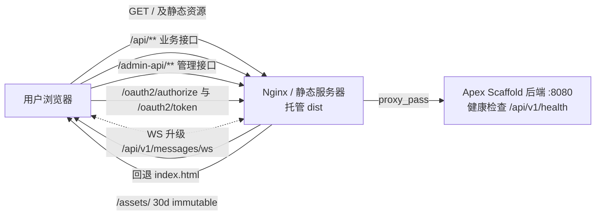

# Apex Admin Web 部署使用指南（迁移后·前后端分离）

> 版本：1.2.0 ｜ 适用：dev / it / prod 全环境
> 本文档面向 **前端独立工程**（`apex-admin-web`，Vue 3 + Vite）的构建与部署，记录前端与后端 [Apex Scaffold](https://github.com/your-org/apex-scaffold)（Spring Boot 3 WebFlux）分离后的部署形态。

---

## 目录

- [1. 迁移背景与部署形态变化](#1-迁移背景与部署形态变化)
- [2. 架构与请求路径](#2-架构与请求路径)
- [3. 前置条件](#3-前置条件)
- [4. 构建与产物](#4-构建与产物)
- [5. 环境变量](#5-环境变量)
- [6. 部署方式一：Nginx 独立部署（推荐生产）](#6-部署方式一nginx-独立部署推荐生产)
- [7. 部署方式二：Docker 容器部署（推荐）](#7-部署方式二docker-容器部署推荐)
- [8. 部署方式三：与后端网关同域部署](#8-部署方式三与后端网关同域部署)
- [9. 开发环境联调](#9-开发环境联调)
- [10. 部署验证清单（迁移回归）](#10-部署验证清单迁移回归)
- [11. 升级与回滚](#11-升级与回滚)
- [12. 常见问题 FAQ](#12-常见问题-faq)
- [13. 命令速查表](#13-命令速查表)

---

## 1. 迁移背景与部署形态变化

本次"前端迁移"将原本内嵌于后端工程 `apex-scaffold` 的静态管理控制台
（`apex-interfaces/src/main/resources/static/admin/` 下的 `index.html` / `app.js` / `styles.css`）
整合到独立的 `apex-admin-web`（Vue 3 + Vite + TS + Pinia + Element Plus）工程。迁移完成后：

| 变更项 | 迁移前 | 迁移后 |
|--------|--------|--------|
| 前端载体 | 后端 `static/admin/` 静态三件套 | 独立工程 `apex-admin-web`，构建产物 `dist/` |
| 后端短入口 `/admin` | 历史行为需以后端工程/目标环境核验 | 当前前端工程不定义该入口行为 |
| 前端托管方式 | 历史托管方式需以后端工程核验 | 本工程构建产物 `dist/` 可由 Nginx / 静态服务器托管，也可按目标环境与后端同域部署 |
| `PUBLIC_PATHS`（公开路径） | 历史配置需以后端工程核验 | 不属于本前端仓库可确认的配置 |
| API 调用日志页面 | 缺失 | 补齐：`monitor/api-call-log` |

**部署影响**：本工程按独立前端工程交付，生产部署应访问实际配置的前端源站地址（如 `https://admin.example.com`）。后端 `/admin` 是否存在、如何响应以及是否仍托管静态资源，需以后端工程和目标环境配置核验；本仓库不定义这些行为。

> 本文只说明前端 `dist/` 的构建、静态托管和 API 代理配置。后端 REST 接口、静态资源托管策略及 Java 服务部署见后端工程与目标环境配置。

---

## 2. 架构与请求路径



- **前端页面/静态资源**：由 Nginx（或任意静态服务器）直接返回 `dist/` 内容，走同域相对路径；`dist/assets/` 为带 hash 指纹的产物，可按长缓存策略交付。
- **前端动态数据**：浏览器请求 `/api/*`（业务）、`/admin-api/*`（管理）以及 OAuth2 授权码登录的 `/oauth2/authorize`、`/oauth2/token`，由 Nginx 反向代理到后端。
- **站内信实时推送**：浏览器与 `/api/v1/messages/ws` 建立 WebSocket，需 Nginx 单独声明 `Upgrade`/`Connection` 转发（见 6.2 与 6.4）。
- **后端接口**：`/admin-api/v1/menus` 返回菜单树并驱动前端动态路由；权限码控制按钮显隐。
- **鉴权**：登录成功返回 `accessToken`，前端以 `Authorization: Bearer <token>` 携带；HTTP 401 时请求层先用 `refreshToken` 单飞刷新并单次重放，刷新失败才清理会话并跳转登录页。
- **租户声明（可选）**：仅当登录响应返回 `tenantId` 时前端记录并附带 `X-Tenant-Id` 请求头；租户作用域由后端从令牌解析。

---

## 3. 前置条件

| 组件 | 版本要求 | 说明 |
|------|---------|------|
| Node.js | ≥ 18 | 前端构建（`devDependencies` 声明 `engines.node >= 18`） |
| npm | ≥ 9 | 依赖安装与脚本执行 |
| Nginx | 任意主流版本 | 推荐生产独立部署用；也可使用任意静态服务器 |

> 后端（Apex Scaffold，JDK 17 + MySQL + Redis）需已就绪可用；其部署与健康检查见后端 `docs/DEPLOYMENT.md`。

---

## 4. 构建与产物

```bash
# 1. 安装依赖
npm install

# 2. 生产构建（先生成类型校验 vue-tsc，再执行 vite build）
npm run build
```

产物输出到工程根目录 `dist/`，典型内容：

```
dist/
├── index.html
└── assets/
    ├── index-*.js        # 应用入口（含按路由分包）
    └── index-*.css
```

> 构建命令为 `vue-tsc --noEmit && vite build`，类型错误会导致构建失败。`vite build` 的关键参数
> （见 `vite.config.ts`）：
> - `chunkSizeWarningLimit: 1000`（KB）抑制大 chunk 告警；构建目标跟随 esbuild 默认（`tsconfig.target` 为 `ES2020`）。
> - `minify: 'terser'` 且 `drop_console` / `drop_debugger`：生产产物移除 `console` 与调试语句。
> - `manualChunks` 按 vue/pinia、element-plus、element-icons、echarts、vueuse、axios、其他 vendor 拆分 chunk。
> - `rollup-plugin-visualizer` 构建后输出 `dist/stats.html`，可手动打开分析产物体积。

---

## 5. 环境变量

构建期由 Vite 读取（`.env.production` / `.env.development`），仅 `VITE_` 前缀变量会注入产物。

| 变量 | 生效环境 | 说明 |
|------|---------|------|
| `VITE_API_BASE_URL` | 生产（`.env.production`） | 后端网关地址。**同域部署留空**，走相对路径 `/api`、`/admin-api`、`/oauth2`；跨域/独立网关时填写完整前缀（如 `https://api.example.com`）。Docker 构建通过 `--build-arg` 注入 |
| `VITE_API_PROXY_TARGET` | 开发（`.env.development`） | Vite dev server 代理目标（`/api`、`/admin-api`、`/oauth2`），默认 `http://127.0.0.1:8080` |
| `VITE_AUTH_TENANT_ENABLED` | 构建期 | 是否在登录页显示租户标识输入（多租户部署设为 `true`，默认关闭）。关闭时登录请求不带 `tenantId` |
| `VITE_OAUTH2_CLIENT_ID` | 构建期 | OAuth2 授权码登录使用的 `client_id`，必须与后端 OAuth2 注册值一致（默认 `apex-admin-web`）。浏览器端为 PKCE 公共客户端，不携带 `clientSecret` |

以上四项取自 `.env.example`，其中前三项在 `src/env.d.ts` 中有类型声明；`VITE_OAUTH2_CLIENT_ID` 由登录页通过 `import.meta.env` 读取。OAuth2 的 `redirect_uri` 由前端按当前 Origin 拼出，需与后端注册值一致。

运行期变量（`docker run` / `docker-compose.yml` 的 `environment`，不进入构建产物）：

| 变量 | 默认值 | 说明 |
|------|--------|------|
| `API_PROXY_PASS` | `http://apex-scaffold:8080` | 容器启动时由 `docker-entrypoint.sh` 的 `envsubst` 渲染进 Nginx 配置，仅影响反向代理 upstream |
| `TZ` | `Asia/Shanghai` | 容器时区 |
| `WEB_PORT` | `80` | Compose 中宿主机端口映射（`${WEB_PORT:-80}:80`） |
| `TAG` | `latest` | Compose 使用的镜像标签 |

```bash
# 例：跨域部署时指定后端网关
VITE_API_BASE_URL=https://api.example.com npm run build
```

> ⚠️ `VITE_*` 为 build 时静态注入，修改后需**重新构建**，不能通过运行时环境覆盖；`API_PROXY_PASS` 只在容器启动时渲染一次，修改后需重启容器。

---

## 6. 部署方式一：Nginx 独立部署（推荐生产）

适用：前端由独立域名（或独立端口）提供服务，与后端分离。

### 6.1 上传产物并配置 Nginx

```bash
# 1. 构建
npm run build

# 2. 部署 dist/ 到站点目录（以 /var/www/apex-admin 为例）
mkdir -p /var/www/apex-admin
cp -r dist/* /var/www/apex-admin/
```

### 6.2 最小 Nginx 配置（同域接管静态 + 反向代理）

`/etc/nginx/conf.d/apex-admin.conf`：

```nginx
server {
    listen       80;
    server_name  admin.example.com;

    root /var/www/apex-admin;
    index index.html;

    add_header X-Content-Type-Options "nosniff" always;
    add_header X-Frame-Options "SAMEORIGIN" always;

    # 带 hash 指纹的静态资源长缓存
    location /assets/ {
        expires 30d;
        add_header Cache-Control "public, max-age=2592000, immutable";
    }

    # 前端单页应用 History 路由回退
    location / {
        try_files $uri $uri/ /index.html;
    }

    # OAuth2 授权与令牌端点
    location ~ ^/oauth2/(authorize|token)$ {
        proxy_pass         http://127.0.0.1:8080;
        proxy_http_version 1.1;
        proxy_set_header   Host $host;
        proxy_set_header   X-Real-IP $remote_addr;
        proxy_set_header   X-Forwarded-For $proxy_add_x_forwarded_for;
        proxy_set_header   X-Forwarded-Proto $scheme;
    }

    # 站内信 WebSocket 握手：必须精确匹配并转发 Upgrade/Connection，
    # 且声明在 /api/ 之前，否则会被普通 HTTP 反代吞掉导致握手失败
    location = /api/v1/messages/ws {
        proxy_pass         http://127.0.0.1:8080;
        proxy_http_version 1.1;
        proxy_set_header   Upgrade $http_upgrade;
        proxy_set_header   Connection "upgrade";
        proxy_set_header   Host $host;
        proxy_set_header   X-Real-IP $remote_addr;
        proxy_set_header   X-Forwarded-For $proxy_add_x_forwarded_for;
        proxy_set_header   X-Forwarded-Proto $scheme;
        proxy_read_timeout 3600s;
        proxy_send_timeout 3600s;
    }

    # 后端业务与管理接口
    location /api/ {
        proxy_pass         http://127.0.0.1:8080;
        proxy_http_version 1.1;
        proxy_set_header   Host $host;
        proxy_set_header   X-Real-IP $remote_addr;
        proxy_set_header   X-Forwarded-For $proxy_add_x_forwarded_for;
        proxy_set_header   X-Forwarded-Proto $scheme;
    }
    location /admin-api/ {
        proxy_pass         http://127.0.0.1:8080;
        proxy_http_version 1.1;
        proxy_set_header   Host $host;
        proxy_set_header   X-Real-IP $remote_addr;
        proxy_set_header   X-Forwarded-For $proxy_add_x_forwarded_for;
        proxy_set_header   X-Forwarded-Proto $scheme;
    }
}
```

```bash
nginx -t && systemctl reload nginx
```

> 仓库内 `docker/nginx.conf` 是上述配置的容器模板版（`proxy_pass` 为 `${API_PROXY_PASS}` 占位，由入口脚本渲染），两者应保持等价；改动任一处需同步另一处。

> **为什么需要 `try_files ... /index.html`**：前端使用 Vue Router「history 模式」，直接刷新
> `/monitor/api-call-log` 等多级路径时需回退到 `index.html` 再让前端路由接管，否则返回 404。
>
> **为什么需要代理 OAuth2、`/api/` 与 `/admin-api/`**：前后端分离后前端动态数据请求使用 `/api/`、`/admin-api/`，授权码登录仅使用 `/oauth2/authorize` 与 `/oauth2/token`；静态资源与页面由 Nginx 直接返回。其他 OAuth2 端点（例如 `/oauth2/userinfo`）未在本工程的 Vite/Nginx 配置中声明专用代理。
>
> **为什么 WebSocket 要单独配置**：站内信实时推送走 `/api/v1/messages/ws`，普通 `location /api/` 不转发
> `Upgrade`/`Connection` 头，握手会失败（前端只能退回 60s 轮询未读数）。专用 location 同时把
> `proxy_read_timeout` 提到 3600s，与服务端连接寿命上限（1h，票据 30s 一次性）对齐，避免被默认 60s 空闲超时切断。
>
> **`proxy_http_version 1.1` 的必要性**：Nginx 默认以 HTTP/1.0 反代且不发送 `Connection` 头，WebSocket 升级必须显式声明 1.1。

### 6.3 后端侧站内信前置条件

前端仓库可确认开发代理和 Nginx 模板为 `/api/v1/messages/ws` 配置了 WebSocket 升级转发；office-service 配置、网关路由和服务拓扑不在本仓库范围内，部署时应按目标后端版本与环境核验：

| 核验项 | 说明 |
|----|------|
| WebSocket upstream | 如部署架构分别配置 HTTP 消息服务和 WS 服务，需确认其路由关系及会话/票据兼容性；具体配置以目标后端为准 |
| Origin 策略 | 核对 office-service 对前端实际 Origin（如 `https://admin.example.com`）的允许策略，以及拒绝时的响应行为 |
| 网关路由 | 确认实际网关将 `/api/v1/messages/**`（含 WS）路由到正确服务 |
| 浏览器协议 | 页面为 HTTPS 时前端按当前页面协议构造 `wss://` 地址；代理和后端需支持对应的 WebSocket 转发 |

### 6.4 启用 HTTPS（生产建议）

```nginx
server {
    listen 443 ssl;
    server_name admin.example.com;
    ssl_certificate     /etc/nginx/ssl/admin.example.com.crt;
    ssl_certificate_key /etc/nginx/ssl/admin.example.com.key;
    # ... 其余 location（含 WS 专用 location）同 6.2
}
server {
    listen 80;
    server_name admin.example.com;
    return 301 https://$host$request_uri;
}
```

> HTTPS 页面下前端按当前页面协议构造 `wss://` 连接 `/api/v1/messages/ws`。后端 TLS 终止位置、内部 upstream 协议及 Origin 校验策略取决于目标部署环境，需分别核验。

---

## 7. 部署方式二：Docker 容器部署（推荐）

适用：需要统一容器化交付、与后端（`apex-scaffold`）编排在同一 Docker 环境时。
本工程提供 `Dockerfile`（多阶段构建）与 `docker-compose.yml` 编排。

### 7.1 目录结构

```
apex-admin-web/
├── Dockerfile                # 多阶段构建：node:18 构建 → nginx:alpine 运行
├── docker-compose.yml        # 前端服务编排
├── .dockerignore
└── docker/
    ├── nginx.conf            # Nginx 站点模板（${API_PROXY_PASS} 占位）
    └── docker-entrypoint.sh  # 容器入口：envsubst 渲染后启动 Nginx
```

### 7.2 镜像设计

```mermaid
flowchart LR
    SRC[源码 + .env.production] --> B1[构建阶段 node:18-alpine<br/>npm install / npm run build]
    B1 --> DIST[dist]
    DIST --> R1[运行阶段 nginx:1.27-alpine]
    TPL[docker/nginx.conf 模板<br/>含 ${API_PROXY_PASS}] --> R1
    ENV1[运行期环境变量<br/>API_PROXY_PASS / TZ] --> EP[docker-entrypoint.sh<br/>envsubst 渲染]
    EP --> CONF[/etc/nginx/conf.d/default.conf]
    R1 --> CONF
    CONF --> UP[后端 upstream]
    R1 --> HC[HEALTHCHECK<br/>wget http://127.0.0.1/]
```

- **构建阶段** `node:18-alpine`：`npm install` → `npm run build`（含 vue-tsc 类型校验），
  产物 `dist/`；`VITE_API_BASE_URL` 通过 `--build-arg` 注入（默认空 = 同域相对路径）。
- **运行阶段** `nginx:1.27-alpine`：仅含静态产物与 Nginx，镜像小、启动快；
  内置 `HEALTHCHECK`（`wget http://127.0.0.1/`）供编排探活。该探活**只证明静态服务可访问**，
  不代表后端反代或 WebSocket 可用。
- **反代地址可配置**：容器启动时由 `docker-entrypoint.sh` 用 `envsubst '${API_PROXY_PASS}'`
  仅展开该占位符（避免误伤 Nginx 的 `$host`、`$uri` 等内置变量），渲染
  `/etc/nginx/conf.d/default.conf.template` 为 `default.conf` 后以前台模式启动 Nginx。
- **WebSocket**：模板中已含 `location = /api/v1/messages/ws`（`Upgrade`/`Connection` + 3600s 超时），
  容器部署无需额外改动 Nginx；仍需满足 6.3 的后端侧前置条件（Origin 白名单与同实例路由）。

### 7.3 构建镜像

工程提供一键构建脚本 `scripts/build/build-image.sh`（风格与后端 `scripts/build/build.sh` 一致）：

```bash
cd /path/to/apex-admin-web

# 1. 构建镜像（同域部署留空 VITE_API_BASE_URL，默认读取 .env.production）
./scripts/build/build-image.sh

# 指定版本标签 / 后端网关 / 禁用缓存
./scripts/build/build-image.sh --tag v1.2.0
./scripts/build/build-image.sh --api-base-url https://api.example.com
./scripts/build/build-image.sh --no-cache

# 等价的原生 docker 命令（脚本内部执行）：
docker build [--build-arg VITE_API_BASE_URL=<url>] -t apex-admin-web:latest .
```

脚本特性：参数解析（`--tag/--api-base-url/--no-cache`）、自动读取 `.env.production`
的 `VITE_API_BASE_URL`、构建完成后打印镜像与运行示例。

### 7.4 独立运行

```bash
# 运行（独立部署时把反代指向宿主后端：macOS/Windows 用 172.17.0.1，Linux 用宿主 IP）
docker run -d --name apex-admin-web -p 80:80   -e API_PROXY_PASS=http://172.17.0.1:8080   apex-admin-web:latest

# 验证
curl -s http://localhost/ | head -5        # 页面
curl -s http://localhost/api/v1/health     # 反代后端健康检查
```

### 7.5 Compose 编排（推荐）

本工程的 `docker-compose.yml` 声明了**外部网络** `apex-network`
（`name: apex-scaffold_apex-network`）与默认 `API_PROXY_PASS=http://apex-scaffold:8080`。
这两者都只是前端侧的编排声明：网络是否已由后端 compose 创建、`apex-scaffold` 服务名能否在容器内解析，
需在目标部署环境用 `docker network ls` / `docker inspect` / `getent hosts` 核验，不能仅凭前端仓库确认。

```bash
# 前置：确保后端 compose 已先启动（其网络 apex-scaffold_apex-network 必须存在）
cd /path/to/apex-scaffold && docker compose up -d

# 前端接入：一条命令即可，compose 自动将容器挂到后端网络
cd /path/to/apex-admin-web
docker compose up -d --build
docker compose ps    # 等待 healthy
```

### 7.6 接入后端 compose 网络的完整启动命令（端到端）

> 以下命令按仓库内 Dockerfile、Compose、入口脚本和 Nginx 模板整理。容器网络、后端服务名解析和端到端反代仍需在目标部署环境中实际验证，不能仅凭前端仓库构建结果确认。

#### 方式一（推荐）：Compose 一键启动

前端 `docker-compose.yml` 已声明外部网络（`external: true` + `name: apex-scaffold_apex-network`）。
该声明只表达「本服务要加入这个已存在的网络」，**网络是否已创建、后端服务名能否解析，必须在目标环境确认**
（后端 `.env` 中 `COMPOSE_PROJECT_NAME=apex-scaffold` 时，网络名通常为 `apex-scaffold_apex-network`）。

**步骤 ①  启动后端 compose（先建网）**

```bash
cd /path/to/apex-scaffold

# 前置检查：网络是否已存在
docker network ls | grep apex-network
#   建议输出: apex-scaffold_apex-network   bridge   local

# 若不存在，则启动后端 compose 任意一次即可自动创建：
docker compose up -d
```

**步骤 ②  启动前端 compose（自动挂入后端网络）**

```bash
cd /path/to/apex-admin-web

# 一键构建并启动；compose 读取 networks.external 复用后端网络
docker compose up -d --build

# 等待就绪
docker compose ps            # STATUS 应为 running (healthy)
```

**步骤 ③  验证整条链路**

```bash
# 1) 确认容器已挂入后端网络
docker inspect apex-admin-web --format '{{range $k,$v := .NetworkSettings.Networks}}{{$k}} {{end}}'
#   期望包含 apex-scaffold_apex-network

# 2) 确认网络内能解析后端服务名
docker exec apex-admin-web getent hosts apex-scaffold
#   期望输出一行 <IP>  apex-scaffold

# 3) 前端页面
curl -s -o /dev/null -w 'page=%{http_code}\n' http://localhost/

# 4) 经容器内 Nginx 反代到后端健康/接口（需后端应用已运行）
curl -s http://localhost/api/v1/health
# 或在不带登录态时验证反代配置：
docker exec apex-admin-web grep proxy_pass /etc/nginx/conf.d/default.conf
#   期望: proxy_pass http://apex-scaffold:8080;
```

#### 方式二：docker run 直接挂网络（免 compose）

后端 compose 已运行、前端镜像已构建，且目标环境已确认网络存在、服务名可解析时使用：

```bash
cd /path/to/apex-admin-web
docker build -t apex-admin-web:latest .

docker run -d --name apex-admin-web \
  --network apex-scaffold_apex-network \
  -e API_PROXY_PASS=http://apex-scaffold:8080 \
  -p 80:80 \
  apex-admin-web:latest

docker exec apex-admin-web getent hosts apex-scaffold   # 应解析出后端容器 IP
curl -s http://localhost/api/v1/health
```

#### 方式三：合并进后端 compose（同网络，无需 external）

> 以下为**参考片段**：若后端 `apex-scaffold/docker-compose.yml` 的 `services` 中加入 `apex-admin-web`
> （挂在既有 `apex-network`，同网络内可直接按服务名访问，无需声明 `external`）。后端仓库是否已合入该服务，
> 需以后端工程实际内容核验。

```bash
# ① 先构建前端镜像（后端 compose 无法引用前端仓库的 build context，故需预构建）
cd /path/to/apex-admin-web
docker build -t apex-admin-web:latest .

# ② 一次性拉起后端 + 前端
cd /path/to/apex-scaffold
docker compose up -d --build            # 全部拉起
# 单独启前端（不连带后端）：
docker compose up -d apex-admin-web --no-deps

# ③ 验证
docker compose ps                       # apex-admin-web 应为 running (healthy)
curl -s -o /dev/null -w 'HTTP %{http_code}\n' http://localhost/   # 200
docker exec apex-admin-web getent hosts apex-scaffold             # 应解析出后端 IP
```

后端 `apex-scaffold/docker-compose.yml` 中对应的 `services` 片段（参考片段，后端仓库是否已合入需核验）：

```yaml
  # ---------------- Apex Admin Web（前端管理后台，可选） ----------------
  apex-admin-web:
    image: apex-admin-web:${TAG:-latest}
    container_name: apex-admin-web
    environment:
      API_PROXY_PASS: ${API_PROXY_PASS:-http://apex-scaffold:8080}
      TZ: ${TZ:-Asia/Shanghai}
    ports:
      - "${WEB_PORT:-80}:80"
    depends_on:
      apex-scaffold:
        condition: service_started
    restart: unless-stopped
    networks:
      - apex-network
```

> **依赖说明**：本片段未给 `apex-scaffold` 添加 `healthcheck`（避免改动后端既有行为），
> 故前端 `depends_on` 用 `service_started`——只保证容器已启动，不保证后端应用已就绪，
> 反代能否正常返回需在目标环境实测。
> `compose up -d apex-admin-web` 因 `depends_on` 会连带拉起后端 `apex-scaffold`；
> 只想单独启前端则加 `--no-deps`。

#### 常见问题（FAQ）

| 现象 | 原因 | 处理 |
|------|------|------|
| compose up 报 `network ... not found` | 后端网络尚未创建，或项目名不符 | 先 `docker compose up -d` 后端；`docker network ls` 核对网络名，同步调整 `name:` |
| 无法解析 `apex-scaffold` | 前端容器未加入该网络，或不在同网络 | `docker inspect apex-admin-web` 查看 `Networks`；确认挂的是 `apex-scaffold_apex-network` |
| 反代 502/504 | 后端应用未启动或端口不一致 | 确认后端 `APP_PORT`（默认 8080）与 `API_PROXY_PASS` 端口一致；`curl` 后端健康端点 |
| 端口 80 被占用 | 宿主机 80 已被占用 | 启动时改映射 `docker compose run --rm -p 8088:80` 或 `.env` 设 `WEB_PORT=8088` |

> **网络名与 DNS 说明**：按 compose 默认命名约定，项目名 `apex-scaffold` + 网络名 `apex-network`
> 通常生成 `apex-scaffold_apex-network`，容器间按 **compose 服务名** `apex-scaffold` 做 DNS 解析。
> 这是命名约定而非本仓库可确认的事实，请以目标环境 `docker network ls` 与
> `docker exec <前端容器> getent hosts apex-scaffold` 的实际结果为准；若用 `docker-compose -p <项目>`
> 改了项目名，需把两处 `apex-scaffold_apex-network` 替换为 `<项目>_apex-network`。

### 7.7 Docker 部署验证

```bash
# 容器与网络
docker ps | grep apex-admin-web
docker exec apex-admin-web nginx -t

# 页面与接口回路
curl -s http://localhost/ -o /dev/null -w '%{http_code}\n'        # 200
curl -s http://localhost/api/v1/health                             # 反代后端可达
curl -s http://localhost/admin-api/v1/api-call-logs?pageNum=1      # 带登录态可查

# 回滚：重新 build 旧 tag 镜像并重启容器即可
```

---

## 8. 部署方式三：与后端网关同域部署

适用：前端与后端共用同一域名/入口，前端走相对路径，`VITE_API_BASE_URL` 留空（默认行为）。

- 前端 `dist/` 交给由后端统一网关代理的静态目录（例如后端 Nginx/网关的 `/` 根目录）。
- Nginx 依据 URI 前缀分流：`/api/`、`/admin-api/` 反向代理到后端 8080，其余静态返回 `dist/`。
- 该方式在浏览器地址栏直接访问前端入口（如 `https://admin.example.com/`）；后端是否仍保留 `/admin` 短入口需以后端工程与目标环境核验。登录后动态路由照常由菜单驱动。

> 迁移后注意：**不要再**把 `dist/` 塞回后端 `static/admin/`。后端是否仍保留 `static/admin/` 与 `/admin` 重定向，需以后端工程与目标环境核验；前端工程与其构建产物不再依赖该目录。

---

## 9. 开发环境联调

```bash
# 1. 启动后端（Java 服务，端口 8080）
#    （见后端工程 docs/DEPLOYMENT.md）

# 2. 启动前端 dev server
npm install
npm run dev
```

- 默认访问 `http://localhost:5173`。
- Vite dev server 已将 `/api`、`/admin-api` 及 OAuth2 端点（`/oauth2/authorize`、`/oauth2/token`）
  代理到 `http://127.0.0.1:8080`（可通过 `.env.development` 的 `VITE_API_PROXY_TARGET` 调整代理目标）。
- `/api` 代理已开启 `ws: true`，开发环境站内信 WebSocket（`/api/v1/messages/ws`）可直接联调。
- 登录流程：`GET /api/v1/auth/captcha`（拉取验证码）→ 提交账号密码 + 验证码 → 获取 `accessToken`
  → 并行加载 `/api/v1/user/info`、`/api/v1/auth/roles/my`、`/api/v1/auth/permissions/my`。
- 多租户联调：`.env.development` 设 `VITE_AUTH_TENANT_ENABLED=true` 后登录页出现租户标识输入。

---

## 10. 部署验证清单（迁移回归）

部署完成后按下列顺序冒烟，确认迁移不影响任何功能：

| # | 校验项 | 通过标准 |
|---|--------|---------|
| 1 | 页面资源加载 | `GET /` 返回 `index.html`，`/assets/*` 返回 200 且响应头含 `Cache-Control: public, max-age=2592000, immutable` |
| 2 | 安全响应头 | `GET /` 响应含 `X-Content-Type-Options: nosniff` 与 `X-Frame-Options: SAMEORIGIN` |
| 3 | 登录 | 输入账号密码 + 验证码能成功登录跳转工作台；`POST /api/v1/auth/login` 经反代返回 `code:0` |
| 4 | 令牌续期 | 令牌过期后普通请求返回 401 时自动刷新并重放成功，页面不跳登录；刷新令牌失效才回登录页 |
| 5 | 系统管理 | 用户 / 角色 / 菜单（树）／部门（树）／字典 / 参数 / 定时任务列表正常 |
| 6 | 账号安全 | 「系统管理 → 账号安全」MFA 配置与 IP 白/黑名单可加载（两接口返回裸数组，非 `Result` 包装） |
| 7 | 租户管理 | 「系统管理 → 租户」列表可分页（`pageNum/pageSize` 必填）；配额清空后提交 `null` 表示不限 |
| 8 | 监控中心 | 监控大盘、登录日志、操作审计、在线用户正常 |
| 9 | **API 调用日志** | 进入「监控中心 → API 调用日志」，列表可按 `serviceName / status / traceId / path` 查询与重置；状态标签（成功/客户端错误/服务端错误/网络异常）渲染正确 |
| 10 | 运维健康 | 「监控中心 → 运维健康」健康报告 / 快照 / 趋势可加载（前端仅调用 health-report、snapshots、trend 等子路径；根路径是否存在以目标后端契约为准） |
| 11 | 数据脱敏 | 「系统管理 → 数据脱敏」规则可读、批量试算返回结果 |
| 12 | 工作流 | 「工作流监控」实例列表（`pageNum/pageSize` + `records/total`）与待办任务（`PageResponse`，读 `list/total`）可加载；发起流程填 `businessKey` 可创建实例 |
| 13 | 站内信（HTTP） | 收件箱 / 已发送可加载（接口返回纯数组，`total` 取数组长度）；未读数接口 `GET /api/v1/messages/unread/count` 正常 |
| 14 | **站内信（WS）** | 浏览器 Network → WS 中 `/api/v1/messages/ws` 状态 `101 Switching Protocols` 且 `ping/pong` 存活；发送新消息后通知角标无需等 60s 轮询即更新 |
| 15 | 办公平台 | 绑定审批页（`/bindings/page`，真实分页 + status 过滤）与组织同步页可加载 |
| 16 | 个人中心 | 当前用户信息与「我的权限明细」展示正常 |
| 17 | 动态路由 | 侧边栏菜单与后端菜单树一致，点击各页面可达（刷新多级路径不 404） |
| 18 | 按钮权限 | 无权限用户按 `v-permission` 隐藏对应操作按钮；**权限列表为空时前端放行**，故须同时确认后端拒绝越权调用 |
| 19 | 接口回路 | 浏览器 Network 中 `/api/*`、`/admin-api/*`、`/oauth2/*` 均代理到后端并返回预期结构 |
| 20 | 后端回归 | 后端 `GET /api/v1/health` 返回 UP；`GET /admin` 的行为（是否 404）需以后端工程与目标环境核验 |

---

## 11. 升级与回滚

### 升级

```bash
# 1. 拉取新版本前端代码
cd /Users/work/apex-admin-web && git pull

# 2. 重新构建
npm install
npm run build

# 3. 备份当前站点
cp -r /var/www/apex-admin /var/www/apex-admin.bak.$(date +%Y%m%d%H%M)

# 4. 覆盖发布（建议先清空旧 assets 避免残留）
rm -rf /var/www/apex-admin/assets
cp -r dist/* /var/www/apex-admin/

# 5. 无需重载 Nginx（静态文件即改即生效）；如改动反代配置再 nginx -s reload
```

### 回滚

```bash
rm -rf /var/www/apex-admin
cp -r /var/www/apex-admin.bak.<TIMESTAMP> /var/www/apex-admin
# 刷新浏览器即可
```

> 前端为静态产物，无需与应用协调停机；若后端接口改动（如新增菜单 `component`），需同时
> 在 `src/router/dynamic.ts` 的 `VIEW_REGISTRY` 注册对应视图后再构建发布。

---

## 12. 常见问题 FAQ

**Q1：访问后端 `/admin` 返回 404？**
本前端工程不定义 `/admin` 入口行为；管理后台应访问实际配置的前端源站（Nginx 托管地址）。后端 `/admin` 是否保留重定向需按后端工程核验。

**Q2：登录后页面接口全部 401？**
通常是后端未就绪或反代 `Authorization` 头被剥离。确认 `/api/v1/health` 可达、Nginx 透传了
`Host`/`X-Real-IP` 且未改写 `Authorization`。跨域部署需后端允许对应 Origin 并处理预检。

**Q3：刷新 `/monitor/api-call-log` 等子路径 404？**
Nginx 未配置 `try_files $uri $uri/ /index.html;`，history 模式路由刷新需回退到 `index.html`。

**Q4：`VITE_API_BASE_URL` 改成网关地址后不生效？**
`VITE_*` 是构建期注入，需删除 `dist/` 后重新 `npm run build`；运行时改环境变量无效。

**Q5：新菜单页面没显示？**
后端菜单 `component` 需在 `src/router/dynamic.ts` 的 `VIEW_REGISTRY` 注册对应视图路径，
否则动态路由无法映射到视图。API 调用日志（`monitor/api-call-log/index`）已注册。

**Q6：站内信不实时推送、Network 里 WS 一直 pending 或 400？**
依次核对：① Nginx 是否有 `location = /api/v1/messages/ws` 且声明在 `/api/` 之前（缺失则 `Upgrade` 头未转发）；
② 网关是否把 `/api/v1/messages/ws` 路由到 office-service；③ office-service `office.messages.allowed-origins`
是否包含前端 Origin（缺省拒绝，握手 403）；④ `ROUTE_OFFICE_WS_URI` 是否与 HTTP 消息路由同一实例。
无 WS 时前端未读数仍靠 60s 轮询兜底，表现为「角标更新延迟」而非完全不可用。

**Q7：登录后立即被踢回登录页、接口反复 401？**
先确认 `POST /api/v1/auth/refresh` 可达且响应含 `accessToken`。刷新仅由 HTTP 401 触发；若刷新接口不通、
未返回令牌或路径被误拦截，请求层会清理会话并跳登录页。另需确认反代未剥离 `Authorization` 头。

**Q8：租户管理 / MFA / 运维健康页面 404 或空列表？**
这几组是新接入的业务域，常见原因是网关未声明对应路由或后端菜单种子未执行：租户走 `/api/v2/platform/tenants`、
MFA 与 IP 规则走 `/api/mfa/**`、`/api/ip-access-control/**`；运维健康前端仅调用 `/api/v2/operations/*` 子路径，根路径是否存在以目标后端契约为准。页面 404 还需核对后端菜单 `component` 与 `VIEW_REGISTRY` 键一致。

---

## 13. 命令速查表

| 命令 | 说明 |
|------|------|
| `npm install` | 安装依赖 |
| `npm run dev` | 启动开发服务器（localhost:5173，代理到后端 8080） |
| `npm run build` | 生产构建，输出 `dist/`（含类型校验） |
| `npm run preview` | 本地预览构建产物 |
| `nginx -t && systemctl reload nginx` | 校验并热加载 Nginx 配置 |
| `cp -r dist/* /var/www/apex-admin/` | 发布前端产物到站点目录 |
| `./scripts/build/build-image.sh` | 一键构建前端镜像（或 `docker build -t apex-admin-web:latest .`） |
| `docker run -d -p 80:80 -e API_PROXY_PASS=http://172.17.0.1:8080 apex-admin-web:latest` | 独立运行容器 |
| `docker compose up -d --build` | Compose 一键构建启动 |
| `docker exec apex-admin-web nginx -t` | 容器内校验 Nginx 配置 |
