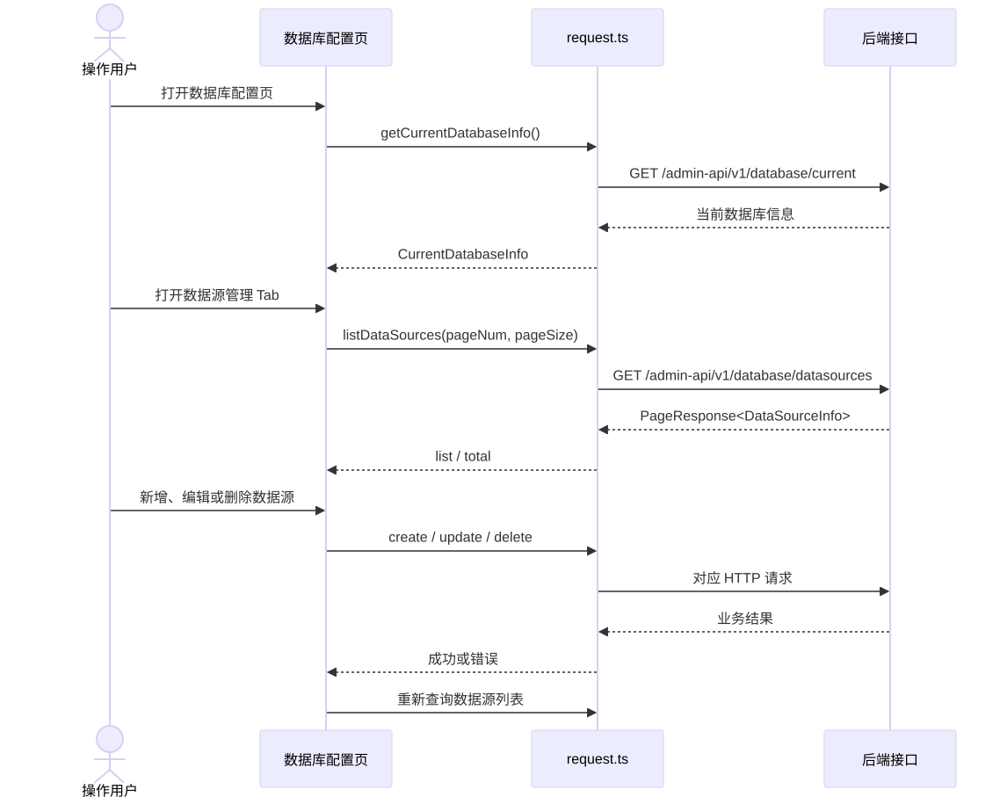

# 数据库配置采集与数据源管理前端接口联调指南

## 1. 文档边界

> 范围说明：本文（历史文件名 `frontend-backend-integration.md`）仅覆盖**数据库配置采集与数据源管理**一个功能域的前后端联调；全局的接口前缀、代理配置与部署口径见 [部署指南](deployment.md) 与 [API 接口目录](../api/README.md)。

本文档只描述当前前端仓库已实现并可核对的调用链、请求参数、响应类型、页面行为和代理边界。事实来源包括：

- [数据库 API](../../src/api/database.ts)
- [全局类型](../../src/types/index.ts)
- [数据库配置页](../../src/views/system/database/index.vue)
- [统一请求封装](../../src/utils/request.ts)

后端 Handler、Service、DTO 类名、权限注解、数据库驱动实现、实际部署连通性和生产环境权限结果不属于本仓库可单独证明的事实，需要在目标后端环境另行核验。

请求通过统一请求层发送。若后端返回数字 `code`，请求层在成功时解包 `data`，页面和 API 函数收到的是业务数据，不是完整的 `Result` 对象；不含数字 `code` 的响应按请求层约定保留原始数据。

## 2. 页面与业务范围

数据库配置页包含两个 Tab：

| Tab | 功能 | 页面状态 |
| --- | --- | --- |
| 配置采集 | 测试连接、生成 YAML/env/Docker Compose 配置、查询当前数据库信息 | 页面挂载时查询当前数据库信息；提交操作分别管理 loading |
| 数据源管理 | 数据源分页列表、新增、编辑、删除、查看连接池指标 | 页面挂载时加载列表；使用服务端分页和 `list/total` |

配置采集表单字段为：

- `dbType`: `mysql` 或 `postgresql`
- `host`
- `port`
- `database`
- `username`
- `password`
- `connectionParams`（可选）
- `environment`: `dev`、`test` 或 `prod`

配置采集页面提示密码仅用于一次性测试和配置导出。数据源管理的密码在新增和编辑时都要求重新输入，后端不回显旧密码。

## 3. 接口清单

| 前端函数 | 方法 | 路径 | 返回类型 |
| --- | --- | --- | --- |
| `testDatabaseConnection` | POST | `/admin-api/v1/database/test` | `DatabaseTestResult` |
| `generateDeploymentConfig` | POST | `/admin-api/v1/database/generate-config` | `DeploymentConfigResult` |
| `getCurrentDatabaseInfo` | GET | `/admin-api/v1/database/current` | `CurrentDatabaseInfo` |
| `listDataSources` | GET | `/admin-api/v1/database/datasources` | `PageResponse<DataSourceInfo>` |
| `createDataSource` | POST | `/admin-api/v1/database/datasources` | `DataSourceInfo` |
| `updateDataSource` | PUT | `/admin-api/v1/database/datasources/{id}` | `DataSourceInfo` |
| `deleteDataSource` | DELETE | `/admin-api/v1/database/datasources/{id}` | `void` |
| `getDataSourceMetrics` | GET | `/admin-api/v1/database/datasources/{id}/metrics` | `DataSourceMetrics` |

除分页查询外，路径参数 `id` 均为数字类型。具体请求由 `src/api/database.ts` 使用 `get`、`post`、`put` 和 `del` 封装。

## 4. 配置采集接口

### 4.1 测试数据库连接

```ts
POST /admin-api/v1/database/test
```

请求体为 `DatabaseConfig & { password: string }`：

```json
{
  "dbType": "mysql",
  "host": "<database-host>",
  "port": 3306,
  "database": "<database-name>",
  "username": "<database-user>",
  "password": "<database-password>",
  "connectionParams": "useSSL=false",
  "environment": "dev"
}
```

返回 `DatabaseTestResult`：

```json
{
  "success": true,
  "message": "<connection-result>",
  "version": "<database-version>"
}
```

`version` 为可选字段。页面先执行表单校验，再调用接口；`success=true` 时显示成功消息和可用版本，`success=false` 时显示 `message`。请求异常交给现有错误处理逻辑，表单校验失败不会发起请求。

### 4.2 生成部署配置

```ts
POST /admin-api/v1/database/generate-config
```

请求体与连接测试相同，密码只随本次请求发送：

```json
{
  "dbType": "postgresql",
  "host": "<database-host>",
  "port": 5432,
  "database": "<database-name>",
  "username": "<database-user>",
  "password": "<database-password>",
  "connectionParams": "",
  "environment": "test"
}
```

返回 `DeploymentConfigResult`：

```json
{
  "yaml": "<yaml-content>",
  "env": "<environment-content>",
  "dockerCompose": "<optional-compose-content>"
}
```

页面将三个字段写入配置展示弹窗，并在 YAML、环境变量和 Docker Compose Tab 之间切换。`dockerCompose` 是可选字段，页面缺省按空字符串展示。文档示例不填入真实密码；生成内容的脱敏和密钥管理由后端契约及部署环境另行确认。

### 4.3 获取当前数据库信息

```ts
GET /admin-api/v1/database/current
```

返回 `CurrentDatabaseInfo`：

```json
{
  "type": "<database-type>",
  "version": "<database-version>",
  "driverVersion": "<optional-driver-version>"
}
```

页面挂载时调用该接口，在描述列表中展示 `type`、`version` 和可选的 `driverVersion`。当前页面请求失败时只写入控制台，不弹出统一错误提示。

## 5. 数据源管理接口

### 5.1 分页查询数据源

```ts
GET /admin-api/v1/database/datasources?pageNum=<page>&pageSize=<size>
```

分页参数使用 `pageNum/pageSize`，不是普通列表常见的 `page/size`。返回 `PageResponse<DataSourceInfo>`：

```json
{
  "list": [
    {
      "id": 1,
      "name": "<data-source-name>",
      "type": "<database-type>",
      "driver": "<driver-class>",
      "url": "<masked-jdbc-url>",
      "username": "<masked-username>",
      "poolSize": 10,
      "activeConnections": 2,
      "status": "UP",
      "createdAt": "<timestamp>",
      "updatedAt": "<timestamp>"
    }
  ],
  "total": 1,
  "pageNum": 1,
  "pageSize": 20,
  "pages": 1,
  "hasNext": false
}
```

`hasNext` 可选。页面读取 `list` 和 `total`，分页变化后重新请求。数据源列表不应被文档描述为返回明文密码。

### 5.2 新增数据源

```ts
POST /admin-api/v1/database/datasources
```

请求体为 `DataSourcePayload`：

```json
{
  "name": "<data-source-name>",
  "type": "<database-type>",
  "driver": "<driver-class>",
  "url": "<jdbc-url>",
  "username": "<database-user>",
  "password": "<database-password>",
  "minIdle": 2,
  "maxPoolSize": 10,
  "connectionTimeout": 30000,
  "idleTimeout": 600000
}
```

返回新建后的 `DataSourceInfo`。页面在对话框提交前校验表单，成功后关闭对话框并刷新列表；密码字段不会从列表记录回填。

### 5.3 更新数据源

```ts
PUT /admin-api/v1/database/datasources/{id}
```

请求体仍为 `DataSourcePayload`，返回更新后的 `DataSourceInfo`。当前页面编辑数据源时要求重新填写密码，不能使用“密码留空即保持原值”的前端语义；后端是否支持其他更新策略需以实际接口契约为准。

### 5.4 删除数据源

```ts
DELETE /admin-api/v1/database/datasources/{id}
```

成功时返回 `void`。页面先显示确认框，用户取消确认不应被当成接口失败；确认后执行删除，成功时刷新当前列表。

### 5.5 查询连接池指标

```ts
GET /admin-api/v1/database/datasources/{id}/metrics
```

返回 `DataSourceMetrics`，字段均为可选：

| 字段 | 含义 | 单位 |
| --- | --- | --- |
| `totalConnections` | 连接总数 | 个 |
| `activeConnections` | 活跃连接数 | 个 |
| `idleConnections` | 空闲连接数 | 个 |
| `waitingThreads` | 等待线程数 | 个 |
| `averageGetTime` | 平均获取连接时间 | 毫秒 |
| `averageUsageTime` | 平均连接使用时间 | 毫秒 |
| `maxWaitTime` | 最大等待时间 | 毫秒 |
| `totalConnectionsCreated` | 创建连接总数 | 个 |
| `totalConnectionsFailed` | 创建连接失败总数 | 个 |

页面从数据源行操作中打开指标展示。指标单位依据当前前端类型和页面文案约定，不据此推断后端监控实现细节。

## 6. 类型对照

### 6.1 数据库配置和采集结果

```ts
interface DatabaseConfig {
  dbType: 'mysql' | 'postgresql'
  host: string
  port: number
  database: string
  username: string
  connectionParams?: string
  environment: 'dev' | 'test' | 'prod'
}

interface DatabaseTestResult {
  success: boolean
  message: string
  version?: string
}

interface DeploymentConfigResult {
  yaml: string
  env: string
  dockerCompose?: string
}

interface CurrentDatabaseInfo {
  type: string
  version: string
  driverVersion?: string
}
```

### 6.2 数据源和指标

```ts
interface DataSourceInfo {
  id: number
  name: string
  type: string
  driver: string
  url: string
  username: string
  poolSize?: number
  activeConnections?: number
  status?: string
  createdAt?: string
  updatedAt?: string
}

interface DataSourcePayload {
  name: string
  type: string
  driver: string
  url: string
  username: string
  password: string
  minIdle?: number
  maxPoolSize?: number
  connectionTimeout?: number
  idleTimeout?: number
}
```

通用分页类型为 `PageResponse<T>`，核心字段为 `list`、`total`、`pageNum`、`pageSize` 和 `pages`，`hasNext` 可选。

## 7. 页面处理流程

### 7.1 配置采集流程



> 图源：[guides-frontend-backend-integration-01.mmd](../diagrams/guides-frontend-backend-integration-01.mmd)（Mermaid 源码；导出件同名 `.svg`，由 `mmdc` 生成）

### 7.2 数据源管理流程



> 图源：[guides-frontend-backend-integration-02.mmd](../diagrams/guides-frontend-backend-integration-02.mmd)（Mermaid 源码；导出件同名 `.svg`，由 `mmdc` 生成）

### 7.3 页面与接口时序



> 图源：[guides-frontend-backend-integration-03.mmd](../diagrams/guides-frontend-backend-integration-03.mmd)（Mermaid 源码；导出件同名 `.svg`，由 `mmdc` 生成）

## 8. 错误处理与安全边界

- 表单校验失败时页面不调用接口。
- 统一请求层负责认证头、响应解包、HTTP 错误转换和现有 Token 刷新规则；上传组件的独立 XHR 规则不适用于本页面。
- 连接测试的业务失败由 `success/message` 表达；配置生成异常使用现有 `showError`；当前数据库信息查询失败目前只记录控制台日志。
- 真实数据库密码不得写入文档、日志、源码或构建期公开变量。示例统一使用占位符。
- 前端页面中的按钮展示不能替代后端接口鉴权。具体权限码、响应包装、参数校验和错误状态码需要结合目标后端接口文档或实际环境验证。
- 生产环境是否使用 HTTPS、后端是否脱敏返回连接地址和用户名、密码是否落库，均不能仅由当前前端仓库推出。

## 9. 联调检查清单

1. 代理或部署网关能够转发 `/admin-api` 路径。
2. 八个接口的 HTTP 方法、路径和字段与本文及 `src/api/database.ts` 一致。
3. 配置采集接口接收密码，数据源列表和详情响应不回显明文密码。
4. 数据源分页请求使用 `pageNum/pageSize`，响应可被页面读取为 `list/total`。
5. 配置生成结果至少提供 `yaml` 和 `env`，`dockerCompose` 缺省时页面仍可展示。
6. 连接池时间指标按毫秒解释，其他单位以实际后端契约为准。
7. 目标环境中的认证、权限、数据库可达性、错误响应、代理连通性和实际部署结果已单独验证。

本文档确认的是前端调用链和类型定义已在本仓库核对，不等同于后端接口已经在某个环境部署成功或完成端到端验收。
